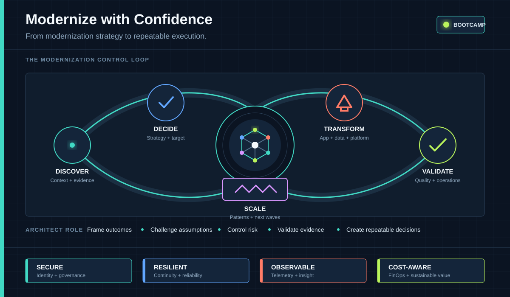

#  Modernize with Confidence Bootcamp

This lab is the hands-on learning environment for **Modernize with Confidence**, a bootcamp for CSAs who want to understand agentic modernization and guide customers through early modernization conversations.

The bootcamp goes beyond moving existing servers to the cloud. Attendees learn how AI-assisted tools, architectural judgment, and Azure services can work together to assess an application estate, identify practical modernization opportunities, and shape a phased path from legacy infrastructure toward secure, resilient, and manageable cloud platforms.

The repository deliberately contains legacy .NET Framework applications and a SQL Server data tier. This legacy architecture is the starting point for a realistic modernization opportunity.

##  The Application

The app we will be working with is **Caldova Retail**, an ASP.NET MVC 5 storefront on .NET Framework 4.8, backed by Entity Framework 6 and a SQL Server database. Its dated project structure, dependencies, authentication, and hosting assumptions are what the labs assess and modernize.

##  Who This Is For

The bootcamp is designed primarily for infrastructure and cloud architects who participate in application and data modernization discussions. It is especially relevant to architects who need to connect infrastructure concerns with application architecture, security, operations, data platforms, and software delivery practices.

Deep application development experience is not the goal. Attendees will instead build enough understanding of the complete modernization lifecycle to ask better discovery questions, recognize constraints and opportunities, involve the right specialists, and help customers move from an initial conversation to an actionable modernization direction.

##  What Attendees Will Learn

By working through the bootcamp, attendees will learn how to:

- Use an agentic modernization approach to accelerate discovery, assessment, planning, and implementation while keeping architectural decisions and validation under human control.
- Assess legacy applications, virtual machines, databases, dependencies, and operational constraints before recommending a migration strategy.
- Frame customer conversations around business outcomes, technical risk, readiness, and the tradeoffs between rehost, replatform, refactor, rearchitect, rebuild, and retire.
- Use GitHub Copilot and modernization tooling to examine existing code, surface technical debt, identify upgrade paths, and assist with targeted changes.
- Evaluate Azure compute and application hosting options, including Azure Virtual Machines, Azure App Service, Azure Container Apps, and Azure Kubernetes Service.
- Plan the evolution of SQL Server workloads toward managed Azure data services such as Azure SQL Managed Instance and Azure SQL Database.
- Apply identity, secrets management, governance, and security capabilities using Microsoft Entra ID, Azure Key Vault, Azure Policy, and Microsoft Defender for Cloud.
- Introduce DevSecOps practices with GitHub, GitHub Actions, GitHub Copilot, and Azure DevOps.
- Include resiliency, business continuity, cost management, and FinOps considerations in a modernization roadmap.
- Turn lessons from a pilot workload into repeatable patterns that can be applied across a larger application portfolio.

##  Learning Approach

The labs follow the progression of a real modernization engagement:

1. Understand the current environment and establish a reliable baseline.
2. Assess application, data, infrastructure, security, and operational readiness.
3. Select an appropriate modernization strategy for each workload component.
4. Use agentic tools to support analysis and implementation without replacing engineering review.
5. Validate functionality, security, observability, resiliency, and operational readiness.
6. Capture decisions and reusable patterns for the next modernization wave.

The emphasis is not on finding a single "correct" Azure service. It is on developing a defensible decision process that balances business continuity, modernization value, delivery risk, and the customer's capacity for change.

## ✅ Prerequisites

Set these up once before you start. Each lab's **Setup** section still covers the steps you do during that lab, such as forking and cloning a repository.

Use a **Windows 10 or 11** computer. The commands below use [winget](https://learn.microsoft.com/windows/package-manager/winget/), which is included with current versions of Windows. Run them in PowerShell, then close and reopen PowerShell so new tools are on your `PATH`.

| Requirement | Needed for | How to install |
| --- | --- | --- |
| **GitHub account** | All labs | [Sign up at github.com](https://github.com/signup). |
| **GitHub Copilot license** | All labs | [Choose a Copilot plan](https://github.com/features/copilot) on the account above. |
| **Visual Studio Code** | All labs | `winget install Microsoft.VisualStudioCode` |
| **GitHub Copilot modernization** extension | All labs | `code --install-extension vscjava.migrate-java-to-azure`, or open the **Extensions** tab in VS Code and search for it. |
| **GitHub Copilot upgrade** extension | Lab 02 | `code --install-extension ms-dotnettools.upgrade-agent`, or open the **Extensions** tab in VS Code and search for it. |
| **Git CLI** | All labs | `winget install Git.Git` |
| **PowerShell** | All labs | Included with Windows. For the latest version, run `winget install Microsoft.PowerShell`. |
| **.NET 10 SDK** | Labs 02 and later | `winget install Microsoft.DotNet.SDK.10` |
| **.NET Framework 4.8** | Lab 02 (legacy app) | The runtime is included with Windows 10 (version 1903 or later) and Windows 11. The targeting pack is added by the Build Tools command in the next row. |
| **MSBuild** (Visual Studio Build Tools) | Lab 02 (legacy app) | `winget install Microsoft.VisualStudio.2022.BuildTools --override "--wait --passive --add Microsoft.VisualStudio.Workload.WebBuildTools --add Microsoft.Net.Component.4.8.TargetingPack"` |
| **NuGet CLI** (`nuget.exe`) | Lab 02 (legacy app) | `winget install Microsoft.NuGet` |
| **IIS Express** | Lab 02 (legacy app) | Download and run the 64-bit installer from [IIS 10.0 Express](https://www.microsoft.com/download/details.aspx?id=48264). |
| **GitHub CLI** (`gh`) | Lab 07 | `winget install GitHub.cli`, then run `gh auth login`. |
| **Modernization CLI** (`modernize`) | Lab 07 | `winget install GitHub.Copilot.modernization.agent`, then run `modernize --help` in a new terminal to confirm. |