# 🚀 Lab 02: Upgrade with GitHub Copilot Modernization

The Caldova Retail storefront is built on **.NET Framework 4.8**, an older version of Microsoft's .NET platform. It only runs on Windows and no longer gets new features, which limits where the app can run in Azure. Before anything else can be modernized, the app has to move to **.NET 10**, the current version, which also runs on Linux and in containers.

In this module you'll use **GitHub Copilot Modernization** to make that move. Rather than finding and fixing every piece of code that no longer works by hand, you'll guide an AI agent that reviews the code, writes a plan you can check and edit, and then carries it out one task at a time.

> ⚠️ **IMPORTANT: EXPECT AN AGENTIC WORKFLOW**
>
> The rest of today's labs use AI agents. The modernization tools provide a structured process where they can, but agents may still take a different path or show options that don't match the screenshots or instructions exactly. Use your best judgment: review what an agent is asking to do, and choose the option that makes sense. The choices you make here won't prevent you from continuing to the next section.
>
> Learning to navigate this variation is part of the workshop—and part of real-world modernization work. If you're unsure what an agent is doing, what an approval means, or whether it seems stuck, ask it to explain or ask your instructor for help.

> 🧭 New to GitHub Copilot Chat? [Copilot Essentials](https://github.com/Azure-Samples/modernize-bootcamp/blob/main/docs/copilot-essentials.md) is a short reference on modes, models, context, cost, and course-correcting.

> 🖥️ **Where you work.** You do this whole lab on the **W11-Workstation** virtual machine in your Skillable lab environment. Its sign-in credentials are on the **Resources** tab of your lab instructions. Everything you need, including VS Code, the GitHub Copilot extensions, and the build tools, is already installed on the VM. At no point do you need to leave the VM or use your own computer.

## 💼 Business case

Caldova Retail runs on .NET Framework 4.8, the last version of a platform that is no longer being developed. It still gets security fixes, but no new features and no performance work. The app has to move onto current .NET before anything else can be modernized, which is why this comes first.

## 📋 What You'll Do

- 👀 See the storefront as it runs on-premises today, then get your own copy running on the VM
- 🔎 Assess a legacy codebase with the GitHub Copilot upgrade agent
- 📋 Review and shape the generated upgrade plan
- 🔄 Start the agentic .NET 10 upgrade, observe its behavior, and learn how to steer it
- 🏁 Understand the end state of a modernized .NET 10 app before moving to Module 3

> 💡 **SCOPE**
>
> This module updates the **underlying framework only**. A framework upgrade does not change how the app looks or what it does: the upgrade agent updates the framework, packages, and supporting code under the hood so the app runs on a modern, supported version of .NET that is compatible with Azure. The database remains on SQL Server, and the app stays visually and functionally identical for the end user. The data tier and the user interface are modernized in later modules.
>
> Keeping the scope tight is what makes the upgrade verifiable: if the app behaves the same afterwards, the framework change is sound.

## 👀 See the app as it runs today

Caldova Retail is already running on-premises, on a Windows Server behind IIS. Check it out:

1. Open **Edge** from the taskbar:

   

2. In the browser type this link: +++https://app01+++. It may take a few seconds to load.

Walk around the storefront for a minute and notice how it behaves:

- The product catalog loads, with images
- Sign-in works for both accounts — use the demo logins below
- Adding an item to the cart works

| Username | Password | Role | Notes |
| --- | --- | --- | --- |
| `alice` | `Password1!` | Admin, Manager | Has existing order history |
| `bob` | `Password1!` | Employee | Has existing order history |

## 🛠️ Setup: Load the Legacy App Repository

> **How the pieces fit.** The app you just looked at, **https://app01**, is the running app on the app server, which is a VM. Its source code lives in a GitHub repository. In this setup you make your own copy of that repository (a **fork**), then download it to this workstation (a **clone**). That puts the code on your machine, so you can assess and upgrade it here.
>
> The upgrade agent saves its changes in Git as it works. Working in your own fork means your changes don't affect the workshop repository or anyone else.

**1. Sign in to the workshop repository.** Open a new tab in Microsoft Edge and type this link in your browser +++https://github.com/Skillable-Events/caldova-retail+++

1. On the Skillable Events single sign-on page, select **Continue**.

   

   > ⚠️ **Sign-in may take a few tries.** If it keeps reloading or shows an error, wait a few minutes, then try again.

2. In the **Sign in** box, enter the **Username** listed under **Azure portal** on the **Resources** tab of your lab instructions, then select **Next**.
3. Enter the **Password** from the same **Azure portal** section. If you are asked for a **Temporary Access Pass**, enter the **TAP** value instead. If it prompts you to stay signed in, hit **Yes**.

**2. Fork and clone the repository.**

1. On the repository page, select **Fork**, then **Create fork** with the defaults left alone.

   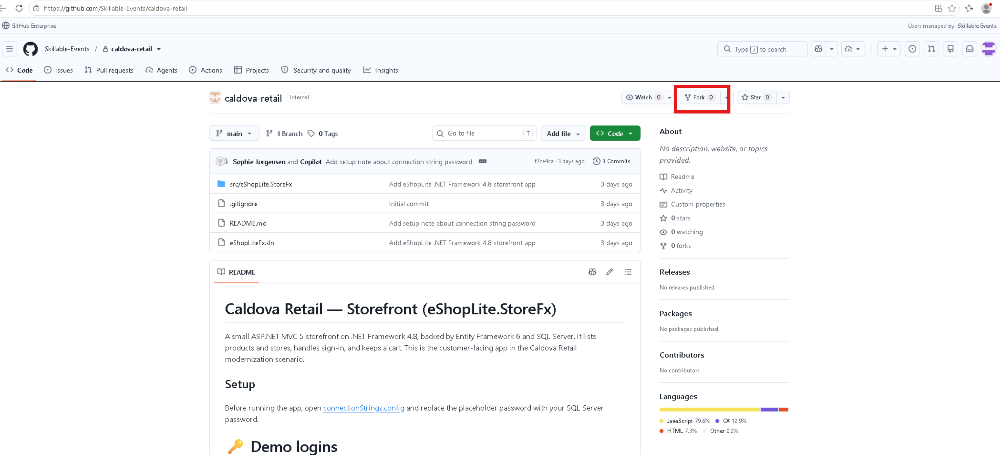

   

2. In your new fork, select **Code**, then copy the **HTTPS** URL. It should look something like **https://github.com/User1-12345678_events/caldova-retail.git**.

   

   

3. Open PowerShell from your applications and clone your fork (run this from the default location, **C:\Users\Admin**). In the command below, replace **your-fork-url** with the HTTPS URL you copied in the previous step (delete the angle brackets too). The finished command looks like this: git clone https://github.com/your-account/caldova-retail.git

   ```powershell
   git clone <your-fork-url>
   ```

   If you are asked to sign in, choose **Sign in with your browser**, approve the authorization (select **Authorize git-ecosystem**), then return to PowerShell. The clone starts once you are signed in.
   > 💡 If you face any errors here, the sign in may not have persisted. If that is the case, re-type the original repo link, +++https://github.com/Skillable-Events/caldova-retail+++, into the browser, follow the sign in, click the button to stay signed in, and then run the PowerShell command again.

**3. Set the build tools path (one time).** Copilot can usually work this out on its own, but we include this step to prevent an error, or Copilot getting stuck, when the upgrade starts. It points the build at the files the legacy web project needs. In the same PowerShell window, run:

```powershell
$vs = & "${env:ProgramFiles(x86)}\Microsoft Visual Studio\Installer\vswhere.exe" -latest -products * -requires Microsoft.Component.MSBuild -property installationPath; [Environment]::SetEnvironmentVariable("VSToolsPath", "$vs\MSBuild\Microsoft\VisualStudio\v17.0", "User"); $env:VSToolsPath = "$vs\MSBuild\Microsoft\VisualStudio\v17.0"
```

This command prints nothing, which is expected. The setting is saved for your user, so you only need to do this once on your VM.

> 💡 If VS Code is already open, close every VS Code window before the next step, so it picks up the new setting when it starts.

**4. Open the storefront folder in VS Code.** Run this command in PowerShell to open the application in VSCode:

```powershell
cd caldova-retail
code .
```

If **code** is not recognized, start VS Code from your applications and use **File → Open Folder…**, then pick the **caldova-retail** folder.

> 💡 If VS Code prompts you to sign in, select **Continue with GitHub**. An authorization page opens in the browser; select **Continue**, then **Authorize Visual-Studio-Code**. Return to VS Code once you are signed in.

Check for any notification near the top banner like shown below. If VS Code opens the folder in **Restricted Mode**, select **Manage** in the banner at the top of the window, then select **Trust**. Once the page shows **In a Trusted Folder**, close that tab.


You are in the right place when the Explorer shows **eShopLiteFx.sln** next to a **src** folder.

**5. Give the app its database password.** The app reads its connection string from **src\eShopLite.StoreFx\connectionStrings.config**. Open that file (navigate under the src folder) and replace the placeholder password with the **W11-Workstation** password from the **Resources** tab of your lab instructions (+++Pa$$w0rd+++). Leave the server, database, and user exactly as they are.

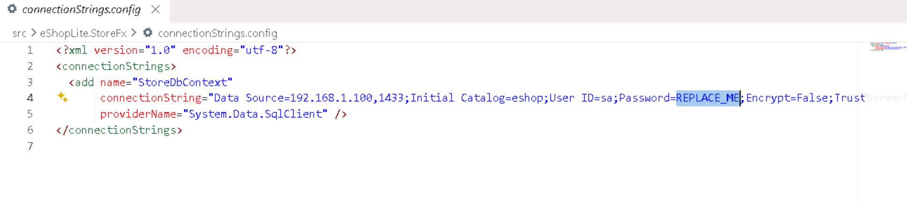

**6. Open Copilot Chat, pick a model, and set your Git commit identity.** The upgrade agent saves its changes as Git commits, so it needs to know who you are before it starts. Open Copilot Chat by selecting the chat icon in the top menu bar, to the right of the search bar:


Click the Copilot icon in the bottom status bar. If it says **Sign In** or **Use AI Features**, you are not signed in to Copilot yet. Select it:

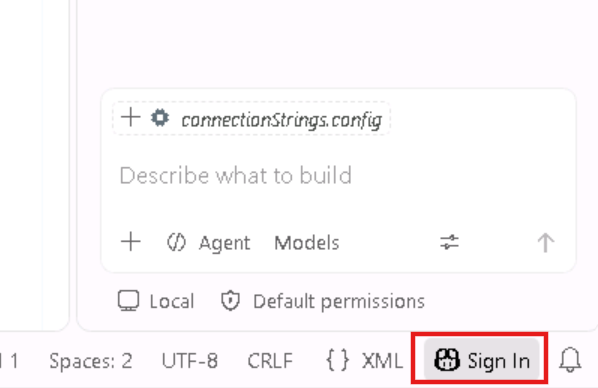

In the sign-in window, select **Continue with GitHub**. When the authorization page opens in your browser, select **Continue**, then **Authorize Visual-Studio-Code**. Return to VS Code when authorization is complete.

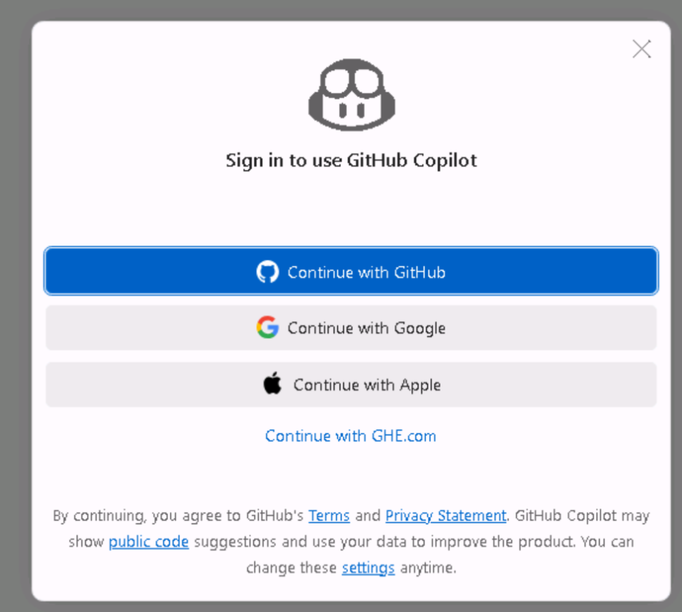

Next, open the model picker, the dropdown under the chat box that shows the current model (for example, **Auto**):

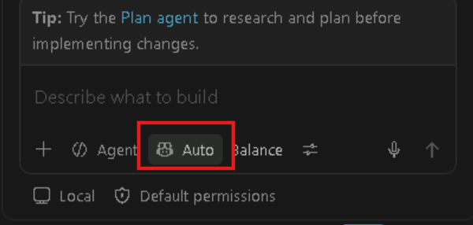

Scroll down to **Other Models** and select **Claude Opus 5.5**. We use it to keep results more consistent, and because we prefer the most powerful model for code analysis. The default works too, so if it isn't available, keep the default.

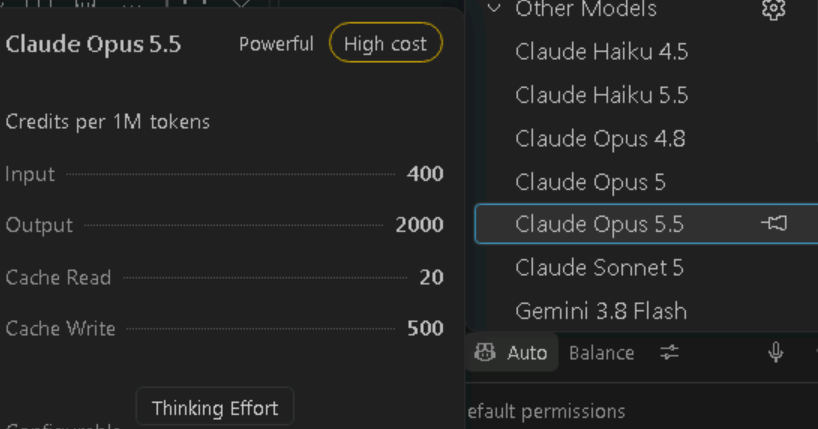

Then send this message in the chat, replacing the placeholders with your lab details:

```plaintext
For the rest of this upgrade, use <your name> and <your lab email> as the Git commit identity.
```

Use the **Username** listed under **Azure portal** on the **Resources** tab as your email. For your name, use the part before **@** in that email (for example, **user1-6614389**) or your own name. Whichever is fine. This lets the agent make commits later without stopping to ask for your identity.

## ▶️ Run the App

To make sure the setup was completed correctly, ask Copilot Chat to build and launch the legacy app for you.

> 💡 Running this .NET Framework app outside a server requires **MSBuild** (the tool that builds the app) and **IIS Express** (a small web server for testing), because legacy ASP.NET apps like this one can't be started with the usual **dotnet run**. Both tools are already installed on the VM, so there is nothing to set up. Keep it in mind for future customer scenarios where you need to run a legacy app yourself.

In Copilot Chat, which you opened and signed in to in the Setup section, submit this prompt:

```text
This is a .NET Framework 4.8 ASP.NET MVC app using packages.config.
Restore its packages with nuget.exe, build the solution with MSBuild, and launch it locally with IIS Express.
Tell me the URL when it is running.
```

Watch Copilot Chat while it works. VS Code may ask you to approve a tool call before Copilot can run a command. Approve any tool calls, like downloading NuGet packages (libraries the app depends on) needed to build and run the solution.

A plain "run this app" prompt would also work. Copilot would inspect the project and work out the build and launch steps itself. Spelling them out up front just gets you there faster and avoids potential trial and error.

Once it loads, walk the app and confirm your copy matches the on-premises one you looked at earlier:

- [ ] The product catalog loads, with images
- [ ] Sign-in works for both accounts — use these demo logins:

  | Username | Password | Role | Notes |
  | --- | --- | --- | --- |
  | `alice` | `Password1!` | Admin, Manager | Has existing order history |
  | `bob` | `Password1!` | Employee | Has existing order history |

- [ ] Adding an item to the cart works

If the build fails, continue prompting Copilot to investigate the error.

You now have your own copy of the on-premises app running on .NET Framework 4.8, behaving exactly as it does on the server. That is the baseline everything that follows is measured against. Time to modernize it.

## 🤖 How GitHub Copilot Modernization Works

GitHub Copilot Modernization works through a three-stage workflow: **Assessment → Planning → Execution**.

- **Assessment:** Copilot analyzes your project structure, dependencies, and code patterns to identify upgrade requirements and potential breaking changes
- **Planning:** The tool generates a detailed upgrade plan document based on assessment findings
- **Execution:** You review the plan, add custom requirements, and Copilot performs the automated upgrade

This lab uses two VS Code extensions that work together. **GitHub Copilot modernization** runs the application assessment and is where you start the upgrade. **GitHub Copilot upgrade** provides the **Upgrade** agent in Copilot Chat that carries out the assessment, planning, and execution for the .NET upgrade. Both are already installed on the VM. They are expected to merge into a single tool over time.

We're going to upgrade our application to achieve one goal: **move the storefront from .NET Framework 4.8 to .NET 10**, with its existing behavior intact.

## Run the GHCP Modernization Application Assessment

Module 1 assessed the **infrastructure** with Azure Migrate — servers, sizing, and dependencies. The modernization extension assesses the **application code**, which is the other half of the picture. Azure Migrate can tell you a server is ready to move; the application assessment tells you whether the code should move as-is or be upgraded first.

You can run one at any time, without committing to an upgrade.

**1. Open the modernization extension.** Click the **GitHub Copilot app modernization** icon in the Activity Bar down the left-hand side of VS Code.


> 💡 **Don't see the icon?** This lab uses two extensions, and both should already be installed on the VM. If either is missing, select the **Extensions** icon in the left sidebar:
>
> 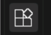
>
> Then search for each of these and select **Install**:
>
> - **GitHub Copilot modernization**
> - **GitHub Copilot upgrade**

**2. Click Start Assessment.**

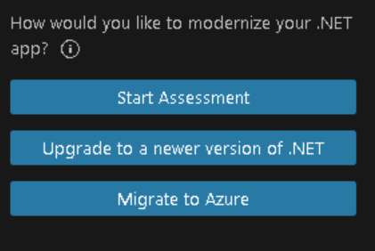

**3. Choose Recommended Assessment.** You are offered a Recommended or a Custom assessment. For this lab, we will proceed with Recommended. Custom covers more: it does a deeper review of the whole codebase, including how it is structured and how its data is organized, and takes much longer.

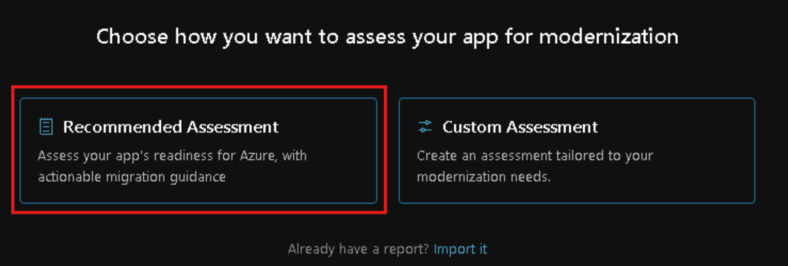

**4. Leave the default target as Cloud Readiness.** Select **OK** with the Cloud Readiness box checked. This measures how ready the app is for Azure. It may take ~30 seconds to appear as running. Expect it to run for a couple of minutes.

You'll also see a **Security** option, which identifies security issues using ISO 5055 and recommends fixes. You can run a security review with either the Recommended or the Custom assessment. We'll leave it unchecked in this lab, but it's worth knowing about when a customer asks about security.

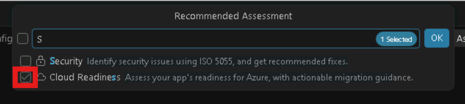

**5. Read the results.** Cloud readiness issues are grouped into **Mandatory**, **Potential**, and **Optional**. The summary estimates the effort to reach the highlighted target Azure service (Azure App Service, Azure Container Apps, or Azure Kubernetes Service) by grouping it into T-shirt sizes, and correctly identifies the app as running on .NET Framework 4.8. Try changing the Target Service dropdown from Azure App Service to Azure Container Apps. Note how issues may disappear/appear/change criticality since this is a different hosting service.

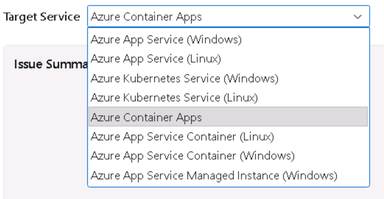

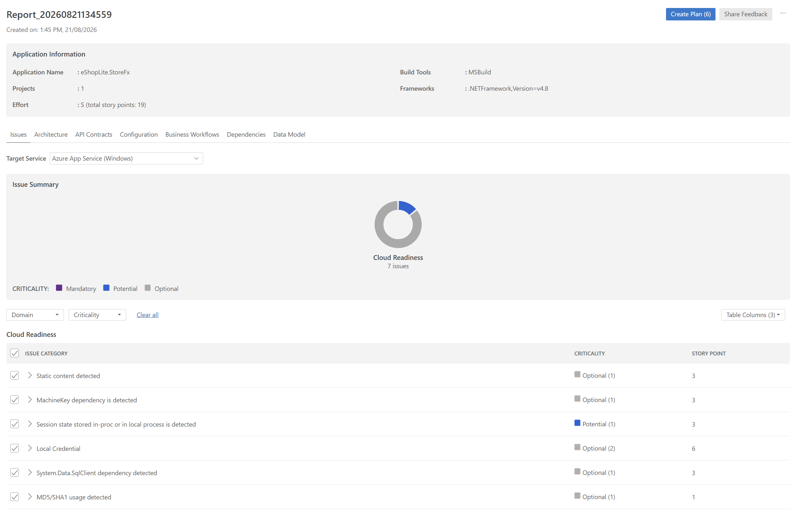

Expand any issue to see what the extension found and the guidance it recommends — the affected code, why it matters for the target service, and what a fix would involve. This is the most useful part of the assessment: the number of **Mandatory**, **Potential**, and **Optional** issues and the effort size show how big the job is, and the details are what you would walk a customer through.

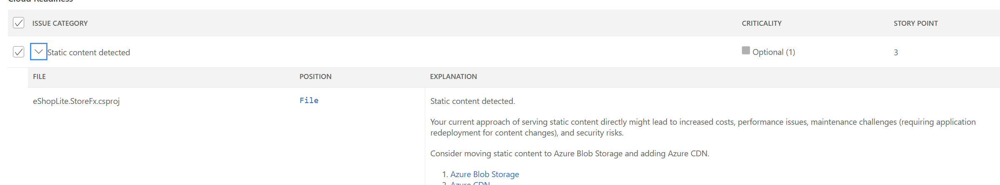

In the top right corner of the assessment there is an option to **Create Plan**, which would generate a plan to remediate the issues it found. We are skipping that here — the framework upgrade comes first, and these findings could change once the app is on .NET 10. For this module the assessment is just a read on the app.

> 💡 **TIP**
>
> You do not have to keep the assessment open to keep it. Reopen the extension from the Activity Bar and choose **Open Assessment Dashboard** — every assessment you have run is listed there, so you can refer back to this one later.

---

## 🚀 Upgrading to .NET 10

The rest of this module is the upgrade itself, in five steps.

> 💡 **Can't see everything on your screen?** If you aren't using a monitor or a larger screen, the Copilot Chat can be hard to see. Press **Ctrl** and **-** (minus) to zoom out and fit more on screen, or select the full screen button on Skillable 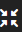.

## 1️⃣ Initiate the Upgrade

1. The GitHub Copilot modernization extension should be open from the assessment run, but if not, re-open the GitHub Copilot modernization extension.

   > 💡 Can't find it? Select **Extensions** in the Activity Bar, search for `modernization`, and select **GitHub Copilot modernization**.
   >
   > 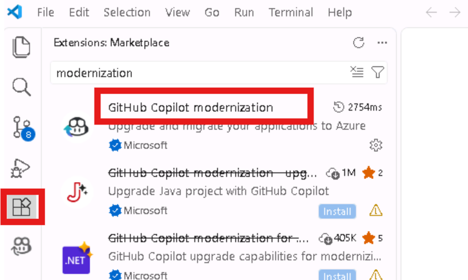

2. Select "Upgrade to a newer version of .NET"

   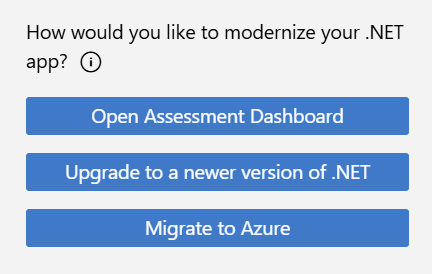

   Behind the scenes, the Upgrade agent scans the repository for keywords to match it to the right upgrade scenario, for example detecting this is a dotnet version upgrade scenario. If it has trouble matching a scenario or gets stuck here, tell it to try again.

3. Copilot Chat should open with the **Upgrade** agent already selected. If it is not, open the **agent picker** at the bottom of the chat box and select **Upgrade**. If **Upgrade** is not listed, check that the **GitHub Copilot upgrade** extension is installed: select **Extensions** in the Activity Bar and search for `GitHub Copilot upgrade` (install it if it is not installed).

   The Upgrade agent is built for this job. A general Copilot agent works from what the AI model already knows. The Upgrade agent instead follows tested, step-by-step upgrade instructions, uses real build tools to find code that will break, and rebuilds the app after each task to check that nothing broke.

   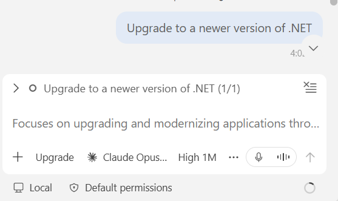

   > 💡 **PICKING A MODEL**
   >
   > **We use Claude Opus 5.5 in this bootcamp** to keep results more consistent, and because we prefer the most powerful model for code analysis. The default works too. Keep in mind different models have different costs, which is worth discussing with the customer when you pick one for their environment.

4. After a minute or two, a pop-up window opens with options for the upgrade. Notice that it has already detected that the app runs on .NET Framework 4.8 and found the solution file (the **.sln** file that ties the app's projects together).

   > 💡 **If something goes wrong, work down this list.** As the scenario starts, you should see a step like this in the chat:
   >
   > 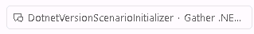
   >
   > 1. **You get an error instead of the pop-up, or you don't see this step or anything about the dotnet-version-upgrade scenario.** The skill may be temporarily unable to bind. Select **Stop**, then send `Try again`.
   > 2. **It is still stuck.** Point it at the scenario files. They live in the extension's folder, and the version number in the folder name can differ, so ask it to find the folder:
   >
   >    ```text
   >    Look in C:\Users\Admin\.vscode\extensions for the folder that starts with ms-dotnettools.upgrade-agent.
   >    Under it, find the dotnet-version-upgrade scenario in upgrade\dotnet\skills\scenarios and use it.
   >    ```
   >
   > 3. **The error mentions Microsoft.WebApplication.targets.** The .NET SDK couldn't find the web build targets. Go back to Setup step **3. Set the build tools path (one time)** and run it. Then close every VS Code window, reopen the folder (run **code .** from the **caldova-retail** folder in PowerShell), and start the upgrade again.
   > 4. **If none of this is working,** GitHub Copilot can still do the upgrade by hand. In the agent picker, switch from the **Upgrade** agent to **Agent** mode, then prompt it in the chat:
   >
   >    ```plaintext
   >    Upgrade this app to .NET 10.
   >    ```

   Select the following options. This is an agentic flow, so variation is normal; **if any options are missing, extra, or appear different, keep the defaults:**

   - **Target Framework:** .NET 10
   - **Flow Mode:** Guided. The agent pauses after the assessment and again after the plan, so you can check its work before it changes any code. This is the best choice while you are learning, and with customers who want to approve each stage. **Automatic** runs from start to finish without stopping; use it once you know the tool and the change is low-risk.
   - **Create working branch:** Check the box. A branch is a separate line of work in Git. The upgraded code goes on the new branch, and your original code stays untouched so you can always go back to it.
   - **Branch name:** upgrade-net10 (or whatever you prefer)
   - **Commit strategy:** Commit after each task. A commit is a saved checkpoint of the code, so you get one checkpoint per finished task.
   - **Branch Sync:** Auto (Merge). This keeps the upgrade workflow in sync with the source branch. We won't have any changes to the source branch in this case, but this is a great option to maintain git history while doing the upgrade.
   - **Pending changes:** Stash. The only change you've made so far is the database password, and we don't want it committed to Git. Stashing sets it aside temporarily so it stays out of the upgrade's commits.

   Select **Confirm** to start the upgrade with these settings.

   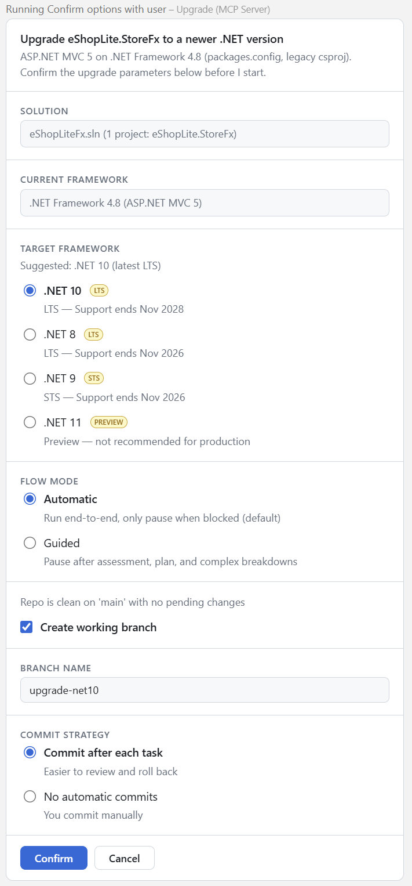

   The window should then show a confirmation. If it does not appear but Copilot Chat is still loading, that's okay—the modal sometimes gets stuck even while the agent continues. Watch the chat for progress.

   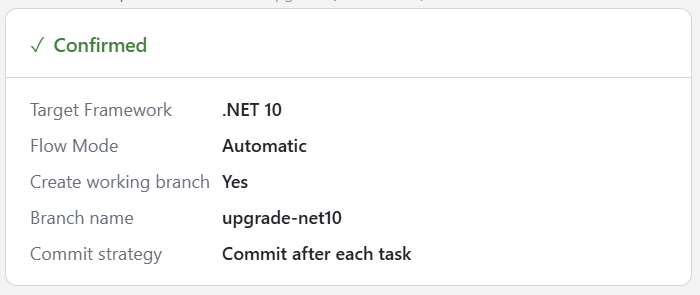

> ‼️ **IMPORTANT**
>
> The agent runs many commands and actions (called tool calls). When VS Code asks you to approve one, read what it is about to do, then approve it. Watching these approvals during the assessment and planning stages is a good way to see how the agent works. With customers, it is best to review each of these calls so they feel comfortable with them.
>
> If VS Code asks **Allow MCP tools from "Upgrade" to make LLM requests?**, select **Allow in this Session**. The Upgrade agent needs this to run its analysis. (MCP, the Model Context Protocol, is how extensions give Copilot extra tools and reference files. The **Upgrade MCP server** comes with the GitHub Copilot upgrade extension and gives the Upgrade agent its upgrade tools and instructions.)
>
> 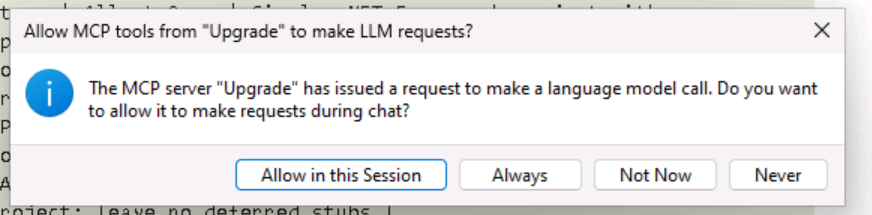

## 2️⃣ Initial Assessment

Once the scenario starts, the agent runs an assessment focused on upgrading to .NET 10 before it plans or changes anything. This is separate from the cloud readiness assessment you ran earlier, which looked at moving the app to Azure. You don't drive this stage — it runs on its own — but what it produces is what you review next.

### Dashboard initialization

You will see the scenario has been initialized and shows links to Dashboard and Activity. Open the dashboard link (it may open automatically).

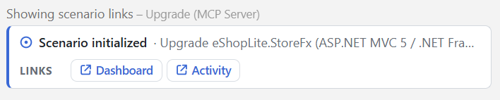

You can see the dashboard is on the "Assess" phase. Observe the other aspects of the dashboard. Throughout this module, it will move between phases until the .NET Framework has been fully updated. It is a great reference to keep track of the upgrade progress.

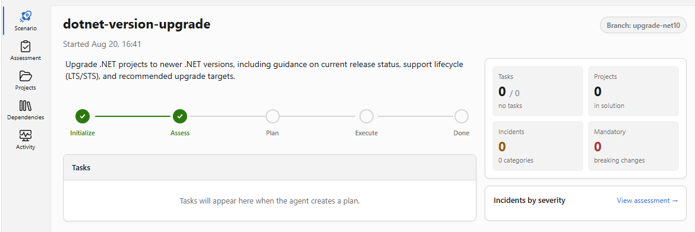

> 💡 **NOTE**
>
> During the upgrade, Copilot may ask permission to read files outside your project folder. This is safe to approve: the agent is reading instruction files from the **Upgrade MCP server** so it can follow a structured process.
>
> 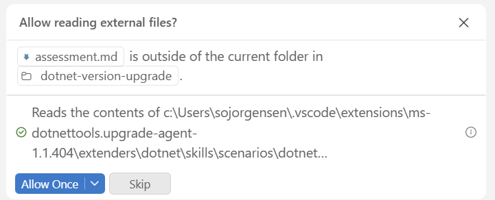

### What the agent examines

- **Project structure** — How the code is organized, which project file format it uses, and which .NET version it targets
- **NuGet packages** — The third-party code libraries the app uses, and whether each one has a version that works on .NET 10
- **API usage patterns** — Deprecated .NET Framework APIs, categorized as binary incompatible, source incompatible, or behavioral change
- **Old web framework** — Parts of the app built on the old ASP.NET web framework (**System.Web**), which does not exist in .NET 10 and has to be rewritten
- **Binding redirects** — Old settings that tell the app which library versions to load; if they are wrong, the app crashes when it runs
- **Effort and risk** — Roughly how many lines of code need to change, how hard each part is, and whether to add tests first that record how the app behaves today

### Where the assessment is written

The agent saves its findings into a workflow folder in your repository rather than leaving them in the chat:

```text
.github/upgrades/scenarios/dotnet-version-upgrade/assessment.md
```

You may also see an "Assessment complete" pop-up with a link to it:

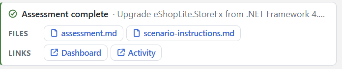

You can also find the files yourself in the **Explorer** view. Expand **.github** → **upgrades\scenarios\dotnet-version-upgrade** to see **assessment.md** alongside the other files the agent created for this upgrade, such as **scenario-instructions.md** (the preferences you just select like target framework, flow mode, etc.). You can open any of these files at any point to see what the agent is working from.

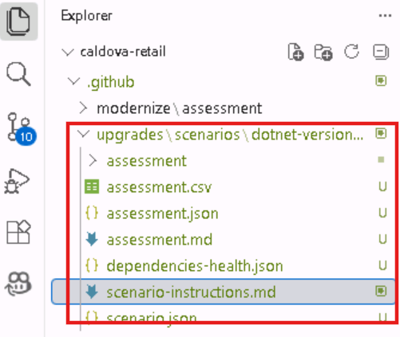

Open **assessment.md** and read it. The report is long, so focus on these four sections. They are the most important ones to look at.

| Section | What to look for | Why it matters |
|---|---|---|
| **Package Compatibility** | Anything marked ⚠️ incompatible | A library with no .NET 10 version has to be replaced or removed. This is the only kind of issue that can block the upgrade completely. |
| **Technologies and Features** | Which technology causes the most issues | This tells you how big the change is. In our run, roughly 99% of issues came from the old web framework (**System.Web**), so the web parts of the app have to be rewritten, not just pointed at a new .NET version. |
| **Binding Redirect Configuration** | The 🔴 Mandatory count | These problems don't show up when the app is built. They show up as errors the first time someone uses the app. |
| **Projects Compatibility** | Difficulty, estimated lines of code (LOC), and the 🧪 test flag | Shows how big the job is, and whether to write tests that record how the app behaves today before changing anything. |

> 💡 **NOTE**
>
> The figures quoted here and below — issue counts, percentages, estimated lines of code — are examples from one run against this storefront. **Your numbers could differ.** The assessment is produced by an agent analyzing your workspace at that moment, so counts can shift with package versions, SDK versions, and the tool's own updates. Read them as an indication of shape and scale, not as values to match.

The layout is the same for every .NET upgrade assessment, but sections only appear when there is something to report. In your own projects, a missing section means nothing was found — not that something went wrong.

## 3️⃣ Review and Shape the Plan

### Confirm Upgrade Options

First, the agent shows a second pop-up with upgrade options. This is separate from the one you answered when you started the upgrade, which set the target framework and the Git settings. This one is about how the code itself is upgraded. Look through the options.

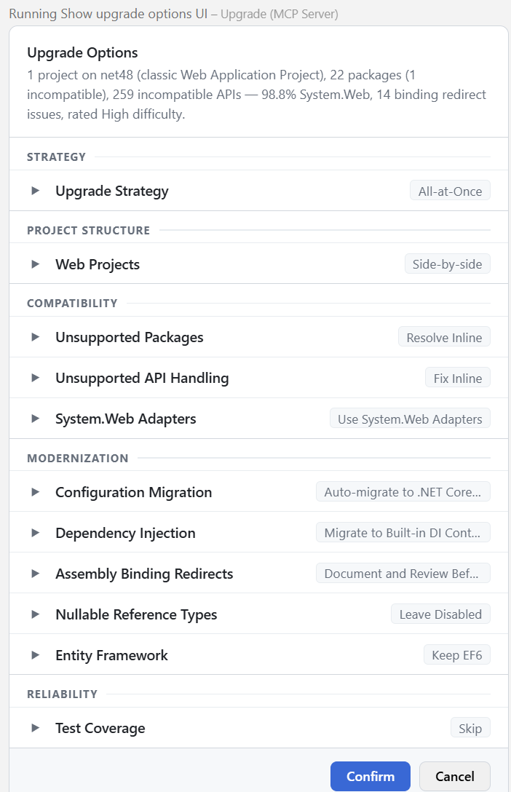

The options can vary between runs in this agentic flow. Hover over an option for more information, or ask Copilot Chat a clarifying question before choosing.

**Upgrade Strategy** controls how the migration is divided:

- **All-at-Once:** Migrate everything together.
- **Incremental:** Migrate smaller parts in stages.

**Project Approach** controls where the migrated code goes:

- **In-place:** Modify the existing project.
- **Side-by-side:** Create a new project alongside the existing one.

Find the setting for the in place versus side-by-side run. It may be labeled **Project Approach** or **Web projects**. Change it to **In-place rewrite** if that option is available. If the options differ or are missing, you can keep the defaults; the agent may present different choices depending on the scenario.

Keep the other defaults. To save time, skip the option to generate automated tests. The agent will still record a baseline of how the app looks and behaves before the upgrade, then use it to guide validation afterward. This baseline helps compare behavior, but it is not a substitute for automated regression tests.

Hit confirm.

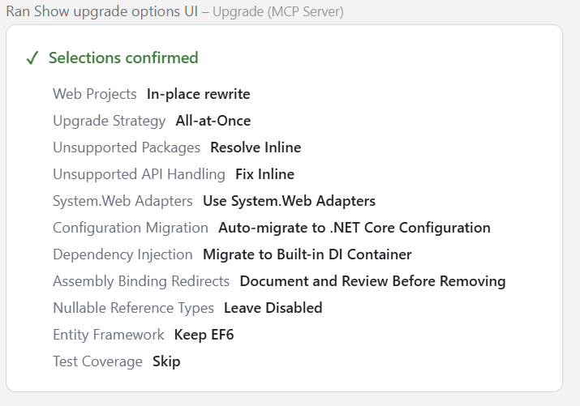

Once you confirm, the agent writes the plan.

> 💡 **NOTE**
>
> While the agent prepares the plan, VS Code may ask to **Allow reading external files?** The request may name a **SKILL.md** file in the installed **.NET Upgrade Agent** extension. These skill files contain instructions that tell the agent how to carry out the upgrade; they are not files from your app. If the prompt identifies the Upgrade Agent extension and a skill file, select **Allow Once** so the agent can read that guidance. Review the file path in the prompt; if it is from an unexpected location, select **Skip** and ask your instructor.

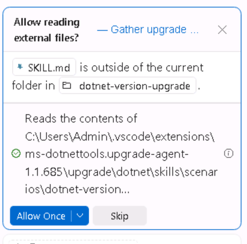

These instruction files live inside the extension itself, in the **.vscode\extensions** folder in your user profile on the VM. There is a file for each stage of the workflow: **assessment.md**, **planning.md**, and **execution.md**. The folder name includes the extension's version number, so yours may differ.

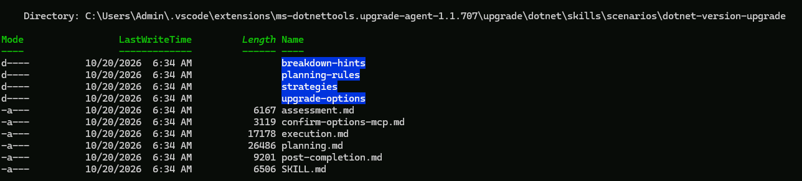

### Review the Generated Plan

When Copilot says the plan is ready, open the **plan.md** file.

It will be saved in the same folder as the assessment:

```text
.github/upgrades/scenarios/dotnet-version-upgrade/plan.md
```

**1. Open plan.md and review it carefully.**

It describes the library updates, the code that may need to change, and the steps the agent proposes. Review it before the upgrade begins. To adjust the approach, edit **plan.md** or tell the agent what you want changed in the chat. You can also ask questions such as, “Why is this task first?” or “Why is this task necessary?” to understand the plan before proceeding.

The agent may list its tasks at the end of **plan.md**, or it may create a separate **tasks.md** in the same folder. Check **plan.md** first; if it doesn't include a task list, open **tasks.md**. Once the plan is approved, a task list will be created to track progress in VS Code.

> 💡 **NOTE**
>
> Because we chose **Guided** flow mode, the agent stops here and waits for you before it changes any code. This is the moment to edit **plan.md** — whatever you leave in it is what gets executed. In **Automatic** mode the agent would carry straight on without asking.

When the plan looks right, approve it by telling the agent to go ahead in the chat (for example, send **Continue**). The agent may also offer an option to approve the plan. Your approval is what starts the upgrade in the next step.

**2. Review the task list.**

The task list checks off each task as it finishes. The agent decides how to split up the work, so **your task list may not match this one exactly**; names, counts, and order can change between runs. You don't need to understand every term below. In short, the agent checks prerequisites, updates the project files, rewrites the code that no longer works on .NET 10, and then tests the app. A typical breakdown looks like this:

| Task | What it does |
|---|---|
| **01-prerequisites** | Confirms the .NET 10 SDK and records current working behavior as a manual acceptance checklist. No tests are generated. |
| **02-project-system-conversion** | Classic WAP → SDK-style **Microsoft.NET.Sdk.Web**, **packages.config** → **PackageReference**. Drops around 9 framework-provided packages and 12 binding redirects. **The code will not compile after this task — that is by design.** |
| **03-aspnet-core-migration** | The real work. **Global.asax** → **Program.cs**, Autofac → built-in DI, Forms Auth → cookie auth, **Web.config** → **appsettings.json**, static files → **wwwroot**. In our run this was roughly 259 API fixes across 12 files. |
| **04-final-validation** | Runs **dotnet run** and verifies products load from SQL Server, sign-in works for both accounts, the cart persists, and orders write back. |

What should hold steady is the **shape**: establish prerequisites, convert the project system, port the application code, then validate. If your run produces six tasks instead of four, that is the agent splitting the same work differently — not a sign anything is wrong.

## 4️⃣ Monitor and Steer the Upgrade Process

Once you approve the plan, the agent begins upgrading the application.

> ‼️ ⏱️ **IMPORTANT: WORKSHOP NOTE ON PACING. YOU DON'T NEED TO WAIT FOR THE UPGRADE TO FINISH**
>
> An end-to-end framework upgrade is an iterative, agent-driven process where the AI analyzes code, edits files, builds, fixes compiler errors, and verifies functionality. In real-world scenarios, this takes a variable amount of time depending on the size of the application, the complexity of the upgrade, and the model used. In our testing, this specific storefront upgrade usually takes **45–60+ minutes**. For the sake of time in this workshop, you will watch the agent work through its first task and then move on to a pre-upgraded repository.
>
> **You can stop and go to Step 5️⃣ once both of these are true:**
>
> 1. **The first task has finished.** It is checked off in the **dashboard** or **tasks.md** (in the same folder as **plan.md**, if the agent created one), or the chat says so. Usually the agent posts that the task is done and committed, because you chose to commit after each task.
> 2. **You've tried the features below:** the dashboard, the Activity tab, and a steering message.
>
> **If no task has finished after about 10 minutes, that's okay.** Stop anyway and move on.
>
> While you wait, **read through this section and try things out.**

During this phase:

- Files are modified incrementally
- Git commits are created for each major milestone
- Progress is displayed in the chat interface, in **tasks.md**, and on the modernization dashboard

The dashboard shows the current phase and which tasks are running, pending, or complete:

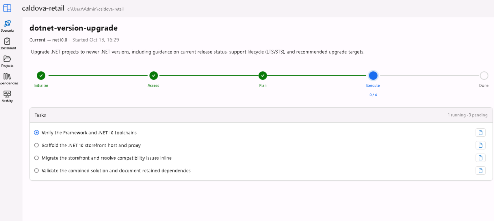

**Switch to Autopilot mode.** During execution the agent runs many commands, tool calls, and test builds. Rather than manually approving each action, switch the agent to run autonomously:

1. Select **Default permissions** at the bottom right of the Copilot Chat window.
2. Select **Autopilot (Preview)** (or **Allow all**).

   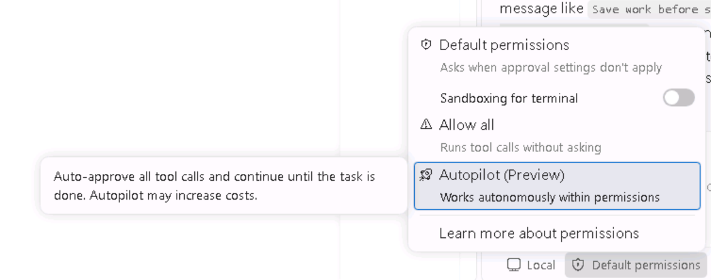

This auto-approves tool calls so the agent can work through the migration tasks continuously. (In real-world customer engagements, teams often stay on default permissions until stakeholders are comfortable with the agent's actions).

**Observe and test while it runs:**

Keep the dashboard and/or **tasks.md** open. As the agent works in Autopilot, monitor the chat box to observe its behavior. You can see how it approaches changes and which files it modifies. Copilot Chat is also available to answer your questions in real time:

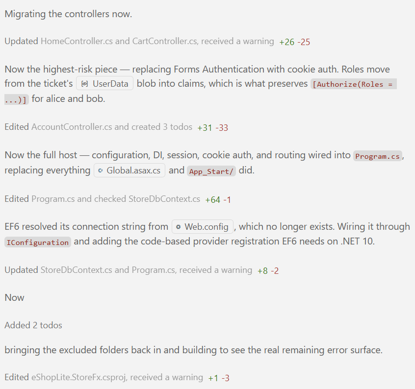

Useful things to ask while it runs:

```plaintext
Explain what you just changed in this task and why.
```

```plaintext
What was the .NET Framework way of doing this, and what replaces it in .NET 10?
```

```plaintext
Why is this task taking a while?
```

Check the **Activity** tab of the dashboard. It records the timeline, log, and commits of the upgrade, showing the exact steps the agent takes (such as rebuilding the app after modifying a file).

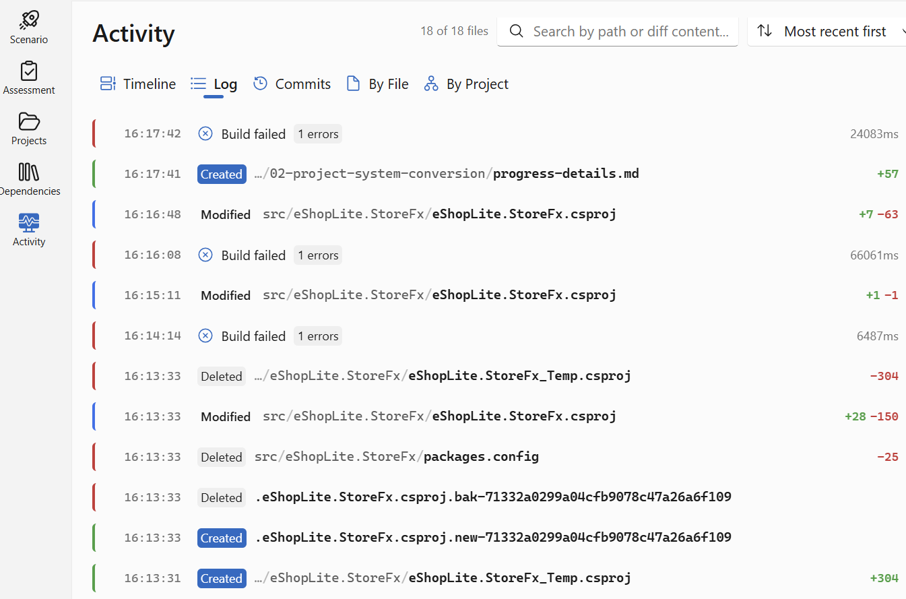

### 🧭 Steering the agent: what to know as you run and guide it

The agent decides each next step based on what it just observed, so it does not always move in a straight line. It can occasionally stall, drift, or pause on errors. You stay in control the whole time:

- **It seems slow or stalled.** If nothing new appears in the chat for 3–5 minutes, select **Stop** to stop the run, then send `continue`.
- **It says "1 confirmation pending" but shows nothing to approve or deny.** This is a tool problem, not something you did. Ask it to `continue`. If it stays stuck, select **Stop**, then send `continue`.

  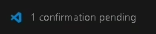

- **Inspect what it is doing right now.** Hover over a step in the chat. If an arrow appears on the right, select it to view the background subagents reviewing or validating a task.

  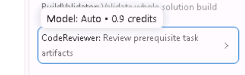

  Hovering over a subagent also shows its details, such as what it is doing and which tool it is running:

  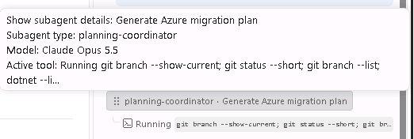

- **See what it has changed.** Select the **files changed** line at the bottom of the chat (for example, "13 files changed") to see every file the agent has edited so far. Look around, but don't select **Undo**, since that would revert the agent's work.

  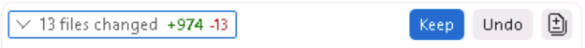

- **Redirect mid-task.** Type your message while the agent is working and send it as a **steering** message (hover over your message and select **Steering**, the arrow icon highlighted below). Copilot reads it immediately before carrying on, rather than queuing it for after the step finishes. For example, you could steer with a question like `What did you just change?`

  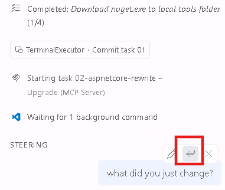
- **Handling stops or errors.** If the agent stops with an error, ask it to continue or diagnose the issue (for example, `Try to continue` or `Why did you get this error?`). In the example below, the agent paused during initialization; a follow-up prompt gets it moving again.

  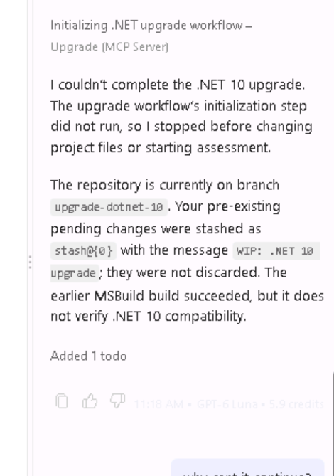

- **The dashboard is not updating.** The dashboard can occasionally lag behind while the agent continues running in Git and chat. If you see commits landing in Source Control or files updating in the chat response (e.g., changes indicator), the upgrade is progressing normally even if the dashboard state is behind.

  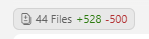

---

## 5️⃣ Wrap Up & Transition

You're ready to wrap up once the first task has finished and you've tried the features in the previous section. If no task has finished after about 10 minutes, wrap up anyway.

**1. Stop the agent.** Select the **Stop** button in Copilot Chat to halt execution.

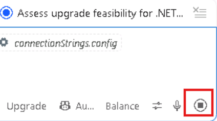

You do not need to let the agent finish the entire task list or troubleshoot any errors that arise during this run.

**2. See what a completed upgrade looks like.** In a full, completed run, the agent finishes all planned tasks and validates the application end-to-end:

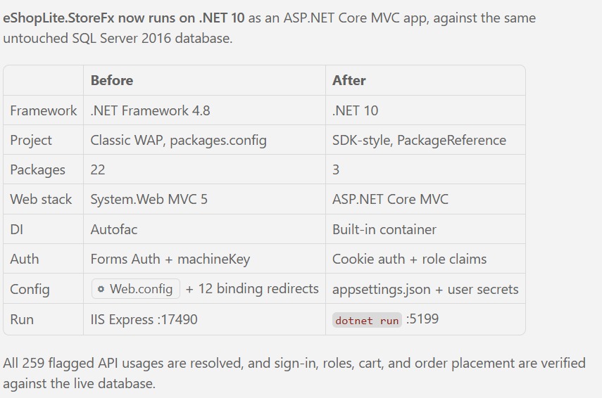

When the full upgrade finishes, the application has undergone significant modernization under the hood:

- **Modern SDK-style projects:** Classic **.csproj** files and **packages.config** are converted to SDK-style projects targeting **net10.0** with **PackageReference**.
- **Modern ASP.NET Core architecture:** **Global.asax** is replaced by **Program.cs**, Autofac is replaced by built-in ASP.NET Core dependency injection, and Forms Authentication moves to modern cookie authentication.
- **Unified configuration:** Connection strings and application settings move from **Web.config** and **connectionStrings.config** into **appsettings.json**.
- **CLI-first run experience:** The application runs cross-platform using standard **dotnet run**, completely removing dependencies on IIS Express and Windows Server.
- **Identical behavior:** The application connects to the same SQL Server database, serves the same catalog and images, authenticates users, and processes carts and orders identically to the legacy version.

**3. Move to the next module.** Because letting the agent finish the entire upgrade may take an hour, the bootcamp provides a pre-upgraded repository so you can proceed without waiting.

Do not attempt to fix or manually finish the in-progress codebase from this module. Instead, proceed directly to the next lab. Module 3 starts from a fresh fork of the pre-upgraded repository, so you won't use this folder again.

---

## 🎯 What You've Accomplished

By using GitHub Copilot Modernization, you've:

- 🔹 Run an automated application assessment to uncover framework dependencies and migration risks
- 🔹 Generated and reviewed a step-by-step modernization plan with **plan.md** and **tasks.md**
- 🔹 Observed an AI upgrade agent execute real code migrations, package upgrades, and builds
- 🔹 Learned how to monitor, inspect, and steer autonomous agents during complex multi-step tasks
- 🔹 Understood what changes are required to transition a legacy .NET Framework app to modern .NET 10

> 💡 **Going further: custom skills**
>
> The agent's built-in instructions cover steps common to .NET migrations. Organizations can add custom migration standards as Markdown files under **.github/skills/** in their repositories, and the agent will adhere to those conventions. See [GitHub Copilot upgrade scenarios and skills](https://learn.microsoft.com/dotnet/core/porting/github-copilot-upgrade/scenarios-and-skills) to learn more.
