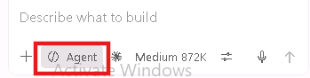
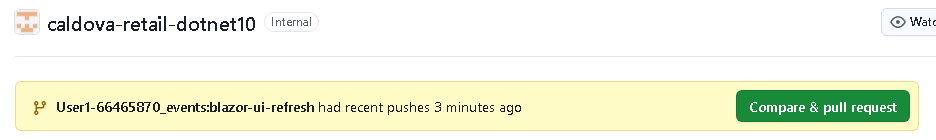
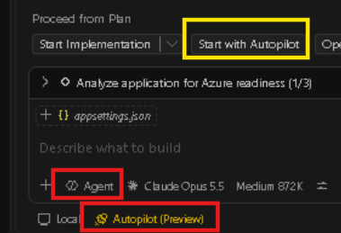
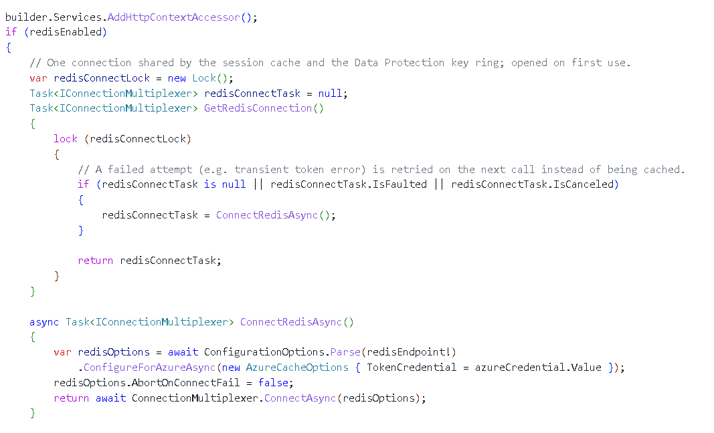

# ☁️ Lab 03: Modernize the App Code for Azure

Module 2 moved the storefront onto .NET 10. That upgrade changed the framework underneath, but not the app's pages, and not how the code works with **Azure services**, such as Key Vault for secrets or Redis for shopping carts. It also rewrote how the app starts up and where it keeps its settings (now in `appsettings.json`).

> 🎯 **This module: prepare the app's code for Azure.** You work on the **application code** only. First you rebuild the pages with **Blazor**, Microsoft's current recommended way to build .NET web UIs. Then you close the code gaps that would stop the app working well with Azure services. Nothing is created in Azure and nothing is deployed. By the end, the app has a modern UI and its code is *ready to use* Azure services, but it is not running in Azure yet. Module 4 designs the Azure environment the app will run in, and Module 6 deploys the app into it.

You work in **GitHub Copilot Chat** for the whole module, switching modes as you go: first **Agent** mode to convert the pages to Blazor, then **Plan** mode to propose where Azure services fit the app, and **Agent** mode again to make the code changes to support them.

> ⚠️ **Expect variation.** As in Module 2, you're working with AI agents, so your plan, task list, code changes, and summary will differ from the screenshots and from the person next to you. That's expected. Use your judgment: review what the agent proposes, choose the option that makes sense, and ask it to explain anything unclear. If it seems stuck, ask what it's doing or tell it to continue.

> 🧭 New to GitHub Copilot Chat? [Copilot Essentials](https://github.com/Azure-Samples/modernize-bootcamp/blob/main/docs/copilot-essentials.md) is a short reference on modes, models, context, cost, and course-correcting.

## 🛠️ Setup: Load the Upgraded .NET 10 Repository

In Module 2, you observed how GitHub Copilot Modernization assesses and begins an upgrade. Because this full agentic framework upgrade may take an hour, we pick up this module using a prepared copy of the storefront that is already upgraded to **.NET 10**.

Follow these steps to fork, clone, and configure the .NET 10 repository (like you did in the previous module):

1. In Microsoft Edge, open this link: +++https://github.com/Skillable-Events/caldova-retail-dotnet10+++. (Sign in with your lab credentials if prompted).
2. Select **Fork**, then **Create fork** with the defaults left alone.
3. In your new fork, select **Code**, then copy the **HTTPS** URL.
4. Open PowerShell from your applications and clone your fork. Run this from the default location, **C:\Users\Admin**. If you still have PowerShell open from the previous module, make sure you are in the **C:\Users\Admin** folder first (run `cd ..` as needed until you are). In the command below, replace **your-fork-url** with the HTTPS URL you copied in the previous step (delete the angle brackets too). The finished command looks like this: git clone https://github.com/your-account/caldova-retail-dotnet10.git

   ```powershell
   git clone <your-fork-url>
   ```

   If you are asked to sign in, choose **Sign in with your browser**, approve the authorization, then return to PowerShell. The clone starts once you are signed in.
   > 💡 If you face any errors here, the sign in may not have persisted. If that is the case, re-type the original repo link, +++https://github.com/Skillable-Events/caldova-retail-dotnet10+++, into the browser, follow the sign in, click the button to stay signed in, and then run the PowerShell command again.

5. Open the storefront folder in VS Code. Run these commands in PowerShell:

   ```powershell
   cd caldova-retail-dotnet10
   code .
   ```

6. Check for a notification in the banner at the top of VS Code. If the folder opens in **Restricted Mode**, select **Manage**, then **Trust**. Once VS Code shows **In a Trusted Folder**, close that tab.

   
7. Open **src\eShopLite.StoreFx\appsettings.json** and replace the placeholder password in the **StoreDbContext** connection string with the **W11-Workstation** password from the **Resources** tab of your lab instructions (+++Pa$$w0rd+++). Leave the server, database, and user as they are.
8. Ask Copilot Chat to **Run the app** (and approve any tool call commands), then verify the product catalog loads in your browser by selecting the **Products** tab before continuing.

   > 💡 Notice how this is different from Module 2. The legacy .NET Framework app needed MSBuild and IIS Express to run. Now that the app is upgraded to .NET 10, it starts with the standard **dotnet run** command, with no IIS Express or Windows Server required.

9. **Set your Git commit identity in Copilot Chat.** Do this again for this new copy of the repository, since Git may save the identity per repository. Send this message, replacing the placeholders with your lab details:

   ```plaintext
   Use <your name> and <your lab email> as my Git commit identity.
   ```

   Use the **Username** listed under **Azure portal** on the **Resources** tab as your email. For your name, use the part before **@** in that email (for example, **user1-6614389**) or your own name. Whichever is fine. This lets the agent make commits later without stopping to ask for your identity.

## 📋 What you'll do

- 🚀 Rebuild the storefront's pages with Blazor components
- ☁️ Assess where Azure services fit the app (secrets, database access, cache), then make the code changes to support them

## 1️⃣ Convert to Blazor pages

Right now, the storefront's pages are built with **ASP.NET MVC**. Each page is a *view* (an HTML template with blanks), and a separate *controller* handles each request, gets the data, and fills in the template. In this step you move the pages to **Blazor**, Microsoft's newer way to build web pages in .NET. With Blazor, each page is a *component*: a single file that holds both the page's layout and its code, built from reusable pieces such as a product card or the cart. This isn't another framework upgrade. Blazor is part of .NET 10, so the app stays on .NET 10 and the storefront does the same things. What changes is how each page is built.

Unlike Module 2, this step does change the pages themselves. Copilot will rebuild each page as a Blazor component. Because the pages are being rebuilt anyway, this is also a good moment to give the store a more modern look, so the prompt below asks for that too.

Confirm Copilot Chat is in **Agent** mode in the agent picker (switch it if it isn't). We use plain **Agent** mode for this step rather than the **Upgrade** agent from Module 2. The Upgrade agent is built on GitHub Copilot, so it could technically attempt this conversion too, but it's purpose-built around predefined upgrade scenarios (like moving between .NET versions), and MVC → Blazor isn't one of them. Without a matching scenario, its assessment, planning, and validation tooling doesn't apply, so plain Agent mode with the custom prompt below is the more direct fit for this conversion.



Then use the following prompt to guide Copilot:

```text
Convert the existing ASP.NET MVC pages to Blazor components in this .NET 10 application. This includes:

Before making any changes, create and switch to a new Git branch named blazor-ui-refresh. Keep all Blazor conversion changes on that branch.

Identify the MVC views, controllers, models, and services involved.
Recommend whether Blazor Server interactivity or static server rendering is most appropriate for this app.
Convert all existing pages one page at a time to use Blazor (preferably Blazor Server or Blazor WebAssembly, depending on suitability).
Remove all non-Blazor pages and ensure routing is correctly configured.
Preserve layout, validation, images, and existing user-facing behavior.
Ensure all media (images, videos, etc.) are correctly referenced and rendered in the new Blazor components.
Fix issues where the page renders blank or fails to load due to routing or layout problems.
Leverage Blazor components to make it look more modern, sleek, and aesthetic.
```

> 💡 **NOTE**
>
> That last line is deliberately vague — "modern, sleek, and aesthetic" means whatever the model decides it means. Expect your result to look different from the screenshots below, and different from the person sitting next to you. That is fine. The point of this step is that you *can* modernize a UI by asking, not that everyone lands on the same UI.
>
> If you have something specific in mind, say so. Name the color palette, ask for product cards in a responsive grid, or paste in a screenshot of a design you like. The more specific the ask, the less the model has to invent.
>
> The same applies when something breaks. If a page renders blank, a component goes missing, or routing misbehaves, describe that specific problem in the chat and let Copilot fix it before moving on.

The agent starts converting the pages. It may ask you to approve tool calls, such as running commands. Read what it's about to do, then approve it. If it asks in the chat whether to continue, reply:

```plaintext
Yes, proceed.
```

If any other pop-up appears, select the default option, then tell Copilot to continue.

Copilot will convert the MVC pages to Blazor components, aiming to preserve the app's functionality while giving it a more modern UI. Expect this update to take about 10–20 minutes.

> **If the conversion gets stuck or takes longer than the workshop allows:** This UI refresh is useful, but it's not required for the Azure code changes or later steps. Stop the agent, switch back to the **main** branch, and continue. The prepared app and following instructions let you proceed without waiting for the UI changes.

**While the agent works, complete these steps:**

- [ ] **Follow its progress in Copilot Chat.** The agent posts paragraph-style updates describing what it has changed and what it plans to do next.
- [ ] **Inspect a code change.** When Chat reports that it edited a file, select the file or change entry to open it in the editor. Look at the diff to see what the agent changed.
- [ ] **Notice errors and recovery.** If the agent reports errors, watch how it investigates and tries to fix them. If it gets stuck, ask what went wrong and what it plans to try next.
- [ ] **Ask a question.** Ask Copilot Chat what it is doing or why it made a particular change. The agent will answer and pause; when you're ready for it to continue the conversion, send `Continue`.

This is our final page (yours may look different):


### ✅ Build and test the Blazor conversion

If Copilot does not automatically do this verification, then prompt copilot to build and run the app:

```text
1. Build the solution to ensure no compilation errors
1. Run the application and verify all functionality
1. Check that:
   - All pages load correctly and render as Blazor components
   - Images and static content display properly
   - Sign-in still works for alice and bob (password Password1!) and the cart still holds its contents
   - No MVC views or controllers are left behind in the routing
   - The application starts cleanly from the Visual Studio Code terminal
```

Use these demo logins when you check sign-in yourself:

| Username | Password | Role | Notes |
| --- | --- | --- | --- |
| `alice` | `Password1!` | Admin, Manager | Has existing order history |
| `bob` | `Password1!` | Employee | Has existing order history |


> 💡 The app does the same things it did at the end of Module 2 — that is the point. Everything so far changed *how* the app runs and renders, not *what* it does.

### 💾 Commit your Blazor changes

Don't skip this one, even if Copilot already built and tested the app for you. Once the app builds and runs the way you expect, commit! A commit saves your changes to Git on the **blazor-ui-refresh** branch, so your work is safe and the next step starts from a clean slate. Ask Copilot Chat:

```plaintext
Commit all the Blazor conversion changes on the blazor-ui-refresh branch with a clear commit message.
```

### 🌐 Push and view it on GitHub

Now push your branch to your fork so you can see your changes on GitHub. Ask Copilot Chat:

```plaintext
Push the blazor-ui-refresh branch to my fork on GitHub and give me the link to view it.
```

Select the link Copilot gives you, or open your fork in the browser yourself. It's the same address you cloned from and includes your account name (for example, **https://github.com/user1-58494_events/caldova-retail-dotnet10**). If you are asked to sign in, choose **Sign in with your browser** and approve the authorization, like you did for the clone.

You should see a banner like this:



Select **Compare & pull request** and scroll through the files that changed: new **.razor** files added, and the **Controllers** and **Views** removed. You don't need to create the pull request. This is just to show how your changes look in the browser, and it's another way to view them. When you're done, return to VS Code.

If you don't see the banner, choose the **blazor-ui-refresh** branch from the branch dropdown and open your latest commit instead.

## 2️⃣ Prepare the app code for Azure

> 🎯 **Goal: let Azure's managed services handle the parts the app currently has to handle itself** — things like secrets management, distributed caching, and observability. This is the modernization step: not just moving the app to the cloud unchanged, but changing how it behaves to take advantage of being there. None of those Azure services exist yet, so nothing here depends on them; the code just needs to be ready to use them the moment they do.

Creating an Azure service doesn't make your app use it automatically — the two are separate. The app can't read secrets from Key Vault just because a Key Vault exists somewhere in Azure; it needs code that calls Key Vault to fetch them. In this step, you add that calling code. This is **code changes only**: nothing is created or deployed in Azure, and the database is deliberately left untouched (more on why in the prompt below).

Think of each Azure service as a switch, and the switch is just a setting in a config file like **appsettings.json**. Every switch starts out missing or empty, so the app runs the way it always has. You're adding the wiring and leaving the switches off: the code to call each new service will exist, but it never runs until a real setting value shows up. When the app is deployed to Azure in Module 6, those settings get filled in and the switches turn on — without touching the app's code again.

You'll do this directly in Copilot Chat by switching modes, the same way you did for the Blazor conversion: **Plan** mode to analyze the app and propose the changes, then **Agent** mode to build them. Expect about 20-30 minutes.

1. **Check the model, switch to Plan mode, and send this prompt.** First, check the model picker, the dropdown under the chat box that shows the current model. If it isn't set to **Claude Opus 5.5** (a new chat can reset it), scroll down to **Other Models** and select it again. We use it to keep results more consistent, and because we prefer the most powerful model for code analysis. The default works too, so if it isn't available, keep the default.

   Open the mode dropdown and choose **Plan**. Plan mode reads the repository and proposes an approach, but it does **not** change any files yet.

   > 🤖 **Paste this into Copilot Chat.** Approve any tool calls it makes while thinking through this.

   ```text
   Analyze this application and propose the application code changes needed to run it on Azure.

   Scope the plan to app code only:
   - No Dockerfile or infrastructure-as-code (Bicep/Terraform/ARM). Assume Azure resources are provisioned
     later; read endpoints and connection strings from configuration. Don't look at or consider the
     infra/ folder; it belongs to a later step.
   - Leave the database alone: same SQL Server, same connection details, same storage location.
   - Keep all Azure setup in one place in startup code, and list every new configuration key in
     appsettings.json with an empty placeholder.
   - Cover Redis (session/cart cache) and Application Insights, plus any other Azure services the assessment
     finds the app needs.
   - Every new service must be optional and config-driven: empty setting = app runs as before; partially
     filled = fail fast at startup with a clear error.

   Summarize the current gaps, propose a task plan with reasoning for each task, and create a new branch named
   azure-code-prep. Stop for review — don't change any files yet.
   ```

   In plain terms, this prompt tells the agent to:

   - **Assess, then plan, in one pass.** No separate exploration step needed first.
   - **Change app code only.** No Dockerfile or infrastructure files, and don't factor in the **infra/** folder — that's Module 4's territory.
   - **Assume the Azure resources will exist later,** and read their addresses from settings.
   - **Leave the database alone.** Same server, same connection details, same storage location.
   - **Keep the Azure setup tidy.** All in one place in the startup code, with every setting listed (empty) in **appsettings.json**. The agent's output can vary, and this keeps it tighter and more standard, so it's easier to review.
   - **Name the services we know we want to include, but leave room for more.** Redis for session and cart data, and Application Insights for observability — plus anything else the assessment turns up.
   - **Build in the switch pattern from the start.** Every new service is optional and configuration-driven, so the app keeps running with no Azure settings filled in.
   - **Work on a new branch.**

   The agent may ask to read files or run commands along the way. Read what it's about to do, then approve it. **If it asks you to select any options, read through to understand the options and proceed with the defaults (any selections you choose are fine; this is for learning and should not affect further labs).**

2. **Review the plan.** Spend a few minutes reading the agent's response in the chat. Yours may differ from the person next to you, and that's fine. Reject the plan, and ask the agent to revise it, if it:

   - touches the database connection string, moves it to Key Vault, or changes which SQL Server it points to
   - generates a Dockerfile or any Bicep/Terraform/ARM files
   - scatters the Azure setup code across several files instead of one place
   - leaves out a configuration key the app will need in **appsettings.json**
   - makes a new Azure service mandatory instead of optional and configuration-driven

   If anything is unclear, ask a follow-up question before approving, for example:

   ```text
   For each task in the plan, explain in plain language what would go wrong in Azure without it, and why you chose that approach.
   ```

3. **Switch to Agent mode, turn on Autopilot, and run the approved plan.** Switch the mode dropdown to **Agent**, then switch the agent to Autopilot, like you did in Module 2, so it can keep going without pausing for approval before each command:

   1. Select **Default permissions** at the bottom right of the Copilot Chat window.
   2. Select **Autopilot (Preview)**.

   

   

   - **Red:** switch the mode dropdown to **Agent** and turn on **Autopilot (Preview)**, then send the message below to start.
   - **Yellow:** if Copilot instead shows a **Start with Autopilot** button directly under the plan (next to **Start Implementation**), you can select that instead — it does the same thing in one click, and you can skip sending the message below. Either way is fine.

   If you went with the manual (red) route, send:

   ```plaintext
   Implement the approved plan exactly as discussed. Commit your changes as you go, and stop to summarize if you hit a blocker.
   ```

   > 🗣️ **While it runs:** if it is taking a bit and timing lines up, your instructor may lead a discussion on some important topics. You can also read up on a topic you're curious about in the [Talking Points](https://github.com/Azure-Samples/modernize-bootcamp/blob/main/docs/talking-points.md), such as custom skills, model selection, or the modernization CLI.

4. **Follow the progress.** The agent works through the tasks one at a time, building the app and committing after each one. To check on it at any time, ask:

   ```text
   Summarize progress against the approved plan: list completed tasks, the current task, remaining tasks, and any errors or blockers.
   ```

   > ⚠️ **Please be aware:** sending a message interrupts the agent. It stops, answers with a summary, and you'll need to tell it to continue (send **Continue**). That's fine for checking in on a long-running task. Just don't be surprised when it pauses.

   > ⏳ **If nothing new appears for 3–5 minutes,** the agent may be stuck. Select **Stop** in Copilot Chat, then send **Continue**, like you did in Module 2.

5. **Read the summary.** When every task is done, the agent posts a summary in the chat: the branch your changes are on, whether the app builds, and each task with its commit. Yours will differ from the person next to you. One thing to notice: none of the new Azure code has been tested against real Azure yet, because those services don't exist until later modules. The summary may also flag infrastructure-side work the app's code can't do on its own — for example, granting the app's managed identity access to Redis (a cache access policy) and Key Vault (the Key Vault Secrets User role). That's expected: those grants are part of the identity and RBAC design Module 4 produces, not something this step's code changes can satisfy.

   Also look for any outstanding issues the summary notes. In a real engagement, you would work through these with the agent until the app reaches a satisfactory state. We're showing you that this can happen, but we'll move on. It won't block the rest of the labs.

   > 💡 **NOTE**
   >
   > If the summary doesn't show up in the chat, send this message:
   >
   > ```text
   > Summarize changes
   > ```

6. **Peek at the code.** Check where the Azure setup lives — for example **Program.cs**, or a new file like **AzureSetup.cs**. If you aren't sure, ask Copilot:

   ```text
   Where does the Azure service setup code live? Show me the code that connects to Redis and other Azure services.
   ```

   You'll see some code for Redis, like this (yours may look different):

   

   - **The switch:** the **if (redisEnabled)** check means the Redis code only runs when a Redis setting is filled in. This shows the switch constraint we put in the plan was upheld.

7. **Add the database password back, if needed.** Open **src\eShopLite.StoreFx\appsettings.json** and check the **StoreDbContext** connection string. If the plan's pass over **appsettings.json** reset it to **REPLACE_ME**, paste the **W11-Workstation** password from the **Resources** tab (+++Pa$$w0rd+++) of your lab instructions back in, the same way you did during setup.

8. **Check it still runs.** Ask Copilot:

   ```text
   Build and run the app, then give me the local URL so I can open it in a browser.
   ```

   With the Azure settings empty, the app should still load, including the pages that use the database — its connection string hasn't moved. If Copilot doesn't show the link, ask it again: **What's the local URL I should open in a browser?**

   Once it's open, check that sign-in still works and the cart still holds its contents, the same way you did for the Blazor conversion: sign in as `alice` or `bob` (password `Password1!`) and add something to the cart. If anything looks off, ask Copilot to fix it.

9. **Commit any outstanding changes.** The agent should have committed as it went, but in case it did not, ask Copilot Chat:

   ```plaintext
   Check for any uncommitted changes on the azure-code-prep branch, and commit them with a clear message if there are any. Exclude the database password.
   ```

> 🎉 **That's it — the app's code now supports the Azure services Copilot recommended.**
>
> You started Module 2 with a .NET Framework 4.8 app on Windows Server. It now runs on .NET 10, renders with Blazor, and is wired to use Azure services. It isn't running in Azure yet, because those services don't exist. In Module 4 you design them as infrastructure as code, and in Module 6 you deploy the app onto them.

## 🔧 Troubleshooting common issues

### YARP errors

YARP is a tool that routes traffic when an old and a new version of an app run side by side. You chose the all-at-once upgrade in Module 2, so this app doesn't need it. If you see YARP errors:

- Ask Copilot to find where YARP is used in the app.
- Ask Copilot to remove the YARP packages, settings, and startup code.
- Rebuild the app after it is removed.

### Missing images or static files

If product images don't appear after modernization:

- Ask Copilot to check that images, styles, and other static files are in the `wwwroot` folder, which is where .NET 10 web apps serve them from.
- Ask Copilot to confirm that the app is set up to serve static files.
- Ask Copilot to check that the image paths in the pages match the files in `wwwroot`.


## ✅ Verification

By the end of this section, you should be able to check each of these:

- 🔹 **Converted the MVC pages to Blazor.** Check: **src\eShopLite.StoreFx\Components\Pages** has **.razor** files (like **Home.razor**; names may differ), and there are no **Controllers** or **Views** folders or **.cshtml** files left.
- 🔹 **Planned and executed the Azure code changes.** Check: you kept the plan to app code only (no database changes, no infrastructure files generated), and the approved plan covered Redis and Application Insights, plus whatever other services the assessment found the app needs.
- 🔹 **Made the code changes for those services.** Check: the Azure setup is in one place in the startup code (usually **Program.cs**; ask Copilot if you can't find it), and **appsettings.json** lists each Azure setting with an empty value.
- 🔹 **Kept the app working.** Check: it builds and runs with the Azure settings empty, and the **Products** tab still loads.

If you have trouble verifying any of these, message Copilot in the chat and ask it to fix it. It's also okay if you don't fix it. This won't block the next lab, it is for your learning.

> **Next module preview:** Module 4 does two things. First, it writes the infrastructure as code (IaC) for the Azure services this app now expects, such as Redis and Application Insights. Second, it designs the cloud foundation around them: the secure networking, identities, and hosting the app will run on. You plan it and have Copilot write it as Bicep files. Your instructor has already set up the real Azure environment, so your Bicep stays as files in your repository to review, not something you deploy. The app itself is deployed in Module 6.
