# ☁️ Lab 03: Modernize the App Code for Azure

Module 2 moved the storefront onto .NET 10. That upgrade changed the framework underneath, but not the app's pages, and not how the code works with **Azure services**, such as Key Vault for secrets or Redis for shopping carts. It also rewrote how the app starts up and where it keeps its settings (now in `appsettings.json`).

> 🎯 **This module: prepare the app's code for Azure.** You work on the **application code** only. First you rebuild the pages with **Blazor**, Microsoft's current recommended way to build .NET web UIs. Then you close the code gaps that would stop the app working well with Azure services. Nothing is created in Azure and nothing is deployed. By the end, the app has a modern UI and its code is *ready to use* Azure services, but it is not running in Azure yet. Module 4 designs the Azure environment the app will run in, and Module 6 deploys the app into it.

You work in **GitHub Copilot Chat** for the whole module: first with the **Upgrade** agent to convert the pages to Blazor, then with the GitHub Copilot modernization extension's **Migrate to Azure** option to assess where Azure services fit the app and make the code changes to support them.

> ⚠️ **Expect variation.** As in Module 2, you're working with AI agents, so your plan, task list, code changes, and summary will differ from the screenshots and from the person next to you. That's expected. Use your judgment: review what the agent proposes, choose the option that makes sense, and ask it to explain anything unclear. If it seems stuck, ask what it's doing or tell it to continue.

> 🧭 New to GitHub Copilot Chat? [Copilot Essentials](https://github.com/Azure-Samples/modernize-bootcamp/blob/main/docs/copilot-essentials.md) is a short reference on modes, models, context, cost, and course-correcting.

## 🛠️ Setup: Load the Upgraded .NET 10 Repository

In Module 2, you observed how GitHub Copilot Modernization assesses and begins an upgrade. Because this full agentic framework upgrade may take an hour, we pick up this module using a prepared copy of the storefront that is already upgraded to **.NET 10**.

Follow these steps to fork, clone, and configure the .NET 10 repository (like you did in the previous module):

1. In Microsoft Edge, open this link: +++https://github.com/Skillable-Events/caldova-retail-dotnet10+++. (Sign in with your lab credentials if prompted).
2. Select **Fork**, then **Create fork** with the defaults left alone.
3. In your new fork, select **Code**, then copy the **HTTPS** URL.
4. Open PowerShell from your applications and clone your fork. Run this from the default location, **C:\Users\Admin**. If you still have PowerShell open from the previous module, make sure you are in the **C:\Users\Admin** folder first (run `cd ..` as needed until you are). In the command below, replace **your-fork-url** with the HTTPS URL you copied in the previous step (delete the angle brackets too). The finished command looks like this: git clone https://github.com/your-account/caldova-retail-dotnet10.git

   ```powershell
   git clone <your-fork-url>
   ```

   If you are asked to sign in, choose **Sign in with your browser**, approve the authorization, then return to PowerShell. The clone starts once you are signed in.
   > 💡 If you face any errors here, the sign in may not have persisted. If that is the case, re-type the original repo link, +++https://github.com/Skillable-Events/caldova-retail-dotnet10+++, into the browser, follow the sign in, click the button to stay signed in, and then run the PowerShell command again.

5. Open the storefront folder in VS Code. Run these commands in PowerShell:

   ```powershell
   cd caldova-retail-dotnet10
   code .
   ```

6. Check for a notification in the banner at the top of VS Code. If the folder opens in **Restricted Mode**, select **Manage**, then **Trust**. Once VS Code shows **In a Trusted Folder**, close that tab.

   
7. Open **src\eShopLite.StoreFx\appsettings.json** and replace the placeholder password in the **StoreDbContext** connection string with the **W11-Workstation** password from the **Resources** tab of your lab instructions (+++Pa$$w0rd+++). Leave the server, database, and user as they are.
8. Ask Copilot Chat to **Run the app** (and approve any tool call commands), then verify the product catalog loads in your browser before continuing.

   > 💡 Notice how this is different from Module 2. The legacy .NET Framework app needed MSBuild and IIS Express to run. Now that the app is upgraded to .NET 10, it starts with the standard **dotnet run** command, with no IIS Express or Windows Server required.

9. **Set your Git commit identity in Copilot Chat.** Do this again for this new copy of the repository, since Git may save the identity per repository. Send this message, replacing the placeholders with your lab details:

   ```plaintext
   Use <your name> and <your lab email> as my Git commit identity.
   ```

   Use the **Username** listed under **Azure portal** on the **Resources** tab as your email. For your name, use the part before **@** in that email (for example, **user1-6614389**) or your own name. Whichever is fine. This lets the agent make commits later without stopping to ask for your identity.

## 📋 What you'll do

- 🚀 Rebuild the storefront's pages with Blazor components
- ☁️ Assess where Azure services fit the app (secrets, database access, cache), then make the code changes to support them

## 1️⃣ Convert to Blazor pages

Right now, the storefront's pages are built with **ASP.NET MVC**. Each page is a *view* (an HTML template with blanks), and a separate *controller* handles each request, gets the data, and fills in the template. In this step you move the pages to **Blazor**, Microsoft's newer way to build web pages in .NET. With Blazor, each page is a *component*: a single file that holds both the page's layout and its code, built from reusable pieces such as a product card or the cart. This isn't another framework upgrade. Blazor is part of .NET 10, so the app stays on .NET 10 and the storefront does the same things. What changes is how each page is built.

Unlike Module 2, this step does change the pages themselves. Copilot will rebuild each page as a Blazor component. Because the pages are being rebuilt anyway, this is also a good moment to give the store a more modern look, so the prompt below asks for that too.

Select the **Upgrade** agent from the agent picker in Copilot Chat, then use the following prompt to guide Copilot:

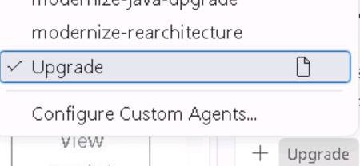

```plaintext
Convert the existing ASP.NET MVC pages to Blazor components in this .NET 10 application. This includes:

Before making any changes, create and switch to a new Git branch named blazor-ui-refresh. Keep all Blazor conversion changes on that branch.

Identify the MVC views, controllers, models, and services involved.
Recommend whether Blazor Server interactivity or static server rendering is most appropriate for this app.
Convert all existing pages one page at a time to use Blazor (preferably Blazor Server or Blazor WebAssembly, depending on suitability).
Remove all non-Blazor pages and ensure routing is correctly configured.
Preserve layout, validation, images, and existing user-facing behavior.
Ensure all media (images, videos, etc.) are correctly referenced and rendered in the new Blazor components.
Fix issues where the page renders blank or fails to load due to routing or layout problems.
Leverage Blazor components to make it look more modern, sleek, and aesthetic.
```

> 💡 **NOTE**
>
> That last line is deliberately vague — "modern, sleek, and aesthetic" means whatever the model decides it means. Expect your result to look different from the screenshots below, and different from the person sitting next to you. That is fine. The point of this step is that you *can* modernize a UI by asking, not that everyone lands on the same UI.
>
> If you have something specific in mind, say so. Name the color palette, ask for product cards in a responsive grid, or paste in a screenshot of a design you like. The more specific the ask, the less the model has to invent.
>
> The same applies when something breaks. If a page renders blank, a component goes missing, or routing misbehaves, describe that specific problem in the chat and let Copilot fix it before moving on.

After you send the prompt, one of three things happens. Any of them is fine:

- **A pop-up appears.** Approve it by choosing the default option.
- **The agent stops and asks in the chat whether to continue.** Tell it to proceed:

  ```plaintext
  Yes, proceed.
  ```

- **The agent starts working right away.** You're good. That means it has already made a decision and begun to work.

Notice what the agent says: no upgrade scenario covers MVC → Blazor, so it will do this as a **direct code change**. The Upgrade agent ships with tested scenarios for common migrations, but it is not limited to them. It is strong at understanding languages and frameworks and converting between them, and it still runs structured checks as it works, such as reading the app before it edits and building to verify its changes. Because the Upgrade agent is built on top of GitHub Copilot, you can also ask it questions and give it requests outside its predefined scenarios, just as you would any other Copilot agent.

Copilot will convert the MVC pages to Blazor components, aiming to preserve the app's functionality while giving it a more modern UI. Expect this update to take about 10–20 minutes.

> **If the conversion gets stuck or takes longer than the workshop allows:** This UI refresh is useful, but it's not required for the Azure code changes or later steps. Stop the agent, switch back to the **main** branch, and continue. The prepared app and following instructions let you proceed without waiting for the UI changes.

**While the agent works, complete these steps:**

- [ ] **Follow its progress in Copilot Chat.** The agent posts paragraph-style updates describing what it has changed and what it plans to do next.
- [ ] **Inspect a code change.** When Chat reports that it edited a file, select the file or change entry to open it in the editor. Look at the diff to see what the agent changed.
- [ ] **Notice errors and recovery.** If the agent reports errors, watch how it investigates and tries to fix them. If it gets stuck, ask what went wrong and what it plans to try next.
- [ ] **Ask a question.** Ask Copilot Chat what it is doing or why it made a particular change. The agent will answer and pause; when you're ready for it to continue the conversion, send `Continue`.

This is our final page (yours may look different):

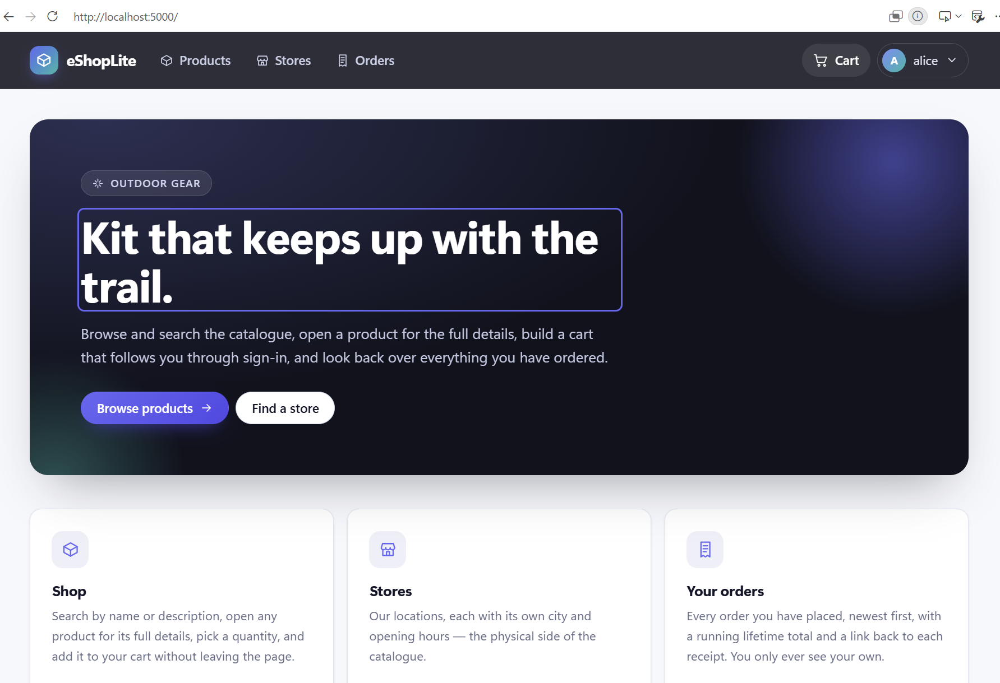

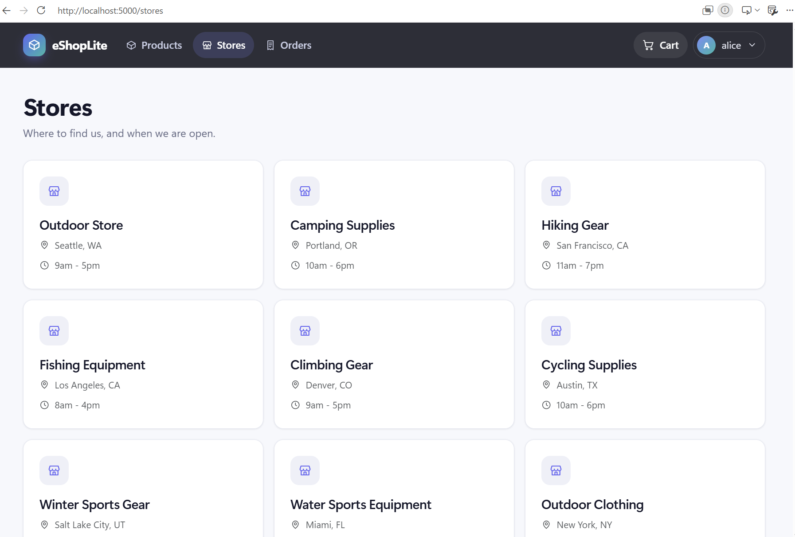

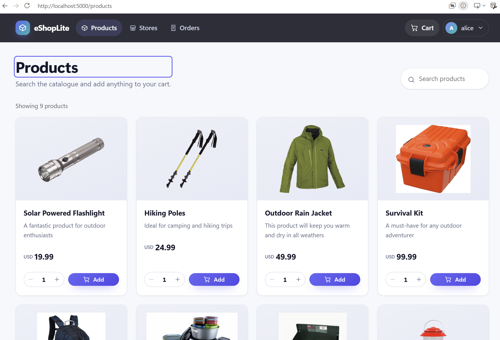

### ✅ Build and test the Blazor conversion

If Copilot does not automatically do this verification, then prompt copilot to build and run the app:

```plaintext
1. Build the solution to ensure no compilation errors
1. Run the application and verify all functionality
1. Check that:
   - All pages load correctly and render as Blazor components
   - Images and static content display properly
   - Sign-in still works for alice and bob (password Password1!) and the cart still holds its contents
   - No MVC views or controllers are left behind in the routing
   - The application starts cleanly from the Visual Studio Code terminal
```

Use these demo logins when you check sign-in yourself:

| Username | Password | Role | Notes |
| --- | --- | --- | --- |
| `alice` | `Password1!` | Admin, Manager | Has existing order history |
| `bob` | `Password1!` | Employee | Has existing order history |

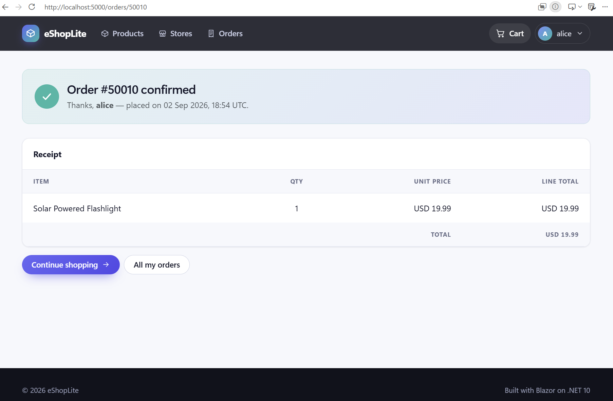

> 💡 The app does the same things it did at the end of Module 2 — that is the point. Everything so far changed *how* the app runs and renders, not *what* it does.

### 💾 Commit your Blazor changes

Don't skip this one, even if Copilot already built and tested the app for you. Once the app builds and runs the way you expect, commit! A commit saves your changes to Git on the **blazor-ui-refresh** branch, so your work is safe and the next step starts from a clean slate. Ask Copilot Chat:

```plaintext
Commit all the Blazor conversion changes on the blazor-ui-refresh branch with a clear commit message.
```

## 2️⃣ Prepare the app code for Azure

Creating an Azure service doesn't make your app use it. The app needs code that knows how to connect to the service. For example, to read secrets from Key Vault, the app needs code that calls Key Vault. In this step you add that code. This is **code changes only**: nothing is created or deployed in Azure.

Think of each Azure service as a switch, and the switch is just a setting. You add the code and leave the switch off, so the app still runs locally exactly as before. When the app later runs in Azure, the settings are filled in and the switches turn on.

You'll use the **Migrate to Azure** option in the GitHub Copilot modernization extension. It works in three stages: **assess → plan → execute**. Expect about 30–40 minutes. See the [GitHub Copilot modernization overview](https://learn.microsoft.com/dotnet/azure/migration/appmod/overview) to learn more.

1. **Start Migrate to Azure.** Open the GitHub Copilot modernization extension from the Activity Bar, then under **QuickStart** select **Migrate to Azure**.

   

   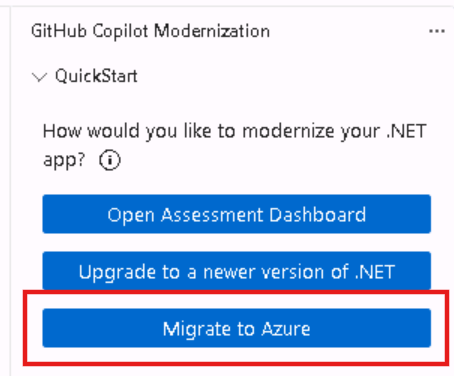

   A chat opens with the prompt "Migrate this application to Azure". If the chat doesn't open with this prompt, close out of the extension and select **Migrate to Azure** again.

2. **Choose the scope.** When the agent asks **What do you want to migrate to Azure?**, select **My entire application**, then **Submit**. You'll narrow the job down in step 5. **If it doesn't have this pop-up, that is okay. That means it has already made a decision and begun to work.** If nothing happens after a minute or two, send:

   ```plaintext
   Assess my entire application for migration to Azure.
   ```

   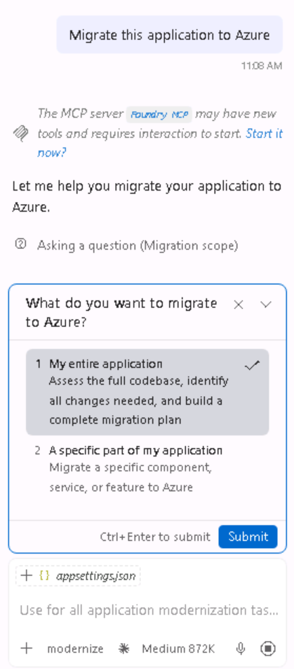

3. **Read the assessment.** The agent first runs the same kind of cloud readiness assessment you ran in Module 2, which can take a minute or two. Notice that **Frameworks** shows **net10.0**, because the assessment picks up your .NET 10 upgrade. Some issues from Module 2 are gone, and the ones left are what still stands between the app and Azure. Even when an issue isn't **Mandatory**, the **Potential** and **Optional** ones are best practice to resolve before moving to Azure.

   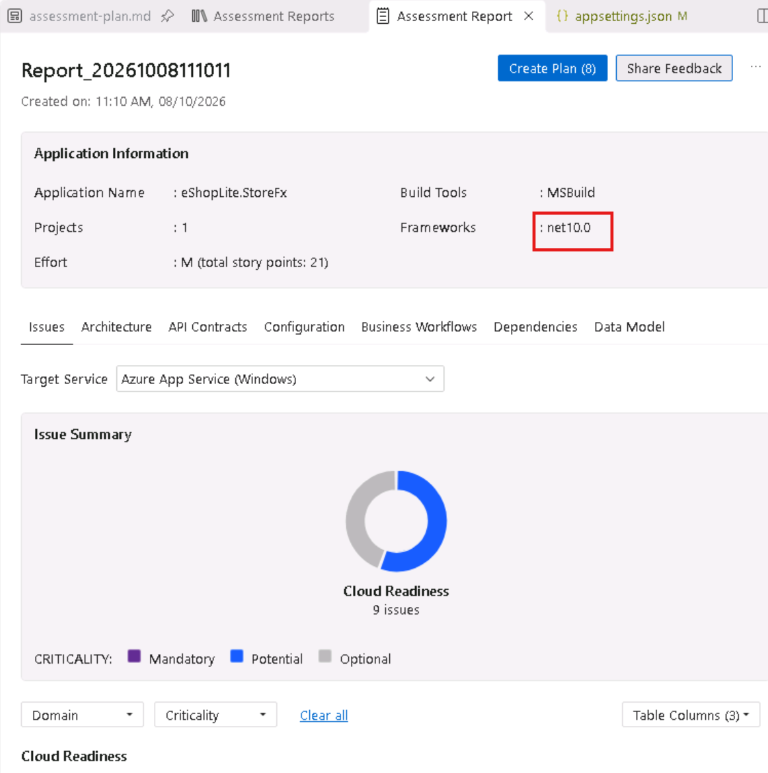

4. **Read the suggestions.** The agent lists what the app is today and the changes it recommends for Azure, such as hosting, the database, secrets, and cache.

   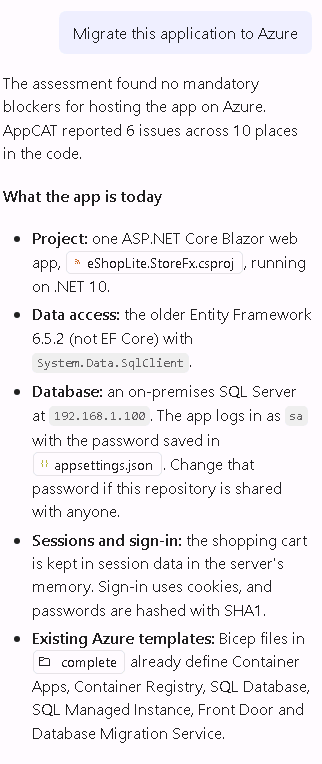

   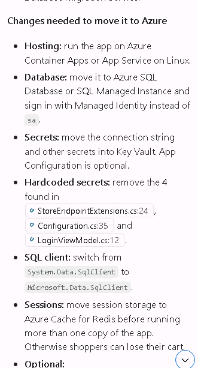

   Some of these are covered in later modules, so we won't do them now.

5. **Check the model, then limit the job and plan.** First, check the model picker, the dropdown under the chat box that shows the current model. If it isn't set to **Claude Opus 5.5** (a new chat can reset it), scroll down to **Other Models** and select it again. We use it to keep results more consistent, and because we prefer the most powerful model for code analysis. The default works too, so if it isn't available, keep the default. Then send this prompt. It keeps the job to app code only and leaves the database, Docker, and infrastructure for later:

   ```plaintext
   Proceed to planning. Include the application code changes needed to run this app on Azure. Don't generate a Dockerfile or any infrastructure-as-code files (Bicep/Terraform/ARM). I'll provision the Azure resources later, so assume they exist and read endpoints and connection strings from configuration. Don't migrate or change the database: the app must keep using the same existing SQL Server with the same connection details.

   Keep all Azure service setup in one place in the startup code, not scattered across files. List every configuration key the app reads for Azure in appsettings.json with an empty placeholder value, so the file shows everything the deployment must provide.

   Make sure the plan also covers secrets in Key Vault, a Redis cache for session and cart data, and observability with Application Insights, even if the assessment didn't flag them.

   Create a new branch for the changes.
   ```

   In plain terms, this prompt tells the agent to:

   - **Change app code only.** No Dockerfile or infrastructure files.
   - **Assume the Azure resources will exist later,** and read their addresses from settings.
   - **Leave the database alone.**
   - **Keep the Azure setup tidy.** All in one place in the startup code, with every setting listed (empty) in **appsettings.json**. The agent's output can vary, and this keeps it tighter and more standard, so it's easier to review.
   - **Include the services we want,** even if the assessment didn't flag them: Key Vault for secrets, Redis for session and cart data, and Application Insights for observability. The assessment finds problems in the code. This line adds what you want the app to have, the same way you would bring your own requirements to a customer engagement.
   - **Work on a new branch.**

   The agent now writes a plan. It may ask you to approve tool calls along the way, such as reading files or running commands. Read what it's about to do, then approve it.

   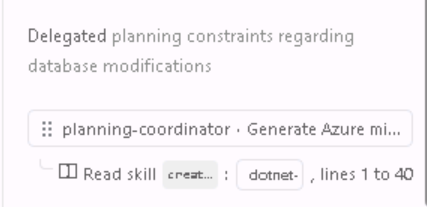

   > 💡 **Reminder:** while the **planning-coordinator** is running, you can hover over the subagent in the chat and select it to see all the tasks it's doing, like you did in Module 2.

   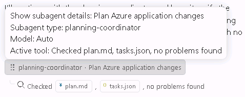

   > 💡 **Why limit the job?** The agent could do the code, the infrastructure, and the deployment in one pass. We split it up so you can see each step on its own, and because customers often don't want everything at once. What you tell the agent to do, leave alone, and assume already exists sets the size of the plan.

6. **Review the plan.** When the agent says the plan is ready, open **plan.md** in the **.github/modernize** folder. It may be inside a subfolder there, and the tasks may be in a separate **tasks.json** file. If the agent asks whether you want to review or execute the plan, choose **Review**. Nothing in your code has changed yet.

   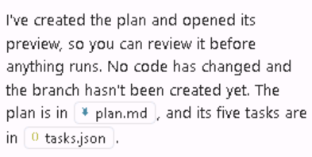

   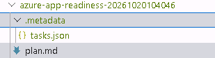

   Skim the tasks. Yours may differ from the person next to you, and that's fine. If a task touches the database or creates infrastructure files, tell the agent to remove it. To understand the plan, ask:

   ```text
   For each task in the plan, explain in plain language what would go wrong in Azure without it, and why you chose that approach.
   ```

   **Add one rule to the plan.** None of the Azure services exist yet, so the app has to keep working without them. Type this in the chat and ask the agent to add it to the plan:

   ```plaintext
   Add this condition to the plan:

   Every Azure service added by this plan must be optional and switched on only by a configuration setting; when the setting is empty, the app must run exactly as it did before without contacting Azure, and if the settings for a service are only partly filled in, the app must stop at startup with a clear error instead of silently falling back.
   ```

   This is the switch idea from earlier: with no Azure settings the app runs as it does today, and a half-filled service stops with a clear error instead of being quietly ignored.

7. **Run the plan.** First switch the agent to Autopilot, like you did in Module 2, so it can keep going without pausing for approval before each command:

   1. Select **Default permissions** at the bottom right of the Copilot Chat window.
   2. Select **Autopilot (Preview)**.

   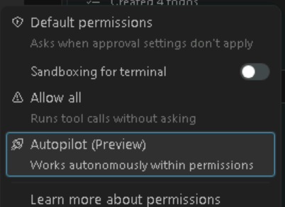

   Then send:

   ```plaintext
   Execute the plan.
   ```

   > ⏱️ **This is the longest part of the module.** The agent works through every task, building the app as it goes, and it can take about 30–40 minutes.
   >
   > 🗣️ **While it runs:** if timing lines up, your instructor will lead a discussion on some important topics. You can also read up on a topic you're curious about in the [Talking Points](https://github.com/Azure-Samples/modernize-bootcamp/blob/main/docs/talking-points.md), such as custom skills, model selection, or the modernization CLI.

8. **Follow the progress.** The agent works through the tasks one at a time, building the app and committing after each one. It usually tracks them in a **progress.md** file. If you don't see one, ask Copilot Chat to create it. Open it and look at what the agent does for each task. It follows the same structured flow every time: change the code, validate it (build, security check, consistency check), then commit and write a summary. To check on the agent at any time, ask:

   ```text
   Summarize progress against the approved plan: list completed tasks, the current task, remaining tasks, and any errors or blockers.
   ```

   > ⚠️ **Please be aware:** sending a message interrupts the agent. It stops, answers with a summary, and you'll need to tell it to continue (send **Continue**). That's fine for checking in on a long-running task. Just don't be surprised when it pauses.

   > ⏳ **If nothing new appears for 3–5 minutes,** the agent may be stuck. Select **Stop** in Copilot Chat, then send **Continue**, like you did in Module 2.

   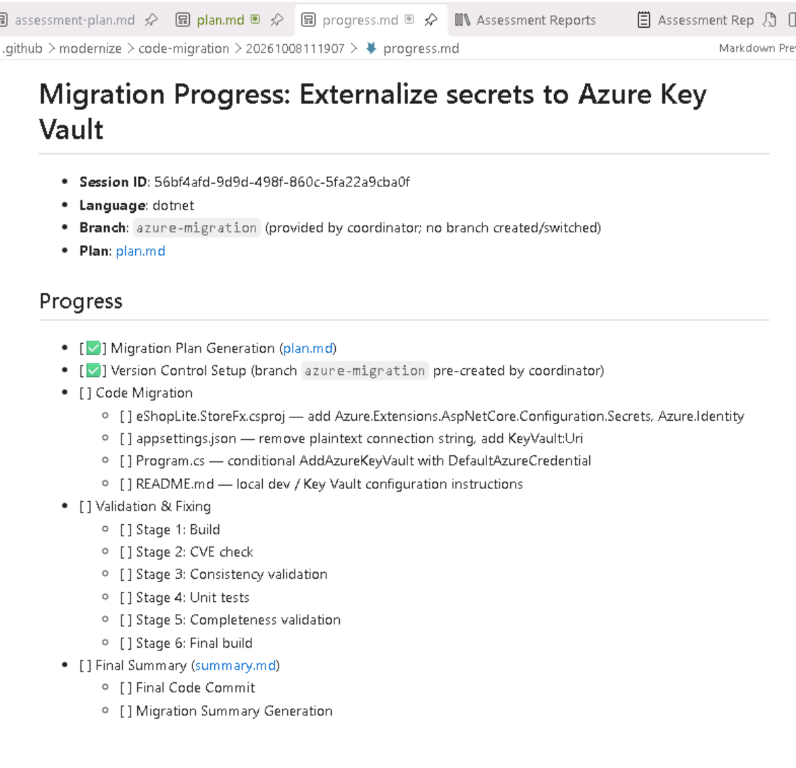

9. **Read the summary.** When every task is done, the agent posts a summary in the chat: the branch your changes are on, whether the app builds, and each task with its commit. Yours will differ from the person next to you. One thing to notice: none of the new Azure code has been tested against real Azure yet, because those services don't exist until later modules.

    Also look for any outstanding issues the summary notes. In a real engagement, you would work through these with the agent until the app reaches a satisfactory state. We're showing you that this can happen, but we'll move on. It won't block the rest of the labs.

    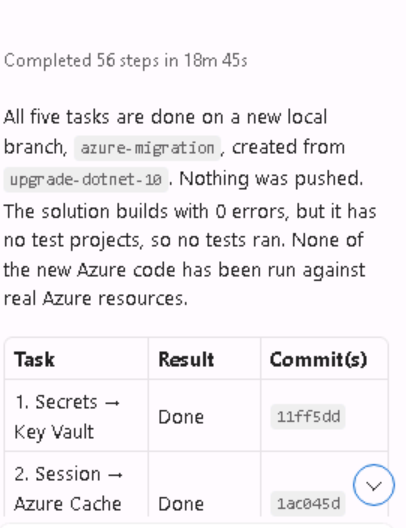

10. **Optional: check it still runs.** Want proof the app still works? Ask Copilot to build and run it, then open the URL it gives you. With the Azure settings empty, the app should still load.

    If the pages that use the database show an error, the agent may have moved the database connection string out of the settings file. Ask Copilot:

    ```plaintext
    Where does the app read the database connection string from now, and how do I set it locally?
    ```

    Then follow its instructions, and tell it to re-run the app.

> 🎉 **That's it — the app's code now supports the Azure services Copilot recommended.**
>
> You started Module 2 with a .NET Framework 4.8 app on Windows Server. It now runs on .NET 10, renders with Blazor, and is wired to use Azure services such as Key Vault. It isn't running in Azure yet, because those services don't exist. In Module 4 you design them as infrastructure as code, and in Module 6 you deploy the app onto them.

## 🔧 Troubleshooting common issues

### YARP errors

YARP is a tool that routes traffic when an old and a new version of an app run side by side. You chose the all-at-once upgrade in Module 2, so this app doesn't need it. If you see YARP errors:

- Ask Copilot to find where YARP is used in the app.
- Ask Copilot to remove the YARP packages, settings, and startup code.
- Rebuild the app after it is removed.

### Missing images or static files

If product images don't appear after modernization:

- Ask Copilot to check that images, styles, and other static files are in the `wwwroot` folder, which is where .NET 10 web apps serve them from.
- Ask Copilot to confirm that the app is set up to serve static files.
- Ask Copilot to check that the image paths in the pages match the files in `wwwroot`.

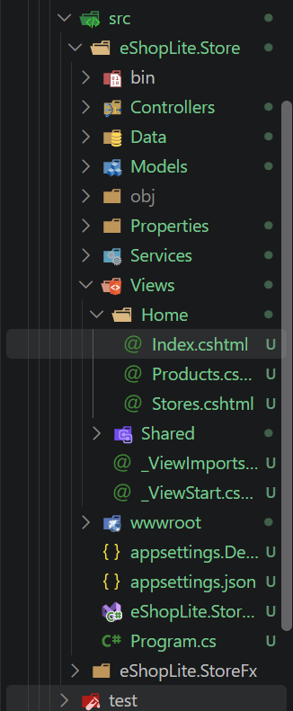

## ✅ Verification

By the end of this section, you should have:

- 🔹 Converted the MVC pages to Blazor components
- 🔹 Assessed where Azure services fit the app (secrets, cache, static content, etc.)
- 🔹 Made the code changes to support those services
- 🔹 Kept the application buildable and its behavior unchanged throughout

> **Next module preview:** Module 4 designs the Azure resources this app now expects, such as the private networks, the identities it signs in with, and the service that runs it. You plan them and have Copilot write them as Bicep files. Your instructor has already set up the real Azure environment, so your Bicep stays as files in your repository to review, not something you deploy. The app itself is deployed in Module 6.
