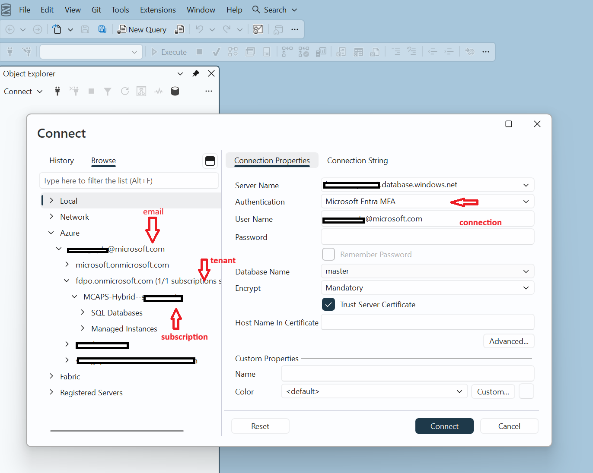
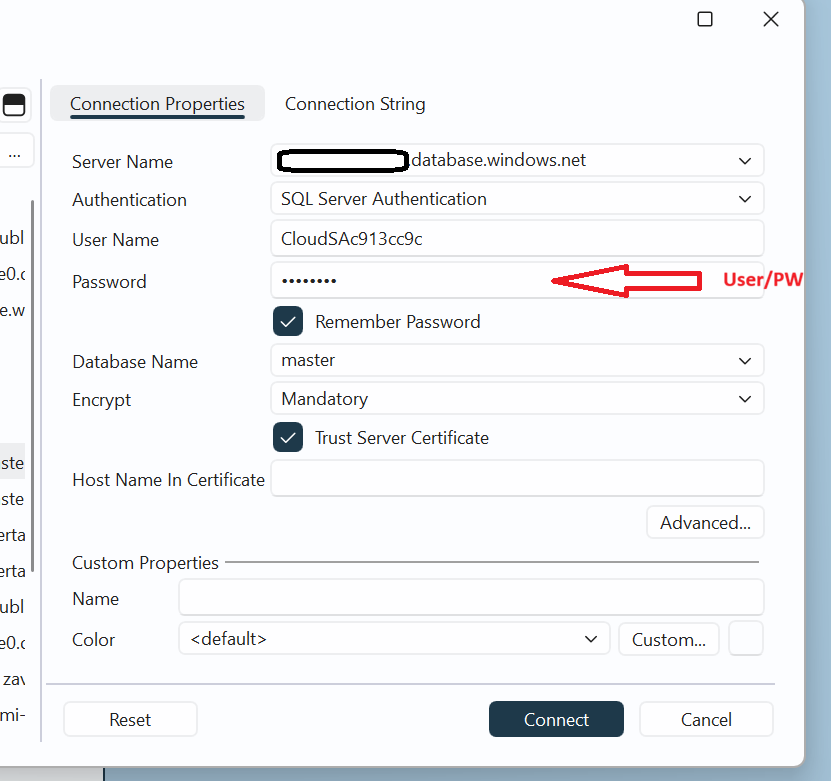
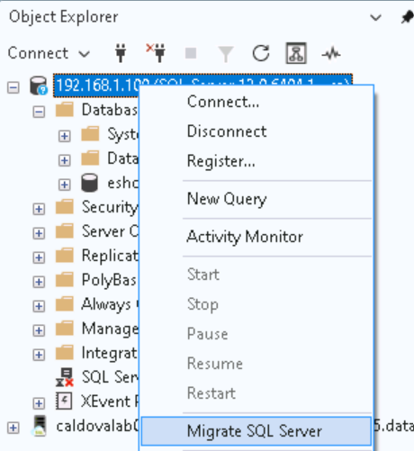
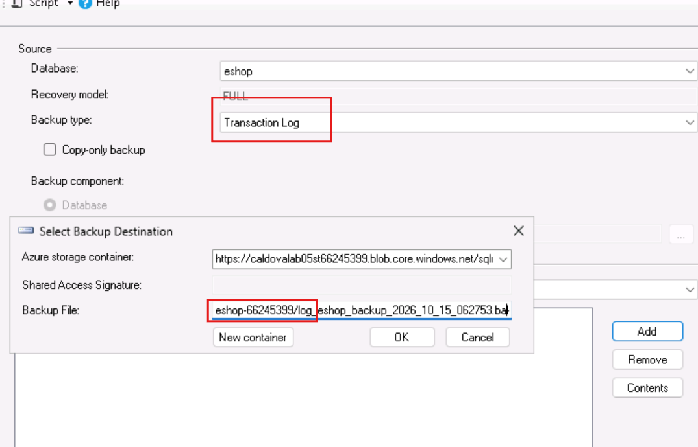
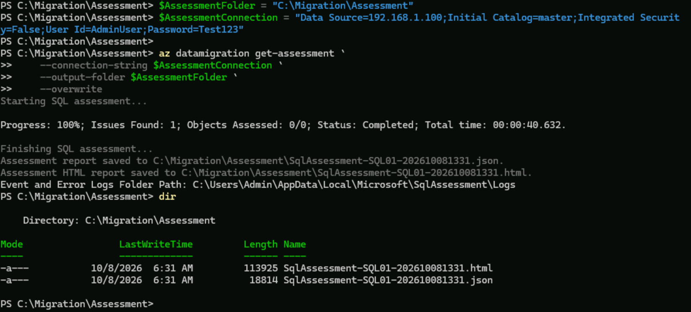
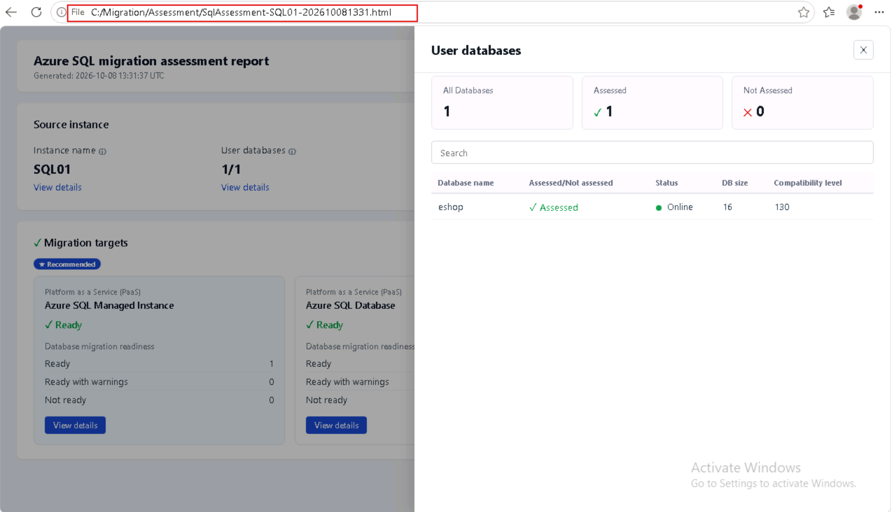
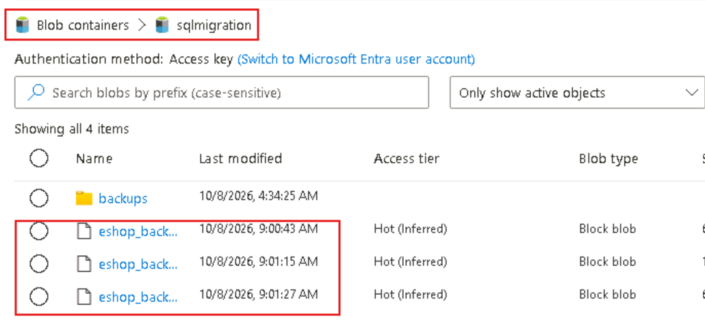

# Lab 05: Database Modernization Bootcamp

> [!NOTE] This lab requires additional Azure resources to be deployed.   
>
> - Azure Database Migration Service
>
> 
> They must follow a certain naming convention.  All resources you create must end with i.e. have a suffix @lab.LabInstance.Id.  Failing to do so, will block you from creating those Azure resources.
>
> - DMS: `caldova-lab05-sqlmig-@lab.LabInstance.Id`
> 
> <b>All resources created for this lab must be deployed in the same region and resource group where Azure SQLDB Hyperscale is provisioned.</b> 
>


An Azure policy in place enforces a certain naming convention for these resources.

## SQL Server to Azure SQL Database — Student Migration Challenges

**Scenario:** Migrate the eShop database from SQL Server on VM to Azure SQL Database by using Azure Database Migration Service (DMS).

Now that the application is upgraded and moved to Azure PaaS services, it is time to modernize and migrate the database. 

***Security rule:*** *Never expose passwords, storage keys, SAS tokens, or connection strings in screenshots or submissions..*

Learning objectives

Students will learn to:

* Gather information about a SQL server database.
* Learn about different authentication mechanisms in SQL server.
* Learn about different types of backups and migration techniques.
* Run an assessment of the source SQL Server database, analyze the report.
* Create Azure Data Migration Service (DMS)
* Run DMS online migration to SQL MI and verify migration. 

## Challenge 1 — Validate the source database

### Student tasks

1. Open SQL Server Management Studio from the task bar. It would have pre-populated login to the source database.
2. Connect to the local SQL Server using "sa" SQL login given to you.
3. Right click on the server and click on "New Query".
4. Execute the following SQL.

```sql
Use master;
select @@version ;
```
5. Right click on database eshop and click on properties to determine database size, collation, disk file name and size of database files and "recovery mode", as shown.

[](./images/Challenge_1_db_properties.png)

6. Note the "page" names displayed when checking on database "properties" section. The "page" list will be different for SQL Managed Instance that we will migrate to, later.
7. From the "Files" section, note down the data files and transaction log file name.
8. You connected to the SQL server using SQL authentication. What are other ways to authenticate to a SQL server?
9. (Research on this) What is a logical and physical backup of SQL database ?
10. (Research on this) different type of recovery modes for SQL database.


## Success criteria

* SSMS connects to the source instance.
* The student records the source version, edition, size etc.
* You can explain at least four different authentication mechanisms and show at least two ways to connect.
* You understand that logical backup (.bacpac) is an export of data structure and data that can be moved across OS/versions of SQL. It is also a point-in-time backup. Under the hood, a .bacpac file is simply a compressed ZIP package containing JSON/XML metadata definition files and data
* A physical backup (.bak) by contrast is page-by-page physical copy of files. Along with transaction log backups, a physical backup can be used to restore database with minimal data loss - as you will do in this lab later.
* You can explain recovery model and different types of backups.

## Challege 2 - Create the target Azure SQL Database

1. ### Launch cloud shell. 

Run this from your command line - Windows Powershell or WSL2 command line, or Mac terminal. Alternately you can also launch cloud shell from the azure portal.

```bash
az login
```

2. ### Set to your subscription (if not already set)

If your login did not take you to the correct subscription, set to the subscription you need

```bash
az account set --subscription <subscription_id>
```

3. The first resource we need is an Azure SQL logical server. Most internal Microsoft subscriptions require that this server be created with Entra-id only authentication. Your microsoft alias email will be the admin first, then we will add a SQL authentication login. First we need to find out your email and entra id login id.

```bash
email=`az ad signed-in-user show --query mail -o tsv`
eid=`az ad signed-in-user show --query id -o tsv`
```

We need to know the resource group and the location where you want your Azure SQL logical server to be created.

```bash
read -r -p "Enter resource group: " rg
read -r -p "Enter azure region: " loc
read -r -p "Enter a unique name for Logical SQL Server: " servername
```
Now we can create the server

```bash
az sql server create -g "$rg" -n $servername --location "$loc" \
  --minimal-tls-version "1.2" --enable-public-network true \
  --enable-ad-only-auth --external-admin-principal-type User \
  --external-admin-name "$email" --external-admin-sid "$eid" \
  --tags securityControl=Ignore
```

If you are running these commands from your command shell as opposed to azure cloud shell, you need to add a firewall rule so you can connect to the SQL server.

```bash
my_public_ip=`curl -4 -fs  https://ifconfig.me`
az sql server firewall-rule create -g "$rg" -s "$servername" -n "allow_on_prem"  --start-ip-address "$my_public_ip" --end-ip-address "$my_public_ip"
```
Now you can connect to the SQL server using any client tool like SSMS. SSMS is Microsoft’s SQL Server Management Studio, a 64-bit graphical tool for managing, developing, and administering SQL Server and Azure databases. The app icon looks like this:

 

Since your SQL server onlu allows "AAD" authentication, you can connect to it that way.
Launch SSMS and click on "connect" and then on "database engine".

Under "Connect", follow browse --> Azure and then as this picture shows, find your SQL server.
Remember to use the right email, tenant, subscription and "Microsoft Entra MFA" as authentication option. Also check the icon next to "Trust Server Certificate"



You will notice that there is only a single database - "master" listed there.

Now we will use more CLI commands, first we will create a serverless, 2 vcore Gen5 sql database called "shop" in that sqlserer in hyperscale tier.

```bash
az sql db create -g "$rg" -s "$servername" -n "eshop" \
  --edition Hyperscale --compute-model Serverless --family Gen5 --capacity 2
```
We can connect, create database - all fine. However, in order to migrate our on-premises database to azure, we will use an azure service called DMS - Data Migration Service.

DMS cannot use aad-only authentication. It requires SQL authentication. We need to get the SQL username and password.

But also, we need to disable "aad-only" authentication - so SQL login can work.

```bash
az sql server ad-only-auth disable -g "$rg" -n "$servername" -o none
```

Finally, we should retrieve the SQL login. Azure automatically created it when the service was created.

```bash
sqladmin=`az sql server show -g "$rg" -n "$servername" --query administratorLogin -o tsv`
echo "Your SQL admin user is: " $sqladmin
```

And now we can set a password for this login

```bash
read -r -s -p "Enter the password you want for SQL Admin user: " sqlpw
echo
```

We are ready to set the password now as shown below.

```bash
az sql server update -g "$rg" -n "$servername" --admin-password "$sqlpw" -o none
```

Verify connecting to the SQL server using the password. Launch SSMS but connect using the "SQL Server Authentication" Method as shown here.




## Challenge 3 — Pre-migration assessment of the source database 


### Student tasks

1. ### Using SSMS, connect to the SQL Server 2016  that resides on a VM in this lab environment. The connection to "on-premises" SQL server is preconfigured in the lab. Right click on the server and choose "Migrate SQL Server".

 


2. #### Do not Migrate or Upgrade the database.

Run a "Migration readiness assessment". An html file will open in your browser once the assessment completes. This is the report.

 

3. ### Investigate the report. Find out compatibility issues with different SQL targets. 


## Challenge 4 — Create the required azure resources - DMS

In this part of the lab you will create the necessary Azure resources to perform the migration. Deploy the resources in the same region that Azure SQL MI is deployed.  You will:

- Create a resource provider (if it does not exist) in the subscription for DMS.
- Deploy an Azure Database Migration Service (DMS) to migrate the database.


### Student tasks

#### <u>Special Note:</u> 👉👉 The DMS needs to be in the same region and resource group as the target SQL DB


#### 1. Resource provider for DMS

We will register your subscription to use DMS if you have never created it.

```bash
az provider register --namespace Microsoft.DataMigration --wait
```
Once registered, we can now create a dms service 

```bash
read -r -p "Enter the name of the Data Migration Service you want to create: " dms
az datamigration sql-service create -g "$rg" -n "$dms" --location "$loc"
```

## Success criteria

- Resource provider is registered for data migrations.
- DMS is deployed in the same region and resource group as SQL MI.


## Challenge 4 — Offline Migration from on-premises SQL Server to SQL Managed Instance

In this challenge you will perform database backups to the Azure Storage account provisioned earlier.  You will then use DMS to perform an *Online* migration. To perform an online migration, DMS restores the full and any differential backups before restoring and playing transaction logs to complete the migration. 

### Student tasks

#### 1. Install Self-hosted Integration Runtime ( SHIR ) on the lab VM <---HERE >


### 2. Migrate the database online using DMS

<b>2a.</b> Navigate to the Azure portal to the DMS service created earlier.  Select "New Migration".


<b>2b.</b> Next, choose the migration scenario - from Sql Server to Azure SQL MI.
Choose <b>Blob</b> as backup location and <b>online</b> as backup mode.


<b>2c.</b> On the next page, configure details as shown. 

> [!Note]
> 
> DMS needs to configure a SQL Instance `caldovalab05sql@lab.LabInstance.Id` to track progress of migration for restartability. 
> 
> What you are entering here is information for that tracking database - not  your source or target database. You need not manage this instance for this lab. 

> [!Note]
> 
> - This tracking database can be in a different region also. 
> - Furthermore, if for some reason you want to try the migration again, you would need to provide a new tracking SQL instance.


<b>2d.</b> Select the Azure SQL managed Instance that already exists as a target.


<b>2e.</b> Specify the location of the backup files in the Azure storage account as well as the target database name `eShop`. 


<b>2f.</b> Start the migration. 


<b>2g.</b> Follow the migration progress. Notice the migration details.


<b>2e.</b> If all is well,  the full backups would have been restored.


<b>2f.</b> The migration is not complete yet.  

Since this is an online migration with minimal outage, the migration will move any incremental data that was added since the migration started. In this lab, you will add some data to source and use backup of transaction logs to move that new data across. 


First, you will add some data on the source SQL server

<b>2g.</b> Go to the source database and add a new row to a table. Use SSMS 22 to launch a query window and run the command. 

You can enter a few more rows if you want.

```sql
INSERT INTO
 dbo.store 
VALUES
 ( 'Test', 'Test', 'Test', 'Test' ) ;
```

<b>2h.</b> Next we need to backup the transaction logs to the storage account, in the same folder/location as the database backups.  Use SSMS to do this as well. Opt for *Transactions Logs* as the back up type.

> [!NOTE]
>
> Prefix the file name with the blob folder `eshop-@lab.LabInstance.Id` and "log_" so you can identify the file easily.



<b>2i.</b> You can follow the progress of the log replay from the portal, same place as where the progress of the migration was being followed.

> [!NOTE]
>
> - When you take a backup of the source database, DMS may take a minute or two to see the backup.
>
> - Notice the order of restore operation of DMS - first full, then differential, then logs - in the same order that the backup was taken. 


<b>2j.</b> Wait until all transaction logs have all been restored and no files are left ( as seen in azure storage ) to restore.

***Perform the cutover. Wait for it to complete.***


<b>2k.</b> Navigate to the Azure SQL Managed instance and confirm the database is there and in good state. Click on *Databases* in the left to list all databases on this managed instance.


<b>2l.</b> Go back to SSMS 22.  Connect to the Azure SQL Managed Instance and eShop database using Entra. Explore the tables and make sure they are all there.  Confirm the row you added above is also present.

Run this following query to confirm the new row(s) you added

```sql
SELECT 
 *
FROM
 dbo.store 
WHERE 
 name like 'Test%' ;
```

<b>Congratulations - you have migrated to Azure SQL.</b>

Now let us create an entra-id user for the application to connect to it. The application identity is `caldova-lab04-runtime-@lab.LabInstance.Id]`.

Launch SSMS to connect to `eshop` database in SQL MI.  You will

- Create a login in the master database. 
- In eshop database create  a user from that login
- Give that user read and write access to the eshop database


```sql
USE [master];

CREATE LOGIN [caldova-lab04-runtime-@lab.LabInstance.Id] FROM EXTERNAL PROVIDER;

 
USE [eshop];

CREATE USER [caldova-lab04-runtime-@lab.LabInstance.Id]
    FROM LOGIN [caldova-lab04-runtime-@lab.LabInstance.Id];

 
ALTER ROLE db_datareader ADD MEMBER [caldova-lab04-runtime-@lab.LabInstance.Id];
ALTER ROLE db_datawriter ADD MEMBER [caldova-lab04-runtime-@lab.LabInstance.Id];

```

## Challenge 5 - Perform online migration using CLI (Optional)

If you completed challenges 1- 4 in under 2.5 hours, you can proceed with challenge 5.  Otherwise click on *Next* in the set of instructions and move on to the apps portion of day 2.  You can always navigate back to this page and complete challenge 5 if you have time.

### VM SQL Server to Azure SQL Managed Instance with Azure DMS Via CLI 

### Objective

Migrate on-premises SQL Server databases to Azure SQL Managed Instance using Azure CLI and Azure Database Migration Service (DMS). The flow includes assessment, remediation, provisioning, data migration, cutover, and post-migration validation.

#### End-to-End Flow

```text
Compatibility assessment
        |
Remediate blockers and reassess
        |
Prepare storage and backups
        |
Create Azure Database Migration Service
        |
Start online migration
        |
Monitor backup restoration
        |
Cut over applications
        |
Validate
```

For simplicity, the exercise will use the same Database Migration Service (DMS) and the same storage account 
and backups as the previous exercise.

The challenge uses Azure CLI from PowerShell. The <b>az datamigration</b> command group is an Azure CLI extension and requires Azure CLI 2.75.0 or later.

### 1. The Migration Mode

| Mode | Behavior | Downtime |
|---|---|---|
| Online | DMS restores a full backup and continually restores transaction-log backups. An explicit cutover completes the migration. | Usually limited to final cutover |

Use online migration when the source database must remain available while data is copied.

### 2. Prerequisites

Before starting:

1. Locate the Azure SQL Managed Instance already provisioned in your lab environment's subscription.
3. Establish connectivity by using SSMS 22 installed on the lab VM's desktop, use the Entra with Password account.

.


### 3. Install and Configure Azure CLI

```powershell
az version
az upgrade

az extension add --name datamigration --upgrade

az login

az provider register --namespace Microsoft.DataMigration

az provider show `
    --namespace Microsoft.DataMigration `
    --query registrationState `
    --output tsv
```

The expected provider registration state is <b>Registered</b>.

### 4. Run the Migration Assessment

The assessment runs locally and does not require a DMS resource.

<b>4a.</b> Using SSMS 22, connect to the *master* database in a query window and create a sysadmin user.
Avoid using special characters in the user and password in these exercises as to not spend time escaping characters
in the commands that need to run from command line.  Use this account to perform the assessment.

```sql
USE [master]
GO
-- Step 1: Create a SQL Server Login
CREATE LOGIN [AdminUser]
WITH PASSWORD = '<put a password of your choosing here>';

-- Step 2: Add the Login to the Sysadmin Role
ALTER SERVER ROLE [sysadmin]
ADD MEMBER [AdminUser];
GO
```

<b>4b.</b> Connectivity to the SQL server will use SQL Server authentication. 

 The *AdminUser* account created above will be used.  

Run the cmdlet below to start an assessment. 

- The command below assumes your source IP address, correct it if needed.
- Put your password that you chose below within the double quote "" below. 

#### SQL Server Authentication

```powershell
$AssessmentFolder = $HOME

$AssessmentConnection = "Data Source=192.168.1.100;Initial Catalog=master;Integrated Security=False;User Id=AdminUser;Password=<put password here>"

az datamigration get-assessment `
    --connection-string $AssessmentConnection `
    --output-folder $AssessmentFolder `
    --overwrite
```



<b>4c.</b> Review the resulting HTML or JSON for:

- Server-level assessment issues
- Database-level assessment issues
- TargetReadinesses.AzureSqlManagedInstance
- Warnings and errors
- DatabaseRestoreFails
- Impacted objects
- Recommended remediation



<b>4d.</b> Pay particular attention to unsupported features, cross-database dependencies, CLR, linked servers, SQL Agent dependencies, Windows authentication dependencies, file layouts, database sizes, and encryption.

<b>4e.</b> Resolve blocking issues and rerun the assessment. Retain the before-and-after reports as migration evidence.

## 5. Collect Performance Data and Obtain SKU Recommendations (optional)

The extension provides these commands:

```powershell
az datamigration performance-data-collection --help
az datamigration get-sku-recommendation --help
```

Collect performance data during normal operations, peak business hours, batch windows, reporting periods, and maintenance activity.  
There is no load placed on the database for this lab hence nothing meaningful will be produced.

Use the results to select:

- General Purpose or Business Critical
- vCore count
- Storage capacity and performance tier
- Zone redundancy

Include enough headroom for workload growth and operational spikes.


## 6. Perform an Online Migration using Azure CLI
These are the overall steps of an online migration using DMS from Azure CLI.

1. Take a full backup.
2. Take a differential backup.
2. Upload it to the migration Blob container at the *root*.
3. Continue taking transaction-log backups.
4. Upload each log backup in sequence.
5. Do not break the transaction-log chain.
6. During cutover, stop writes and take a final tail-log backup.

#### Backups

Unlike backing up the database files into a folder in an Azure Storage Account BLOB container  when running DMS from the portal, running DMS from the CLI requires that the backup files reside in the root of the container.  Copy the existing backups from the earlier exercise to the root of the BLOB container. Optionally, create new full, differential and transaction log backups and place them at the root of the container.  Either will work.


 
## 7. Start an Online Migration

Get the environment information.  Fill in all information for the variables according to your environment. Start the migration.

```powershell
$StorageAccount = "caldovalab05st@lab.LabInstance.Id"
$StorageResourceGroup = az storage account list --query "[?name=='$StorageAccount'].resourceGroup | [0]" --output tsv
$MiResourceGroup = "rg-caldova-lab04-secondary-@lab.LabInstance.Id"
$ManagedInstance = "caldovalab04mi@lab.LabInstance.Id" 
$MigrationResourceGroup = az resource list --name "caldova-lab05-sqlmig-@lab.LabInstance.Id" --resource-type "Microsoft.DataMigration/sqlMigrationServices" --query "[0].resourceGroup" --output tsv
$MigrationService = "caldova-lab05-sqlmig-@lab.LabInstance.Id"

$StorageAccountId = az storage account show `
    --resource-group $StorageResourceGroup `
    --name $StorageAccount `
    --query id `
    --output tsv

$ContainerName = az storage container list `
    --account-name  $StorageAccount `
    --auth-mode login `
    --query "[].name" `
    --output tsv

$ManagedInstanceId = az sql mi show `
    --resource-group $MiResourceGroup `
    --name $ManagedInstance `
    --query id `
    --output tsv

$ManagedInstanceLocation = az sql mi show `
    --resource-group $MiResourceGroup `
    --name $ManagedInstance `
    --query location `
    --output tsv

$MigrationServiceId = az datamigration sql-service show `
    --resource-group $MigrationResourceGroup `
    --sql-migration-service-name $MigrationService `
    --query id `
    --output tsv

$StorageAccountKey = az storage account keys list `
    --resource-group $StorageResourceGroup `
    --account-name $StorageAccount `
    --query "[0].value" -o tsv

$SourceLoc = @{
    AzureBlob = @{
        storageAccountResourceId = $StorageAccountId
        accountKey = $StorageAccountKey
        blobContainerName = $ContainerName
    }
} | ConvertTo-Json -Depth 10 -Compress


$SourceLocation = $SourceLoc.Replace('"', '\"')

$SourceDatabase = "eShop"
$TargetDatabase = "eShopCLI"

az datamigration sql-managed-instance create `
    --managed-instance-name $ManagedInstance `
    --resource-group $MiResourceGroup `
    --target-db-name $TargetDatabase `
    --scope $ManagedInstanceId `
    --migration-service $MigrationServiceId `
    --source-database-name $SourceDatabase `
    --source-location $SourceLocation
```
### 8. Monitor the Migration

The same information retrieved from the CLI can also be viewed in the portal.

```powershell
az datamigration sql-managed-instance show `
    --managed-instance-name $ManagedInstance `
    --resource-group $MigrationResourceGroup `
    --target-db-name $TargetDatabase `
    --expand MigrationStatusDetails
```
### 9. Cutover

During the controlled change window, these are the typical steps:

1. Stop application writes.
2. Disable jobs and integrations that write to the source.
3. Drain application connections.
4. Take a tail-log backup.
5. Upload the tail-log backup.
6. Wait for DMS to restore it.
7. Record final validation values.
8. Initiate cutover.

Once all 3 backups have been restored, perform the cutover.

Get the migration operation ID:

```powershell
$MigrationOperationId = az datamigration sql-managed-instance show `
    --managed-instance-name $ManagedInstance `
    --resource-group  $MiResourceGroup `
    --target-db-name $TargetDatabase `
    --expand MigrationStatusDetails `
    --query "properties.migrationOperationId" `
    --output tsv
```

Perform the cutover:

```powershell
az datamigration sql-managed-instance cutover `
    --managed-instance-name $ManagedInstance `
    --resource-group  $MiResourceGroup `
    --target-db-name $TargetDatabase `
    --migration-operation-id $MigrationOperationId
```


### 10. Post-Migration Validation

Use SSMS 22 to connect to the eShopCLI database.  Explore the migrated objects.
