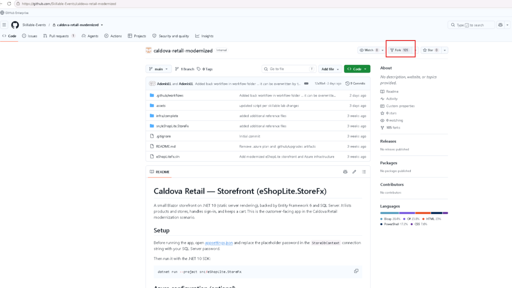
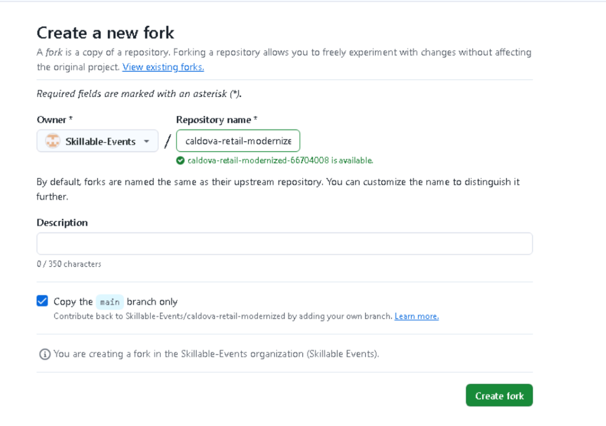
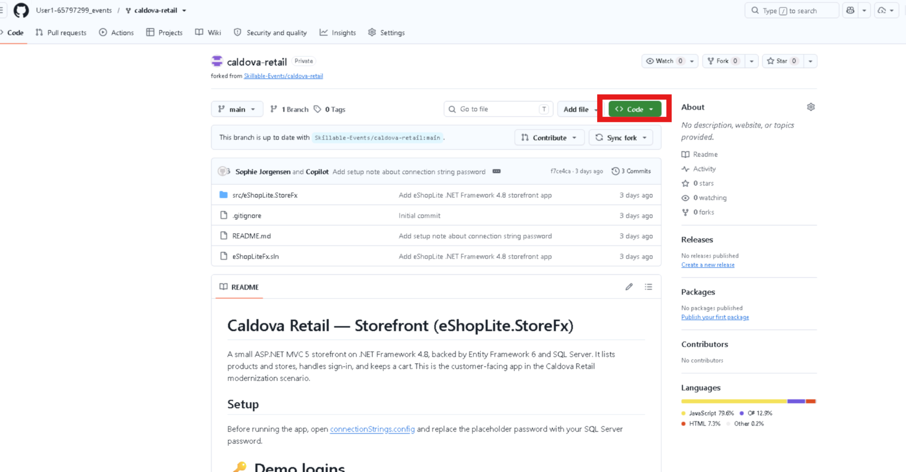
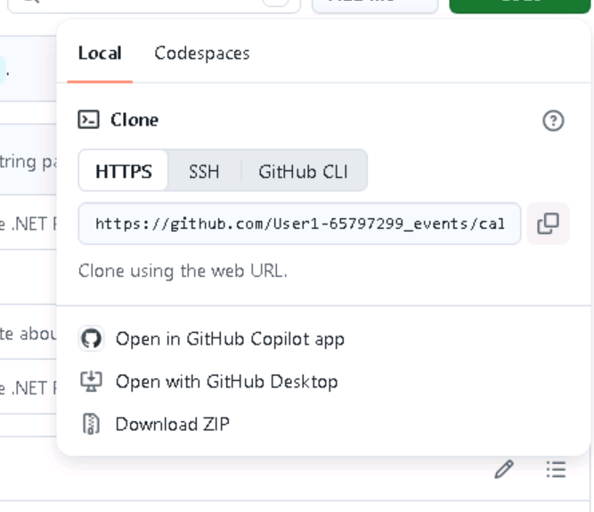
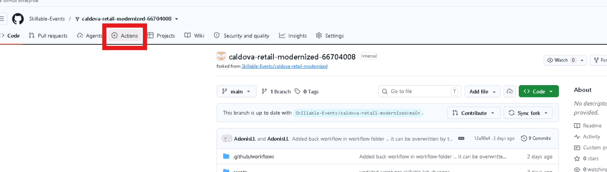
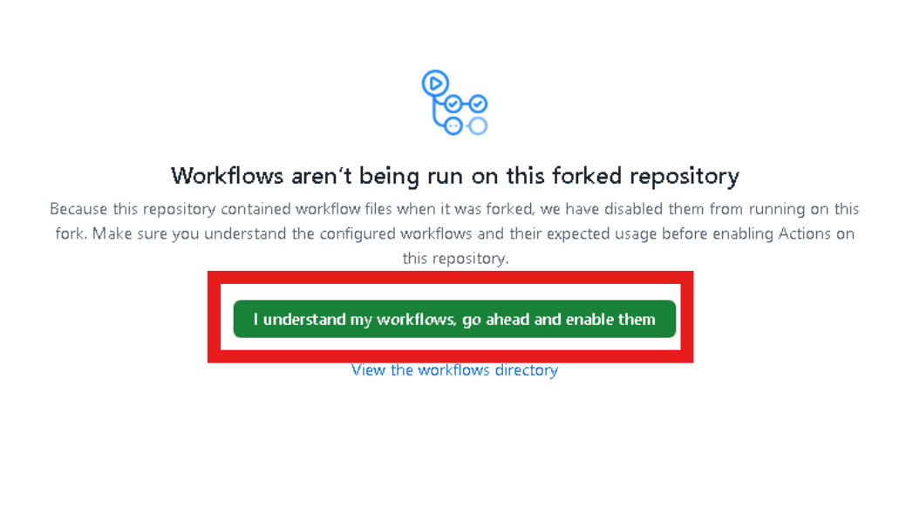
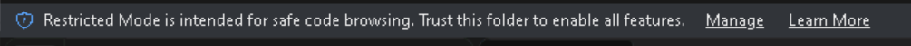
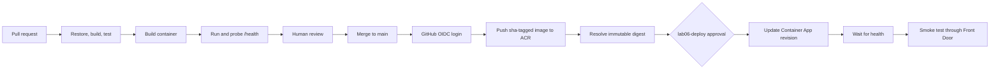
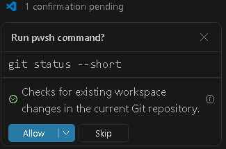

# 🚀 Lab 06: Deploy Code with GitHub Actions

In this lab, you will use GitHub Copilot to create a GitHub Actions CI/CD workflow that takes the modernized retail application from source code to a running release on Azure. You will build on the secure platform examined in Lab 04 and supplied by the instructor-preprovisioned environment, along with the eshop database migrated in Lab 05. The workflow will validate the application, build and test a container, push an immutable image to the existing Azure Container Registry, and deploy that image to Azure Container Apps, replacing the placeholder image.

GitHub Copilot helps you turn the application's requirements and the existing platform's deployment contract into a working workflow rather than starting from a generic YAML template. You will use **Agent** mode to inspect the repository and generate the container files, then **Plan** mode to propose the workflow for your review before returning to **Agent** mode to implement it. This approach reduces repetitive authoring and helps connect application-specific build steps with OIDC authentication, image publishing, and deployment requirements. You remain responsible for reviewing each generated job, asking Copilot to correct gaps, and validating the workflow and deployed application before considering the release complete.

This lab takes approximately **60-75 minutes**.

## 🎯 Objectives

By the end of this lab, you will be able to:

- separate pull-request validation from deployment
- create a repeatable multi-stage .NET container build
- test a container before publishing it
- authenticate GitHub Actions to Azure with OIDC
- push an immutable image to ACR without registry passwords
- deploy an image by digest rather than by a mutable tag
- update an existing Container App without recreating its infrastructure
- verify revision health and roll back safely

## ✅ Prerequisites

- completed the planning, Bicep generation, validation, and review walkthrough in Lab 04
- access to the instructor-preprovisioned Lab 04 platform
- completed Lab 05, including the managed-identity database user
- Azure access to read the Lab 04 deployment and configure federated credentials
- GitHub ADMIN permission on the repository
- your own fork of the modernized retail app (cloned in Setup below)
- GitHub Actions enabled for the repository


That is the Module 3 end state: the storefront on .NET 10, rendered with Blazor, with its code already updated to use Azure services such as Key Vault and managed identity. If you modernized the root application in place, use its corresponding solution and project paths instead.

## 🛠️ Setup

> This lab configures GitHub OIDC on your repository and runs a CI/CD workflow from it, so you need admin rights on your participant-specific fork in **Skillable-Events**. Run this module against **your own fork** rather than the workshop repository.

**1. Sign in to the workshop repository.** Open a new tab in Microsoft Edge and type this link in your browser `https://github.com/Skillable-Events/caldova-retail-modernized`

1. On the Skillable Events single sign-on page, select **Continue**.

   

   > 💡 If the sign-in keeps returning to the same page or shows an error, wait a few minutes and try again; this is a transient error. If it takes you to the Skillable GH Enterprise main page [Skillable-Events GH](https://github.com/enterprises/Skillable-Events) search for "caldova-retail-modernized" in the search bar and access the repository that way.

2. In the **Sign in** box, enter the **Username** listed under **Azure portal** on the **Resources** tab of your lab instructions, then select **Next**.
3. Enter the **Password** from the same **Azure portal** section. If you are asked for a **Temporary Access Pass**, enter the **TAP** value instead. If it prompts you to stay signed in, hit **Yes**.

**2. Fork and clone the repository.**

1. On the repository page, select **Fork**. On the **Create a new fork** page, select **Skillable-Events** as the **Owner** and append your **Skillable instance ID** to the **Repository name**, using the format **caldova-retail-modernized-<your-skillable-instance-id>** (for example, **caldova-retail-modernized-12345678**). Confirm both values before selecting **Create fork**.

   

   

2. In your new fork, select **Code**, then copy the **HTTPS** URL. It should look something like `https://github.com/Skillable-Events/caldova-retail-modernized-12345678.git`, with your own instance ID in the repository name.

   

   

3. Enable GitHub Actions is the new repository





4. Open PowerShell from your applications and clone your fork, pasting the URL you copied into it (run this from the default location -- C:\Users\Admin):

   ```powershell
   git clone <your-fork-url>
   ```

   If you are asked to sign in, choose **Sign in with your browser**, approve the authorization (select **"Authorize git-ecosystem"**), then return to PowerShell. The clone starts once you are signed in.
   > 💡 If you face any errors here, the sign in may not have persisted. If that is the case, re-type in the original repo link, +++https://github.com/Skillable-Events/caldova-retail-modernized+++, follow the sign in, click the button to stay signed in, and then run the Powershell command again.

**3. Open the storefront folder in VS Code.** Run these commands in PowerShell, replacing <your-skillable-instance-id> with the instance ID you used in the repository name:

```powershell
cd "caldova-retail-modernized-<your-skillable-instance-id>"
code .
```

If **code** is not recognized, start VS Code from your applications and use **File → Open Folder…**, then pick the **caldova-retail-modernized folder with your instance ID appended**. If VSCode asks you to sign into GitHub again, authorize access there as well.

If VS Code opens the folder in **Restricted Mode**, select **Manage** in the banner at the top of the window, then select **Trust**. Once the page shows **In a Trusted Folder**, close that tab.




You are in the right place when the Explorer shows **eShopLiteFx.sln** next to a **src** folder.

> 📂 **Where to run commands:** Every PowerShell command in this lab assumes your current folder is the cloned **caldova-retail-modernized folder with your instance ID appended**. The simplest option is the VS Code integrated terminal (**Terminal → New Terminal**), which already opens in that folder. If you use a standalone PowerShell window instead, first run `cd "caldova-retail-modernized-<your-skillable-instance-id>"`, replacing the placeholder with your instance ID. Throughout this lab, blocks marked **💻 Run this in the terminal** are commands you run yourself, while blocks marked **🤖 Paste this into Copilot Chat** are prompts you send to Copilot — not terminal commands.

## 🔑 Authorize VS CODE

In VSCODE select the agent in the bottom right, and click the "Use AI Features" button.


The **Sign in to use GitHub Copilot** prompt opens and select Continue with GitHub


The browser opens displaying an "Authorize with Visual Stusio Code" prompt. Select Continue


Finally select **Authorize Visual Stusio Code** on the next prompt.


## 🔑 Bootstrap GitHub OIDC

The Azure platform is already provisioned, but its GitHub federation cannot be
copied generically between repositories. An OIDC federated credential includes
the repository and GitHub environment in its subject, so this setup must be
completed for the repository that will run the Lab 06 workflow.

The preprovisioned platform includes separate build and deployment identities.
Bootstrap your repository 

> 💻 **Run this in the terminal.**

```powershell
az login
```

Choose **Work or School Account** and follow the prompts to login to az cli.

```powershell
gh auth login
```

Follow the GitHub CLI sign-in prompts below. Their order may vary by CLI version:

1. **Where do you use GitHub?** Select **GitHub.com**.
2. **What is your preferred protocol for Git operations on this host?** Select **HTTPS**.
3. **Authenticate Git with your GitHub credentials?** Type **Y** and press **Enter**.
4. **How would you like to authenticate GitHub CLI?** Select **Login with a web browser**.
5. Copy the **one-time code** displayed in the terminal, then press **Enter** when prompted to open `https://github.com/login/device` in your browser.
6. Paste the code into the browser's device activation page, select **Continue**, and follow the prompts to authorize GitHub CLI using your lab GitHub account.
7. Return to the terminal and wait for confirmation that authentication succeeded before continuing.

```powershell
gh repo set-default origin
```

```powershell

$subscriptionId = az account show --query id --output tsv
```

```powershell
.\assets\scripts\Initialize-Lab06RepositoryFromResourceGroups.ps1 `
  -SubscriptionId $subscriptionId `
  -AllowDeploymentWithoutRequiredReviewer `
  -DeploymentBranch 'main'
```

> [!NOTE]
> ℹ️ **Informational — for reference only:** The following list explains what the script does automatically. These are not additional steps for you to perform.

The script:

1. examines successful deployments in the preprovisioned resource groups and
   matches bootstrap, primary, secondary, and global deployments by their Bicep
   output contracts
2. validates the existing identities, target resources, and scoped role
   assignments without creating or changing them
3. reads GitHub's effective OIDC subject prefix, including immutable owner and
   repository IDs when enabled, then binds the build identity to lab06 and
   the deployment identity to lab06-deploy with environment-scoped
   federated credentials
4. creates both GitHub environments, restricts lab06-deploy to main, and
   allows deployment without a required reviewer
5. publishes and verifies the non-secret variables required by the workflow

The script selects the newest matching deployment in each resource group and
verifies that all four deployments have the same prefix and suffix
parameters before changing GitHub. If deployment history requires an older
record, pass one or more of
-BootstrapDeploymentName, -PrimaryDeploymentName,
-SecondaryDeploymentName, and -GlobalDeploymentName.

Each resource group is discovered independently from its
rg-caldova-lab04-bootstrap-, rg-caldova-lab04-primary-,
rg-caldova-lab04-secondary-, or rg-caldova-lab04-global- prefix. If more
than one resource group matches a prefix, supply the corresponding
-BootstrapResourceGroup, -PrimaryResourceGroup, -SecondaryResourceGroup,
or -GlobalResourceGroup override.

This keeps the main branch restriction but does not add a manual approval
gate. The script emits a warning when it configures the environment without a
required reviewer.

<!-- To test discovery and print the selected deployments and reconstructed values
without changing Azure resources or GitHub, run:

> 💻 **Run this in the terminal.**

```powershell
.\assets\scripts\Test-Lab06ResourceGroupDeploymentValues.ps1 `
  -SubscriptionId $subscriptionId
``` -->

The probe emits JSON and accepts the same four optional deployment-name
overrides.

## 🧭 Delivery Flow



## 🔐 Identity and RBAC

> [!NOTE]
> ℹ️ **Informational — for reference only:** This section explains what the bootstrap script does automatically. You do not need to create identities or assign permissions yourself.

The bootstrap script connects your GitHub repository to the existing Lab 04 environment using **passwordless sign-in**. It:

- **Checks existing resources and permissions.** RBAC (*role-based access control*) determines what each identity can do and where. The build identity has **AcrPush** on the registry to publish images. The separate deployment identity has **Container Apps Contributor** on the retail Container App to deploy a revision and **Reader** on Front Door to locate the endpoint for testing. The script verifies these roles; it does not create them or reuse the infrastructure identity.
- **Sets up GitHub-to-Azure trust.** Federated credentials link the build identity to your repository's lab06 environment and the deployment identity to lab06-deploy. With **OpenID Connect (OIDC)**, Azure checks GitHub's repository and environment claims before issuing a short-lived token. No Azure client secret or registry password is stored in GitHub.
- **Configures the workflow environments.** The lab command restricts lab06-deploy to main without requiring manual reviewer approval. The script also publishes and verifies non-secret GitHub variables identifying the Azure resources and the correct identity for each environment.

The application's runtime identities remain separate. Their permissions allow the running app to pull images and access services and data; this script does not configure those permissions or grant database access.

> [!TIP]
> For additional insight, review [Initialize-Lab06RepositoryFromResourceGroups.ps1](../../../assets/scripts/Initialize-Lab06RepositoryFromResourceGroups.ps1) directly to see how discovery, permission checks, OIDC trust, and GitHub configuration are implemented.

## Challenge 1: Create the Container Contract

The application has no Dockerfile. Generate one rather than copying a template, because the container has to satisfy two things at once: how the application starts, and what the preprovisioned Lab 04 platform expects to run.

Open GitHub Copilot in **Agent** mode. In Copilot Chat, open the mode dropdown (near the message box) and choose **Agent**. Agent mode can read the files in this repository and create or edit files for you, which is why it is the right mode for generating the Dockerfile.

> [!IMPORTANT]
> **Read the prompt before pasting it.** Notice the context it gives the agent: which application details to inspect, where to find the infrastructure expectations, and what security and build requirements to follow. It also asks the agent to flag disagreements between the app and the platform. Understand what you are asking it to do rather than simply copying and pasting; use these requirements to review its output.

> 🤖 **Paste this into Copilot Chat.**

```text
Scan this application and the infrastructure deployed in Lab 04, then create a Dockerfile
and a .dockerignore for the retail app.

Read the application first: target framework, project layout, entry point, the health
endpoints it exposes, and every setting it reads from configuration.

Then read infra/complete to see what the platform expects: the ingress port, the
container registry, and how the Container App authenticates to Azure.

Requirements:
- multi-stage build, using the SDK image only for restore and publish and the ASP.NET
  runtime image for the final stage
- run as a non-root user
- listen on the port the Container Apps ingress targets
- no secrets, connection strings, or credentials baked into the image; anything the app
  needs at runtime arrives as an environment variable or through managed identity
- a .dockerignore that excludes source-control metadata, build output, and local secret files

Tell me about any place where the application and the infrastructure disagree.
```

Review the chat window, review any prompts that are presented to allow the agent task.


Check the result against the contract before you build it:

- mcr.microsoft.com/dotnet/sdk:10.0 only for restore and publish
- mcr.microsoft.com/dotnet/aspnet:10.0 for the smaller runtime image
- a non-root runtime user
- port 8080 for platform ingress, and /health for pipeline and release probes
- a build context that excludes source-control metadata, build output, and local secret files

> 💡 The credentials question is the interesting one. The app needs a database
> connection at runtime, but the image must not contain it. Lab 04 Bicep owns
> the passwordless connection-string environment variable and runtime identity;
> Lab 05 grants that identity access after migrating eshop. GitHub Actions
> changes only the image. If Copilot bakes configuration into the image or
> rewrites environment variables during release, that is the failure to catch.

<!-- Build the application before building its image:

> 💻 **Run this in the terminal.**

```powershell
dotnet restore .\eShopLiteFx.sln
```

```powershell
dotnet build .\eShopLiteFx.sln `
  --configuration Release `
  --no-restore
``` -->

<!-- Then build and test the container locally:

> 💻 **Run this in the terminal.**

```powershell
$context = '.\'
```

```powershell
$dockerfile = Join-Path $context 'src\eShopLite.StoreFx\Dockerfile'
```

```powershell
$image = 'caldova-retail:lab06-local'
```

```powershell

docker build --file $dockerfile --tag $image $context
```

```powershell
docker run --detach --rm `
  --name caldova-retail-lab06 `
  --publish 8080:8080 `
  --env 'ConnectionStrings__StoreDbContext=Server=localhost;Database=eShop;User ID=test;Password=NotUsed1!;Encrypt=True;TrustServerCertificate=True' `
  $image
```

```powershell
Invoke-WebRequest http://localhost:8080/health
``` 

 ```powershell
docker stop caldova-retail-lab06
``` 

The dummy connection string permits startup but is never used by the health endpoint. It is only for a local container smoke test. -->

## Challenge 2: Design the Workflow

Open GitHub Copilot in **Plan** mode. In Copilot Chat, open the mode dropdown and choose **Plan**. Plan mode proposes an approach and writes a plan for you to review, but it does **not** change any files yet. You will review that plan before Copilot builds anything.

> [!IMPORTANT]
> **Read the prompt before pasting it.** Notice how it separates pull-request validation from deployment on main, defines passwordless authentication, and limits what the workflow can change. It also requires health checks, concurrency controls, and a rollback procedure. Understand these requirements rather than simply copying and pasting; use them to evaluate the agent's plan before approving implementation.

> 🤖 **Paste this into Copilot Chat.**

```text
Plan a GitHub Actions workflow for the modernized retail app in this repository.

Requirements:
- On pull requests that change the retail app, Dockerfile, or workflow: restore, build,
  test, build the container, run it locally, and verify /health. Do not authenticate to
  Azure and do not push or deploy.
- On pushes to main: repeat validation, authenticate with Azure Login and OIDC, sign in
  to the existing Lab 04 ACR, push one image tagged sha-<full commit SHA>, resolve its
  manifest digest, and deploy registry/repository@digest.
- Use the dedicated Lab 06 identity and the protected lab06-deploy environment.
- Update only the existing retail Container App. Do not deploy or modify infrastructure.
- Verify ACR pull uses the Container App system identity.
- Verify Bicep already configured `ConnectionStrings__StoreDbContext`,
  `AZURE_CLIENT_ID`, and `ASPNETCORE_ENVIRONMENT`; do not set or replace them.
- Preserve the existing replica and autoscale settings.
- Wait for the new revision to become healthy and smoke test through Front Door.
- Add concurrency so an older deployment cannot overtake a newer commit.
- Add an explicit rollback procedure.
- Pin supported major versions of third-party actions.
- Never use latest as an image tag and never print tokens or credentials.

List required GitHub variables, permissions, jobs, job dependencies, and failure
conditions. Stop after the plan.
```

Review the proposed plan against the prompt's requirements before approving it. It should separate pull-request validation, image publishing, and deployment, use passwordless authentication, and preserve the existing infrastructure and runtime settings. If anything is missing or unclear, ask Copilot to revise the plan. The workflow file does not exist yet; you will review its YAML after implementation below.

### Implement the plan

When the plan looks right, switch the mode dropdown back to **Agent** and have Copilot build the workflow from the plan:

> 🤖 **Paste this into Copilot Chat.**

```text
Implement the approved plan. Create the workflow file at
.github/workflows/lab06-retail-cicd.yml exactly as planned.

Use the GitHub variables listed in this lab, the lab06 and lab06-deploy
environments, and OIDC federated credentials. Do not use client secrets or
registry passwords.

Only create the workflow file. Do not push a branch, open a pull request, run
the workflow, or deploy anything.
```

Agent mode re-reads your repository and writes **.github/workflows/lab06-retail-cicd.yml**. Approve its file edits as it goes, and let it finish before you continue.

### Manually review the workflow YAML

> [!TIP]
> **Optional exploration — not an additional required step.** The guide below shows how you could review a GitHub Actions workflow yourself, including validation, image publishing, and deployment. You do not need to understand every YAML setting right now. Explore any area that interests you, or continue to **Challenge 3: Publish and Run** to push your changes and run the workflow. You can return here as a reference.

To explore, use the VS Code Explorer to expand .github, then workflows, and open lab06-retail-cicd.yml in your cloned repository. Your generated file's job names may differ from the examples in this lab.

A GitHub Actions workflow is a YAML text file that tells GitHub when to run automation and what to do. Indentation groups settings: on defines the events that start the workflow, jobs groups the work, and each job's steps lists its actions or commands. Within steps, uses runs a reusable action and run executes shell commands. You can use **Ctrl+F** to find settings and follow their indentation to see whether they apply to the whole workflow or a single job.

These are examples of what to look for during a **manual review**, not another prompt to paste into Copilot. You can explore one area at a time:

- **Pull-request permissions:** Find permissions at the top level and within each job. The pull-request validation job must not receive id-token: write, which allows a job to request an OIDC token. Check both levels because a top-level grant can apply to jobs without their own permissions.
- **Passwordless sign-in:** Find azure/login and its with settings. It should use client-id, tenant-id, and subscription-id from GitHub variables, not a client secret or a creds JSON secret. Registry sign-in should use az acr login, not ACR admin usernames and passwords.
- **Separate build and deployment jobs:** Under jobs, identify validation, image publishing, and deployment as separate jobs. The deployment job should reference environment: lab06-deploy; its if condition should limit deployment to pushes to main. Pull requests must not sign in to Azure, push images, or deploy.
- **An exact image version:** Search for latest and inspect the image build, push, and deployment commands. Publish a `sha-<full commit SHA>` tag, then deploy using registry/repository@sha256:... so the release points to one exact image rather than a changeable tag.
- **No SQL password or runtime configuration changes:** Inspect deployment commands and their arguments. They should update the image only, not add a SQL password or replace ConnectionStrings__StoreDbContext, AZURE_CLIENT_ID, or ASPNETCORE_ENVIRONMENT.
- **No infrastructure or scaling changes:** Inspect run commands for infrastructure deployments such as az deployment or azd up, and Container App arguments that change replicas or scaling. This workflow should release application code, not rebuild or resize the platform.
- **Tests before deployment:** Find the build, test, container startup, and /health checks. Steps run in order within a job, but separate jobs can run in parallel unless linked by needs. Follow the deployment job's needs chain to confirm successful validation and image publishing are required first.

If a setting is unfamiliar, you can ask Copilot to explain that specific YAML block. If you spot a problem, ask it to propose a correction and review the change.

Copilot generated the **entire** workflow from the plan. The following subsections explain how you could explore each job in more detail. If you spot a mismatch with the requirements, ask Copilot to fix that part instead of editing the YAML yourself.

#### Explore pull-request validation

To follow along, open the generated file:

```text
.github/workflows/lab06-retail-cicd.yml
```

Look for minimal top-level permissions:

```yaml
permissions:
  contents: read
```

Under **on**, look for pull_request and push events with paths filters covering the retail app, Dockerfile, and workflow. These filters tell GitHub which file changes should trigger validation.

> [!TIP]
> **Optional exploration — learn what the YAML does.** You do not need to master these settings or complete a separate checklist here. If you would like to explore, find the validation job under **jobs** and follow its steps from top to bottom. Each step often has a readable name; uses runs a reusable action, while run contains commands. The explanations below connect those settings to their purpose. You can ask Copilot about an unfamiliar block or continue to **Challenge 3: Publish and Run**.

The validation job should:

1. **Check out the commit.** Look for **uses: actions/checkout@...**. This downloads the version of the repository being validated onto the GitHub runner, the temporary machine that executes the job.
2. **Set up .NET 10.** Look for **uses: actions/setup-dotnet@...** with dotnet-version: '10.0.x' (or an equivalent .NET 10 SDK selection). This makes the SDK available for the build commands.
3. **Restore, build, and run available tests.** Look for dotnet restore, dotnet build, and, where test projects exist, dotnet test in run blocks. These download dependencies, compile the code, and check its behavior. A failed command should fail the job, not be ignored.
4. **Build the Docker image locally.** Look for docker build with -t or --tag, which gives the image a local name for testing on the runner. This step should not push the image to a registry.
5. **Start a test container.** Look for docker run using that image, a port mapping (`-p`), and a nonproduction dummy connection string supplied as an environment variable (`-e` or `--env`). The dummy value lets the app start for this check without exposing real database credentials; it does not verify Azure database access.
6. **Poll /health.** Look for a loop using curl, Invoke-WebRequest, or an equivalent HTTP command against the container's local /health endpoint. It should allow time for startup, retry for a limited period, and fail the job if the app never becomes healthy.
7. **Clean up even if the check fails.** Look for a cleanup step with if: always() and a command such as docker stop or docker rm -f targeting the test container. GitHub normally skips later steps after a failure; always() ensures cleanup still runs.

This job must **not** include Azure login. Forked pull requests must be able to validate without Azure access. If Azure login appears here, ask Copilot to move it to the deployment jobs.

#### Explore build and push

To see how image publishing differs from pull-request validation, look for a job that runs on pushes to main, uses the lab06 GitHub environment, and has these job permissions:

```yaml-nocode
permissions:
  contents: read
  id-token: write
```

Unlike pull-request validation, this job needs Azure access to publish an image. Look for **azure/login**, followed by registry sign-in and push commands such as:

```PowerShell-nocode
az acr login --name "$ACR_NAME"
docker push "$IMAGE_REFERENCE"
```

The image tag should include the full commit SHA, linking it to the code that produced it:

```PowerShell-nocode
sha-${GITHUB_SHA}
```

You can then follow how the job resolves the digest from ACR and passes the digest-qualified image reference to the deployment job. A digest makes the approved artifact immutable even if someone later creates another tag.

#### Explore deployment

To understand the release stage, look for a separate job using the lab06-deploy environment. Its steps should show how it:

1. authenticates through the lab06-deploy federated credential
2. verifies the target app and registry match Lab 04
3. verifies the system identity, user-assigned runtime identity, and required
   Bicep-owned environment-variable names
4. updates the image by digest
5. preserves the existing environment variables, secrets, replica count, and
   autoscale configuration
6. waits for the new revision to report healthy
7. tests the public Front Door endpoint

The Bicep-owned passwordless connection string has this shape:

```text
Server=tcp:<server>,1433;Initial Catalog=eshop;User Id=<runtime-identity-client-id>;Authentication=Active Directory Managed Identity;Encrypt=True;TrustServerCertificate=False;Connection Timeout=30;
```

It identifies endpoints and authentication mode but contains no credential. If your exploration reveals a missing or incorrect deployment step, ask Copilot to explain and correct that job.

## Challenge 3: Publish and Run

Now publish your changes so GitHub Actions can run the workflow. The commands below set your Git commit identity, create a branch, save your changes in a commit, push that branch to GitHub, and open a pull request. Opening the pull request triggers validation without deploying; merging it into main triggers image publishing and deployment.

From the repository root, replace the example email and name with your own. These identify your commits; they do not sign you in to GitHub.

> 💻 **Run this in the terminal.**

```powershell
git config --global user.email "your.email@example.com"
```

```powershell
git config --global user.name "Your Name"
```

The next commands create lab06-cicd, stage all changes in the repository (git add .), commit them, and publish the branch. gh pr create --fill opens a pull request using the commit message for its title and description.

> 💻 **Run this in the terminal.**

```powershell
git switch -c lab06-cicd
git add .
git commit -m "Add Lab 06 retail CI/CD workflow"
git push -u origin lab06-cicd
gh pr create --fill
```

Open the pull request on GitHub, wait for validation to succeed, review the changes, and merge into `main`. Follow the deployment run in the repository's **Actions** tab. If you configured a required reviewer for `lab06-deploy`, approve deployment only after verifying that the image digest belongs to the merged commit; the lab's default setup does not require this approval.

## ✅ Verify the Release

> [!NOTE]
> The checkout, .NET setup, build, test, and local container checks run automatically on a GitHub Actions runner. You can inspect them in the workflow logs; you do not perform them in the Azure portal. The steps below check the application that was actually released to Azure.

Start in your GitHub repository's **Actions** tab. Open the run for the merged commit on `main` and confirm that validation, image publishing, and deployment succeeded. Expand a job to read its step logs. Note the published `sha-<commit>` image tag and `sha256:...` digest from the publishing output or workflow summary so you can compare them with Azure.

Then open the [Azure portal](https://portal.azure.com), select the subscription used for this lab, and search for **Resource groups**. The Lab 04 resources are split across several groups; use your environment's matching suffix to avoid selecting another participant's resources.

1. **Find the published image.** Open your **rg-caldova-lab04-primary-...** resource group and select the **Container registry**. Under **Repositories**, open the repository used by the workflow and select the sha-<commit> tag. Check that its manifest digest matches the one recorded by the publishing job. This confirms the image reached Azure Container Registry (ACR).
2. **Check which image the app runs.** Return to **Resource groups**, open your rg-caldova-lab04-secondary-... group, and select the retail **Container App**. Open **Revisions and replicas**, select the new revision, and inspect its container image details. Its image reference should use the same registry, repository, and sha256:... digest as the published image.
3. **Check revision health.** In **Revisions and replicas**, confirm the new revision is provisioned successfully, active, healthy, and receiving the intended traffic. Inspect its replicas and logs if it reports an error. A successful image push alone does not mean the application started successfully.
4. **Check that scaling was preserved.** In the Container App's **Scale** settings, compare the minimum and maximum replica counts and scaling rules with the Lab 04 Bicep configuration. The release should change the image, not those settings. You are inspecting the configuration here; do not save changes.
5. **Test the public endpoint.** Open your rg-caldova-lab04-global-... resource group and select the **Front Door and CDN profile**. Find the application's endpoint hostname in its endpoint details, then open `https://<endpoint-hostname>/health` in a browser. Expect a successful health response. Use this Front Door address, not just the Container App's direct URL, to check the public route.
6. **Exercise the application.** Open the same Front Door address without /health.
7. **Locate the rollback candidate.** Return to the Container App's **Revisions and replicas** list and confirm the previous revision is still listed. Record its revision name and image digest as rollback evidence. Do not activate it or change traffic during this check.

If a check fails, use the relevant GitHub job logs or the Container App's logs to investigate before treating the release as complete.

## ↩️ Rollback

Find the previous healthy revision and its image digest:

> 💻 **Run this in the terminal.**


```powershell
az containerapp revision list `
  --name (gh variable get LAB06_CONTAINER_APP_NAME --env lab06-deploy) `
  --resource-group (gh variable get LAB04_SECONDARY_RESOURCE_GROUP --env lab06-deploy) `
  --output table
```

Re-run the workflow using a revert commit, or update the app to the previously approved digest. Do not “fix” a failed release by moving the old image to the latest tag.

Document:

- failed commit SHA
- failed digest
- previous healthy digest
- evidence that the rollback became healthy
- follow-up issue or corrective change

## 🛟 Known-Good Workflow

If your workflow does not validate and lab time is running short:

1. preserve your workflow and failure logs
2. compare it with the completed workflow in /assets/solutions/lab06/lab06-retail-cicd.yml
3. copy the completed workflow into `.github/workflows/lab06-retail-cicd.yml`
4. review every permission, environment, variable, and Azure command before committing
5. explain the defect in your original workflow during the debrief

## 🧹 Cleanup

This lab adds images and revisions but no new Azure service.

To reduce registry storage, delete only known obsolete tags after confirming that no active or rollback revision references their digest. Do not delete the Lab 04 resource groups until all remaining labs are complete.

---

[← Previous: Modernize Data](../05-modernize-data/README.md) | [Next: Modernize with the CLI →](../../day-3/07-modernize-with-cli/README.md)