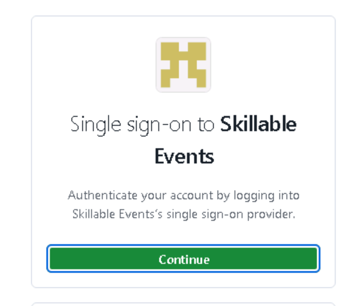
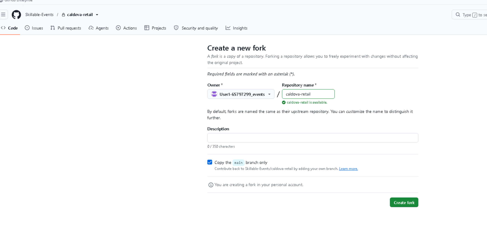
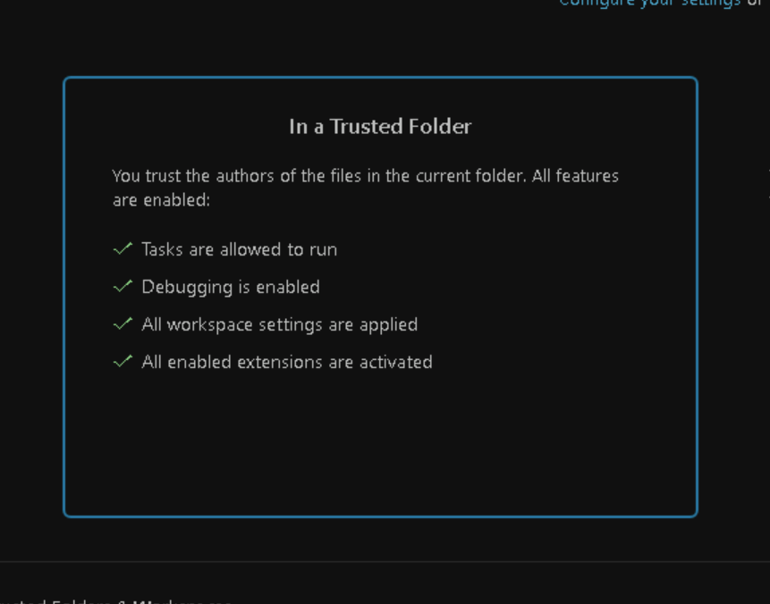
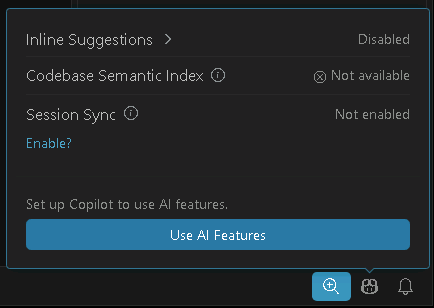
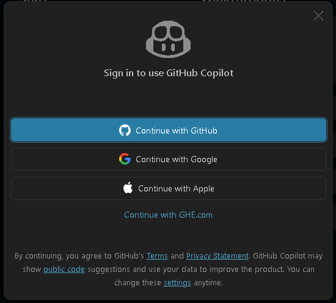
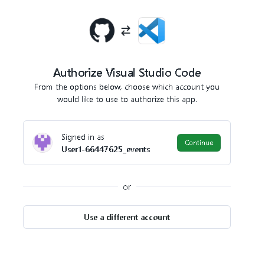
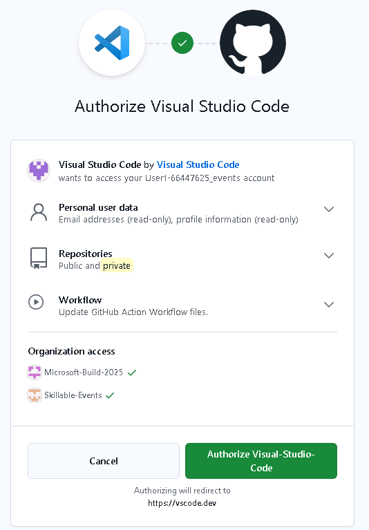

# 🔎 Lab 07: Assess a Multi-Repository Application with GitHub Copilot Modernization

Contoso Legacy Bank is not one project in one repository. Its customer portal, account service, statement API, document worker, and nightly batch process are separate .NET Framework applications that collaborate at runtime.

In this lab, you will use **GitHub Copilot Chat in a multi-root Visual Studio Code workspace** and the **GitHub Copilot Modernization CLI** to assess the five repositories as one application estate. You will compare interactive findings with repeatable CLI reports, reconcile the evidence, and create a dependency-aware modernization roadmap. The modernization extension UI is an optional tool for deeper assessment of an individual repository.

> [!IMPORTANT]
> This is an **assessment and planning lab**. Remain read-only while assessing the application. You may generate draft plans, but do not run `modernize plan execute`, `modernize upgrade`, or ask an agent to change application code.

## 🎯 Learning objectives

By the end of this lab, you will be able to:

- prepare a multi-repository workspace for application assessment
- distinguish repository-level findings from application-wide dependencies
- use GitHub Copilot in VS Code to investigate contracts and consumers across repositories
- run a repeatable, assessment-only scan with the Modernization CLI
- compare AI-generated findings with repository and build evidence
- prioritize modernization work across repository boundaries
- create bounded plans without starting implementation

## 📦 What you will produce

Save your results in a location provided by your instructor or in a local working document outside the application repositories. Your final handoff should contain:

1. the exact commit SHA assessed for the hub and each component repository
2. a finding register covering all five repositories
3. a comparison of the VS Code and CLI results
4. a contract and dependency summary
5. a prioritized, dependency-ordered modernization roadmap
6. bounded draft plans for the first modernization wave
7. assumptions, unknowns, and decisions that require human owners

> [!NOTE]
> **You are not expected to be a developer, and you do not have to fill in these
> tables by hand.** Throughout this lab, each register and matrix is shown as a
> completed **worked sample** so you can see what the assessment produces and how
> that information is used to plan a migration. Your goal is to understand the
> workflow — running the assessments, comparing the two tools, and recognizing a
> good finding — not to author a full professional analysis.

Generated reports can contain source details and architectural information. Review and redact them before publishing or sharing them outside the workshop.

## 🏦 Application estate

The hub repository is [Skillable-Events/modernize_sample_demo](https://github.com/Skillable-Events/modernize_sample_demo). It contains orchestration, documentation, a multi-root VS Code workspace, and five application repositories pinned as Git submodules.

| Repository | Legacy technology | Responsibility | Example modernization direction |
| --- | --- | --- | --- |
| contoso-legacy-bank-portal | .NET Framework 4.8, WinForms, WCF client | Customer search, account views, transactions, and statement requests | Blazor and asynchronous service clients |
| contoso-legacy-bank-accounts | .NET Framework 4.8, WCF, EF6, SQL LocalDB | Customers, accounts, balances, and transactions | ASP.NET Core API, EF Core, and Azure SQL |
| contoso-legacy-bank-statements | ASP.NET Web API 2 | Statement orchestration and status | ASP.NET Core API with resilient clients |
| contoso-legacy-bank-documents | Console/Windows Service worker, file queue, PDFsharp | PDF statement generation | Modern .NET worker, managed messaging, and Blob Storage |
| contoso-legacy-bank-batch | Scheduled console app and CSV files | Nightly transaction import and reconciliation | Azure Functions or Azure Container Apps Jobs |

The hub is the system of record for application-wide architecture and sequencing. Each component repository remains the owner of its code and any future implementation work.

## 🧭 How the two assessment paths work together

You will use two complementary workflows:

| Workflow | Best use in this lab | Limitation to remember |
| --- | --- | --- |
| VS Code multi-root Copilot Chat | One coordinated assessment with per-repository findings, contracts, consumers, and migration order across all five repositories | Source-based analysis is not a tool-generated modernization assessment; coverage depends on accessible context and must be verified |
| VS Code modernization assessment (optional) | Deeper, tool-generated findings for a selected project or repository | The UI workflow described here assesses one repository at a time, not the multi-repository application |
| Modernization CLI | Repeatable per-repository and aggregated reports from one configuration | An aggregate report is evidence, not an approved architecture |

Neither output is automatically authoritative. Repository code, build results, tests, runtime behavior, and owner decisions remain the evidence used to accept or reject a recommendation.

---

## 1️⃣ Prepare the workstation

This lab assumes a Skillable Windows workstation. Git, GitHub CLI, VS Code, GitHub Copilot, Visual Studio build tools, and the modernization tools should already be installed.

> 📂 **Where to run commands:** This lab mixes two kinds of code blocks. Blocks marked **💻 Run this in the terminal** are commands you run yourself in a PowerShell terminal — after you clone the hub in step 2️⃣, run them from the hub root (modernize_sample_demo) unless a step says otherwise. Blocks marked **🤖 Paste this into Copilot Chat** are prompts you send to GitHub Copilot in VS Code, not terminal commands.

### 1. Open PowerShell

Use a regular PowerShell terminal. Do not run these commands from inside another application repository.

### 2. Verify the command-line tools

> 💻 **Run this in the terminal.**

```powershell
git --version
gh --version
code --version
modernize --help
```

## 🛠️ Setup

> Run this module against **your own fork** rather than the workshop repository.

**1. Sign in to the workshop repository.** Open a new tab in Microsoft Edge and type this link in your browser `https://github.com/Skillable-Events/modernize_sample_demo`

1. On the Skillable Events single sign-on page, select **Continue**.

   

   > 💡 If the sign-in keeps returning to the same page or shows an error, wait a few minutes and try again; this is a transient error. If it takes you to the Skillable GH Enterprise main page [Skillable-Events GH](https://github.com/enterprises/Skillable-Events) search for "modernize_sample_demo" in the search bar and access the repository that way.

2. In the **Sign in** box, enter the **Username** listed under **Azure portal** on the **Resources** tab of your lab instructions, then select **Next**.
3. Enter the **Password** from the same **Azure portal** section. If you are asked for a **Temporary Access Pass**, enter the **TAP** value instead. If it prompts you to stay signed in, hit **Yes**.

**2. Fork and clone the repository.**

1. On the repository page, select **Fork**, then **Create fork** with the defaults left alone.

   

   

2. In your new fork, select **Code**, then copy the **HTTPS** URL. It should look something like `https://github.com/User1-12345678_events/modernize_sample_demo.git`.

   

   


4. Open PowerShell from your applications and clone your fork, pasting the URL you copied into it (run this from the default location -- C:\Users\Admin):

  ```powershell
git clone --recurse-submodules <your-fork-url>
Set-Location .\modernize_sample_demo
```

   If you are asked to sign in, choose **Sign in with your browser**, approve the authorization (select **"Authorize git-ecosystem"**), then return to PowerShell. The clone starts once you are signed in.
   > 💡 If you face any errors here, the sign in may not have persisted. If that is the case, re-type in the original repo link, `https://github.com/Skillable-Events/modernize_sample_demo`, follow the sign in, click the button to stay signed in, and then run the Powershell command again.

**3. Open the storefront folder in VS Code.** Run this command in PowerShell to open the application in VSCode:

```powershell
cd modernize_sample_demo
code .
```

If **code** is not recognized, start VS Code from your applications and use **File → Open Folder…**, then pick the **modernize_sample_demo**. If VSCode asks you to sign into GitHub again, authorize access there as well.

If VS Code opens the folder in **Restricted Mode**, select **Manage** in the banner at the top of the window, then select **Trust**. Once the page shows **In a Trusted Folder**, close that tab.




You are in the right place when the Explorer shows **eShopLiteFx.sln** next to a **src** folder.

> 📂 **Where to run commands:** Every PowerShell command in this lab assumes your current folder is the cloned **modernize_sample_demo** folder. The simplest option is the VS Code integrated terminal (**Terminal → New Terminal**), which already opens in that folder. If you use a standalone PowerShell window instead, run `cd modernize_sample_demo` first. Throughout this lab, blocks marked **💻 Run this in the terminal** are commands you run yourself, while blocks marked **🤖 Paste this into Copilot Chat** are prompts you send to Copilot — not terminal commands.

## 🔑 Authorize VS CODE

In VSCODE select the agent in the bottom right, and click the "Use AI Features" button.


The **Sign in to use GitHub Copilot** prompt opens and select Continue with GitHub



The browser opens displaying an "Authorize with Visual Stusio Code" prompt. Select Continue


Finally select **Authorize Visual Stusio Code** on the next prompt.


If it is not authenticated, run:

> 💻 **Run this in the terminal.**

```powershell
gh auth login
```

Choose:

1. **GitHub.com**
2. **HTTPS**
3. **Login with a web browser**

Complete the browser sign-in, then verify again:

> 💻 **Run this in the terminal.**

```powershell
gh auth status
```

The signed-in account must have GitHub Copilot access and read access to the hub and all five component repositories.


## 2️⃣ initialize the application estate

### 2. Initialize the demo

> 💻 **Run this in the terminal.**

```powershell
.\scripts\Initialize-Demo.ps1
```

The script prepares the local integration folders and data used by the application estate.

### 3. Check prerequisites

Running the complete application is not required for this assessment lab. 

> 💻 **Run this in the terminal.**

```powershell
git submodule status
```

**Expected outcome:** Five entries for Portal, Accounts, Statements, Documents,
and Batch, each showing a commit SHA and repository path.

---

## 3️⃣ Open the multi-repository workspace

From the hub root, run:

> 💻 **Run this in the terminal.**

```powershell
code .\contoso-legacy-bank-multi-repo.code-workspace
```

The VS Code Explorer should show five named application roots:

- Portal
- Accounts
- Statements
- Documents
- Batch

The hub contains shared documentation and orchestration, but does not need to
be a workspace root. Keep the five application roots as the assessment scope;
attach the required hub files using **Add required evidence explicitly** below.
If the hub is already listed in Explorer, right-click its workspace root and
select **Remove Folder from Workspace**. This does not delete files or remove
the five separately listed application roots.

Before starting an assessment:

1. confirm all repository folders are visible and accessible in Explorer.
2. trust the workspace only if you recognize the repository
3. confirm all five roots contain source files
4. review `.github\copilot-instructions.md` in the hub and each component repository
5. keep the Source Control view clean so generated or accidental changes are obvious

> [!IMPORTANT]
> The folders under are independent Git repositories. Do not treat them as ordinary hub files. Future code changes would be committed in the owning component repository first, followed by a separate hub submodule-pointer update.

---

## 4️⃣ Assess the application across repositories in VS Code

### Build the agent context

**#codebase** is a Copilot Chat reference to VS Code's **semantic code search**
tool. Semantic search finds code related to the *meaning* of your question,
not just files containing the exact words you typed. For example, a question
about "statement generation" can help locate the request handler, service
calls, and document worker that implement that workflow.

In VS Code, type **#codebase** in the Chat input and select the matching
suggestion, then describe what you want to investigate. In this lab, the open
multi-root workspace makes the five application folders available as search
context; you do not need to switch to a separate window for each repository.

Here is how that context is gathered:

1. **Index:** VS Code uses an available workspace index to locate relevant
   code snippets. Index coverage and exclusion rules affect what can be found.
2. **Retrieve:** **#codebase** searches that index for code related to your prompt.
   Naming the repositories, workflow, and contracts helps focus the search.
3. **Investigate:** Copilot can use available file-reading, text-search, and
   symbol tools to inspect results and follow relationships across files.
4. **Respond:** Copilot uses the retrieved context to construct an answer.
   Check its file references and ask for missing producer or consumer evidence
   before treating the answer as a complete assessment.

For example: > 💻 **Run this in the terminal of the multi-repository workspace.**

> #codebase Analyze the statement-generation workflow across the Portal,
> Accounts, Statements, and Documents repositories. Trace the request from the
> WinForms event through WCF and Web API 2 to the JSON job and generated PDF.
> Remain read-only. Cite repository paths for every contract and consumer.

> [!NOTE]
> **Review the output before continuing.** Look for a step-by-step explanation
> of how a statement request moves between the Portal, Accounts, Statements,
> and Documents repositories, from the WinForms event to the generated PDF.
> Each handoff should identify the sending and receiving code, the contract
> or message exchanged (WCF operation, HTTP request, or JSON job), and the
> repository paths supporting that explanation. Open the cited files to check
> the evidence. If a link in the workflow is missing or inferred, ask Copilot
> to investigate it or label it as unknown rather than assuming the trace is
> complete. This is a source-based explanation, not proof that the workflow
> has been executed successfully.

Think of **#codebase** as "find relevant code," not "read every repository in
full." The model's context window is finite, and search can miss relevant
files. It does not clone missing repositories, run modernization scans, or
execute tests by itself. Agent mode can also discover context automatically;
explicitly using **#codebase** directs it toward semantic workspace search.

For more detail, see [How Copilot understands your workspace](https://code.visualstudio.com/docs/agents/reference/workspace-context).

Use **#codebase** for:

- discovering where a capability is implemented;
- finding producers and consumers of a contract;
- comparing patterns across repositories;
- locating configuration, tests, and dependencies;
- answering questions when you do not already know the important files.

Do not rely on **#codebase** alone when a particular file must be considered.

#### Add required evidence explicitly

In the Chat view, select **Add Context**, then choose **Files & Folders**, or
drag files and folders from Explorer into Chat.

For an application-wide Contoso assessment, explicitly attach:

| Purpose | Context to attach |
|---|---|
| Current architecture | Hub docs\architecture.md |
| Verified repository revisions | Hub compatibility.json |
| Modernization rules | Hub docs\modernization-lab.md and .github\copilot-instructions.md |
| WCF producer contract | Accounts src\Contoso.LegacyBank.Accounts.Contracts |
| WCF consumers | Portal src\...\Services; Statements src\...\Services; Batch src\... |
| Statement file contract | Statements docs\statement-job-schema.md; Documents Models and samples |

The **Add Context → Files & Folders** picker can be limited to files in the
current workspace. If the hub is not a workspace root, do not expect to browse
to it through that picker. Temporarily add it to attach the required evidence:

1. Select **File → Add Folder to Workspace**, choose the cloned
   `modernize_sample_demo` root folder, and select **Add**.
2. Attach only the required hub files from Explorer, not the entire hub or
   its `apps` folder.
3. Before submitting the assessment prompt, right-click the hub workspace
   root in Explorer and select **Remove Folder from Workspace**. Confirm that
   Portal, Accounts, Statements, Documents, and Batch remain listed.

Removing the hub from the workspace does not delete files or erase context
already attached to the current conversation. This avoids overlapping search
roots: the hub's `apps` folders are the same repositories as the five named
application roots, not additional copies. If you start a new chat, attach the
required evidence again.

Explicit attachment means "this evidence must be considered." It is useful
for contracts, configuration, tests, and architecture decisions that a
relevance search might otherwise omit.

Example:

> Using the attached WCF contract, all three attached consumer implementations,
> architecture.md, and compatibility.json, build a producer/consumer matrix.
> Identify operation, DTO, fault, endpoint, versioning, coexistence, and
> migration-order requirements. Treat attached files as authoritative for the
> recorded baseline revision.


Use one Copilot Chat conversation in the multi-root workspace to assess **Portal, Accounts, Statements, Documents, and Batch** as a connected system. You do not need to start five separate modernization UI assessments.

> [!IMPORTANT]
> This workflow uses Copilot's workspace-wide code analysis, not a native multi-repository assessment in the modernization extension UI. A consolidated Chat report does not prove that modernization scans, builds, tests, or runtime checks ran. Use the CLI in the next section for repeatable tool-generated reports, and optionally use the extension UI for a repository-specific deep dive.

### 1. Submit the coordinated assessment prompt

1. In `contoso-legacy-bank-multi-repo.code-workspace`, open **Copilot Chat** and click the **+** (**New Chat**) button at the top of the Chat view to start a fresh conversation.
2. Select **Agent** mode and keep the assessment read-only as instructed in the prompt.
3. If you attached evidence in an earlier conversation, attach it again in this new chat. Then paste the prompt below, starting with `#codebase` so VS Code searches the indexed workspace.

> [!TIP]
> **Review the prompt before running it.** Notice how it defines the scope (all five repositories), sets read-only boundaries, describes the modernization goal, and specifies the report structure. It asks for both repository-level findings and cross-repository dependencies, then requires code evidence and a clear separation of facts, assumptions, and unverified checks. Understanding these parts helps you recognize what the prompt is asking Copilot to do and whether the response actually meets those requirements.

> 🤖 **Paste this into Copilot Chat.**

```plaintext
#codebase Assess all five Contoso Legacy Bank application repositories in this
multi-root workspace: Portal, Accounts, Statements, Documents, and Batch.

Treat this as one coordinated, read-only assessment. Do not require separate
conversations for each repository. Do not edit files, create branches, create
plans, or execute upgrades.

First confirm which repository roots are accessible. Explicitly identify any
inaccessible or insufficiently examined repositories.

Use the hub only for shared documentation, instructions, repository revisions,
and orchestration context supplied through attached files; do not assess it
as a sixth application. Analyze each component once and use one consistent
path for its evidence links. If overlapping workspace paths expose the same
component through both a named root and the hub's apps directory, treat them
as one repository and deduplicate findings, counts, and effort estimates.

Evaluate modernization toward supported modern .NET and appropriate Azure
services. Where an exact target version or architecture is needed, identify
the decision rather than assuming it. Preserve observable behavior and do not
assume all repositories can change in one release.

Produce one consolidated Markdown report containing:

1. A profile for each repository: languages, frameworks and declared/resolved
   versions, project types, executables and entry points, direct and relevant
   transitive dependencies, data and file stores, endpoints, startup
   dependencies, external configuration, hosting, build pipelines, and tests.

2. A finding register grouped by repository. Give every finding a stable ID,
   mandatory/potential/optional classification, severity, confidence, affected
   files and symbols with evidence links, why it matters for the proposed
   target, remediation guidance and compatibility implications, effort range
   in person-days with assumptions and dependencies, tests or runtime evidence
   needed to accept the recommendation, and measurable acceptance criteria.
   Mandatory means a demonstrated target requirement or blocker; potential
   means a risk requiring validation; optional means an improvement not
   required for the target.

3. Cross-repository analysis: trace producers and consumers of WCF operations
   and faults, HTTP routes and payloads, JSON, CSV, LocalDB, file-queue messages,
   and generated PDFs. Identify breaking-change risks, coexistence requirements,
   rollback needs, shared remediation work, and migration sequencing.

4. A summary: finding counts by classification, highest-priority blockers,
   a dependency-ordered modernization roadmap, overall effort without
   double-counting, independently implementable repository work packages,
   unresolved decisions, human decision gates, and validation gaps.

For every conclusion, cite the repository, file, and symbol that support it.
Separate observed facts, inferences, assumptions, and unknowns. Verify
target-specific compatibility claims against authoritative documentation when
available; otherwise mark them unverified. Missing evidence is not proof of
incompatibility.

Distinguish source-based observations from tool-generated assessment results.
Do not claim modernization scans, builds, tests, or runtime checks ran unless
they actually ran; distinguish executed checks from proposed validation.
```

### 2. Review the result

For each repository, inspect:

- detected framework, project type, and dependencies
- mandatory, potential, and optional findings
- affected files and symbols
- why the finding matters for the proposed target
- remediation guidance
- effort estimate and assumptions
- test or runtime evidence needed before accepting the recommendation

Confirm that the report covers all five repositories and their dependencies; a missing repository is a coverage gap, not a successful assessment. Do not create a plan yet. First review the consolidated findings and compare them with the CLI results.

### 3. Build the finding register

A **finding register** is simply a running list of the issues the assessment
discovered, with enough detail that someone could act on each one later. In a
real project your team fills this in as you review each repository.

> [!NOTE]
> **For non-developers:** You do **not** need to complete this table yourself in
> the lab. The rows below are a **worked sample** so you can see what a good
> finding looks like. Each column answers a question an owner will ask before
> funding the work: *What is wrong? Where is the proof? How risky is it? What
> would we do about it?* Read the sample, then focus on recognizing these same
> ingredients in the real assessment output.

Findings are captured in this format (sample rows shown):

| ID | Repository | Finding | Priority | File or symbol evidence | Consumer or dependency impact | Proposed direction | Confidence / unknowns |
| --- | --- | --- | --- | --- | --- | --- | --- |
| VS-01 | Accounts | Data access uses Entity Framework 6 against a local-only SQL LocalDB database, which cannot run in Azure as-is | High | AccountsService data layer and App.config connection string | Portal and Statements both read account data through this service, so any change must keep their calls working | Move to EF Core and Azure SQL, keeping the existing service operations unchanged at first | High confidence it must change; unknown how much data must be migrated |
| VS-02 | Statements | Statement API (ASP.NET Web API 2) calls the Accounts service with no timeout or retry, so a slow account service can hang statement requests | Medium | StatementsController and its WCF client configuration | Portal depends on statement requests completing, so failures surface directly to customers | Add resilient client behavior (timeouts/retries) when moving to ASP.NET Core | Medium confidence; need runtime data on how often this fails today |

At minimum, the assessment investigates these areas. (The jargon in the right
column is the kind of detail a developer would examine — you do not need to
recognize every term; the point is that each repository is examined for both
its own code and how it connects to the others.)

| Repository | Assessment focus |
| --- | --- |
| Portal | WinForms UI coupling, synchronous calls, WCF client configuration, validation, roles, and error states |
| Accounts | WCF contracts/bindings/faults, EF6 behavior, LocalDB assumptions, transactions, and all consumers |
| Statements | Web API 2 routes and payloads, WCF client use, status behavior, timeouts, and failure handling |
| Documents | File-queue claim/replay behavior, PDF output, local paths, service hosting, and failed jobs |
| Batch | CSV schema, duplicate handling, reconciliation, scheduling, local paths, and partial failures |
| All repositories | Configuration, secrets, logging, health, telemetry, package support, build/test coverage, and CI |

### 4. Challenge the output

An AI-generated assessment is a starting point, not an approval to migrate.
Copilot can miss a consumer, infer behavior from incomplete context, or suggest
a change that sounds reasonable but does not fit the application's constraints.
Challenging the output means asking it to show evidence, trace dependencies,
and explain uncertainty rather than simply asking whether its answer is correct.

This helps you:

- **Catch missing dependencies** before a change in one repository breaks another.
- **Separate facts from assumptions** so unsupported recommendations become
  questions to investigate, not mandatory work.
- **Improve scope and effort estimates** by exposing affected consumers,
  compatibility work, and tests the first response might have missed.
- **Make recommendations reviewable** by connecting them to source evidence,
  acceptance checks, and decisions that need a human owner.
- **Reduce migration risk** by identifying where runtime validation,
  coexistence, or rollback evidence is still needed.

More confident wording is not stronger evidence. Follow-up answers still need
verification against the source, tests, and runtime behavior; repeating a claim
does not validate it.

Ask focused follow-ups instead of accepting the first response:

> 🤖 **Paste this into Copilot Chat.**

```plaintext
Show the code evidence for every producer and consumer in the WCF dependency
chain. Which consumers would break if the account service changed first?
```

> 🤖 **Paste this into Copilot Chat.**

```plaintext
Trace statement generation from the portal request through the account service,
statement API, file queue, document worker, and PDF result. Mark every contract
that needs a compatibility or coexistence strategy.
```

> 🤖 **Paste this into Copilot Chat.**

```plaintext
Which recommendations are directly supported by code, which are inferred, and
which require a product owner, security owner, data owner, or operations owner?
```

### 5. Capture the contract matrix

A **contract** is the agreement about how one application talks to another — the
messages they exchange and what each side expects. If you change one app, you
must not break the "contract" the other apps rely on.

> [!NOTE]
> **For non-developers:** The table below is a **worked sample**, not an exercise
> to complete. Think of each row as "App A hands something to App B." This matrix
> matters because it shows the **hidden connections** between repositories — the
> things most likely to break during a migration. The migration order and the
> "coexistence" plans (keeping old and new versions working together) come
> directly from this picture.

Sample contract matrix:

| Producer | Consumer | Contract or data | Evidence | Current failure behavior | Modernization/coexistence concern |
| --- | --- | --- | --- | --- | --- |
| Accounts | Portal | WCF operations and faults | IAccountService operations called by the Portal client | Portal shows an error dialog and the action stops | Portal must keep working while Accounts moves to a new API, so the old operations need a compatibility path |
| Accounts | Statements | WCF operations and DTOs | Statements' account client and shared data objects | Statement request fails if the account call fails | Statements and Accounts cannot both change in the same release without coordination |
| Statements | Portal | HTTP routes and payloads | Web API 2 routes the Portal calls for statement status | Portal cannot show statement status | Keep the same routes/responses when moving Statements to ASP.NET Core |
| Statements | Documents | File-queue message | Message dropped on the shared file queue | Document job is never produced; no error shown to the user | Replace the file queue with managed messaging without losing in-flight jobs |
| Batch | Accounts/data store | CSV and import semantics | Nightly CSV import into the accounts data | Duplicate or partial import corrupts balances | Import must stay idempotent (safe to re-run) after the data store moves to Azure SQL |

The output should make dependencies visible, not merely list technologies.

### 6. Optional: deepen a repository assessment with the modernization UI

> [!NOTE]
> **This section is optional.** It is not a prerequisite for the
> multi-repository workflow; you can skip to the CLI assessment in the next
> section. To **deepen a repository assessment** means to move from the
> application-wide overview to a focused investigation of one component.
> For example, Chat might identify "Accounts uses WCF and EF6," while a
> targeted modernization UI assessment can add tool-generated findings about
> that project's APIs, packages, configuration, and migration requirements,
> depending on the assessment selected and the tool's coverage. Select only
> the repository that needs additional detail; you do not need to repeat
> the UI assessment for all five repositories.

Use this when you need to investigate a specific question, for example:

- Which WCF features or bindings in Accounts need further compatibility review?
- Which dependencies in Statements need changes for the proposed .NET target?
- Which local file paths or hosting assumptions in Documents are flagged as
  cloud-readiness concerns?

Compare the tool's findings with the source evidence and the consolidated
register. Record any new affected files, remediation guidance, or validation
gaps, and check consumers in the other repositories before changing the
recommended migration order. A deeper assessment adds evidence; it does not
prove runtime compatibility or approve a migration.

The extension UI can evolve. Labels might vary slightly:

1. Select the **GitHub Copilot modernization** icon in the Activity Bar.
2. Select **Start Assessment**.
3. Select the project or solution from the repository you want to investigate.
4. Choose **Recommended Assessment** when offered.
5. Choose **Cloud Readiness** as the target.
6. Keep the run in assessment mode. Do not choose **Create Plan**, an upgrade, or an execution action.

If the extension cannot distinguish projects in the multi-root workspace, open only the selected component in a separate VS Code window, for example:

> 💻 **Run this in the terminal.**

```powershell
code .\apps\contoso-legacy-bank-accounts
```

#### Reconcile the additional findings with Copilot

**Use Copilot to propose the comparison, then review it yourself.** You do not
need to merge findings manually row by row. Here, *reconcile* means deciding
whether each additional finding is new, duplicates an existing finding, adds
evidence to it, or conflicts with it.

1. Return to the multi-root workspace and the Chat conversation containing
   the consolidated assessment. A conversation in a separate repository
   window should not be assumed to share that context.
2. Attach the repository-level assessment report and the consolidated register
   using **Add Context**. If the results exist only in a dashboard or another
   conversation, paste the relevant findings, including their evidence and
   the assessed repository revision.
3. Ask Copilot to compare the findings and trace affected consumers across
   the other repositories using the prompt below.
4. Review the proposed changes against the cited source. Keep conflicting
   evidence and unresolved questions visible rather than accepting whichever
   report sounds more confident.
5. After review, save the accepted register in your working document outside
   the application repositories. In this read-only exercise, Copilot proposes
   the revised content in Chat; you decide what to retain.

> 🤖 **Paste this into Copilot Chat after attaching both assessments.**

```plaintext
#codebase Compare the attached repository-level assessment with the
consolidated finding register for all five Contoso repositories. Remain
read-only; propose revised register content in Chat without editing files.

First confirm that both assessments are available and identify their assessed
revisions. Flag missing or different revisions before combining conclusions.

For each additional finding:
- classify it as new, duplicate, supporting evidence, or conflicting evidence;
- match it to an existing finding ID where appropriate and preserve that ID;
- give genuinely new findings unique IDs without duplicating shared work;
- cite the report evidence and verify the relevant source files and symbols;
- trace affected contracts and consumers across the other repositories;
- propose any changes to classification, severity, confidence, remediation,
  effort, validation requirements, or migration order, explaining why.

Return a comparison table and a proposed revised register. Preserve unresolved
conflicts and unknowns. Separate source-confirmed impacts from risks that
require tests or runtime evidence. Do not mark compatibility as verified
solely because a repository-level assessment passed or found no issue.
```

For example, if the Accounts assessment recommends changing a WCF contract,
Copilot should locate the Portal and Statements callers and explain whether
they depend on the affected operations, data objects, or faults. You review
those references and any proposed compatibility strategy. The agent helps
organize and investigate the evidence; a human accepts the register changes,
and tests or runtime checks are still needed to establish compatibility.

---

## 5️⃣ Run the multi-repository Modernization CLI assessment

The hub contains `.github\modernize\repos.json`. It lists the five application repositories and groups them as one logical application named contoso-legacy-bank. The hub itself is excluded because it contains orchestration and documentation rather than an application project.

### 1. Confirm authentication and CLI availability

From the hub root:

> 💻 **Run this in the terminal.**

```powershell
gh auth status
modernize --help
```

### 2. Inspect the repository configuration

> 💻 **Run this in the terminal.**

```powershell
Get-Content .\.github\modernize\repos.json
```

Confirm that it lists:

- contoso-legacy-bank-portal
- contoso-legacy-bank-accounts
- contoso-legacy-bank-statements
- contoso-legacy-bank-documents
- contoso-legacy-bank-batch

### 3. Run the supplied assessment-only wrapper

> 💻 **Run this in the terminal.**

```powershell
.\scripts\Invoke-ModernizeAssessment.ps1
```

The wrapper intentionally runs only modernize assess. It writes Markdown assessment output beneath:

```text
artifacts\modernize-assessment
```

The script is equivalent to:

```powershell
modernize assess `
  --source .github\modernize\repos.json `
  --output-path artifacts\modernize-assessment `
  --format markdown `
  --delegate local
```

The repository config allows the CLI to produce per-repository findings and an application-level aggregate without requiring you to type five URLs.

> [!WARNING]
> Do not substitute modernize upgrade and do not run modernize plan execute. Those commands can change source. This lab ends at reviewed assessment and draft planning.

### 4. Review generated files

List the output:

> 💻 **Run this in the terminal.**

```powershell
Get-ChildItem .\artifacts\modernize-assessment -Recurse -File |
  Select-Object FullName, Length, LastWriteTime
```

Open the generated Markdown reports in VS Code:

> 💻 **Run this in the terminal.**

```powershell
code .\artifacts\modernize-assessment
```

Verify:

- all five repositories have results
- the aggregate groups them as one application
- findings include file or project evidence rather than generic advice
- cross-repository risks are not hidden by repository-level summaries
- failed, skipped, or incomplete scans are clearly identified
- assessed revisions match the SHAs recorded earlier

Do not publish raw reports until they have been reviewed for source details, internal URLs, secrets, credentials, personal data, and unsupported claims.

### 5. Optional: run the interactive CLI

The same CLI also provides a text user interface:

> 💻 **Run this in the terminal.**

```powershell
modernize
```

In the menu:

1. choose **Assess**
2. choose **From a config file**
3. select `.github\modernize\repos.json`
4. keep all five repositories selected
5. select the .NET **Upgrade** and **Cloud Readiness** assessment domains
6. choose **Full analysis** when codebase insights are offered
7. choose **Assess locally**
8. select an output directory
9. review the results, then return to the main menu

Do not continue into plan execution or upgrade.

---

## 6️⃣ Compare and reconcile the results

You ran two assessments: the interactive one in VS Code and the Modernization
CLI. This step compares them. The goal is **not** to decide which tool "won" —
it is to see where they agree (higher confidence), where they disagree (needs a
closer look), and what neither tool could know (gaps for a human to decide).

### 1. Compare coverage

> [!NOTE]
> **For non-developers:** The table below is a **worked sample** showing how a
> reviewer records whether each assessment answered an important question. You do
> not need to fill it in. The value here is the habit: when two tools agree you
> can trust the finding more; when they disagree, you go look at the actual code
> before believing either one.

Sample coverage comparison:

| Question | VS Code result | CLI result | Evidence checked | Reconciled conclusion |
| --- | --- | --- | --- | --- |
| Were all five repositories analyzed? | Yes, one at a time | Yes, all five from one config file | Output files for Portal, Accounts, Statements, Documents, Batch | Agree — full coverage |
| Were frameworks and packages detected correctly? | Yes | Yes | Project files and build output | Agree |
| Were WCF producers and consumers connected? | Partly — strong per-repo detail | Yes — shown in the aggregate report | Account service callers in Portal and Statements | CLI aggregate was clearer on cross-repo links |
| Were HTTP, CSV, file-queue, and PDF contracts identified? | Yes | Yes | Contract matrix from §5 | Agree |
| Were data and LocalDB assumptions identified? | Yes | Yes | Accounts connection string | Agree — a known blocker |
| Were test and observability gaps identified? | Yes | Partly | Missing tests around statement failures | Needs follow-up |
| Were findings supported by files and symbols? | Yes | Mostly | Spot-checked a few findings | Agree, with spot checks |
| Did the result separate facts, assumptions, and unknowns? | Yes | Partly | Prompt required it in VS Code | VS Code was clearer here |
| Did it propose safe coexistence and rollback? | Yes | Partly | Coexistence notes in §5 | Needs a human-owned plan |
| Did it aggregate risks at application level? | Limited | Yes | CLI aggregate report | CLI stronger at the whole-app view |

### 2. Reconcile disagreements

"Reconcile" just means: when the two tools disagree, go find the real answer in
the code or build output, then write down the decision and who owns it.

> [!NOTE]
> **For non-developers:** The row below is a **sample** of how a disagreement is
> resolved. Notice the last column: the final call belongs to a **human owner**,
> not to either tool. AI assessments suggest; people decide.

For every important disagreement:

1. locate the relevant source, configuration, test, or build output
2. identify whether one tool lacked repository or workspace context
3. classify the conclusion as **confirmed**, **rejected**, or **unknown**
4. record the evidence and confidence
5. assign unresolved decisions to a human owner

Sample reconciliation register:

| ID | Topic | VS Code conclusion | CLI conclusion | Verified evidence | Decision | Owner |
| --- | --- | --- | --- | --- | --- | --- |
| RC-01 | Does the Statements service call Accounts with a timeout? | No timeout found (risk) | Not flagged | Checked the Statements client config — no timeout is set | Confirmed as a real risk; add resilient client during migration | Statements repo owner |

### 3. Identify assessment gaps

A complete-looking report can still be based on incomplete evidence. These are
the kinds of things an assessment often **cannot** see on its own — they usually
need a person who knows the business or operations:

- untested runtime failure paths
- missing performance and volume data
- unknown recovery objectives
- undocumented identity and authorization behavior
- unclear data ownership or retention
- missing downstream consumers
- secrets or environment dependencies not represented in source
- recommendations that assume a target Azure service without business constraints

---

## 7️⃣ Prioritize the modernization portfolio

Score work by dependency and risk, not only by how old a framework is.

### 1. Build the prioritization matrix

> [!NOTE]
> **For non-developers:** This is a **worked sample**, not a task to complete.
> Prioritization is how a team decides **what to modernize first**. A dependency
> that many apps rely on (like the account service) usually goes early, because
> everything else waits on it. The ratings below (High/Medium/Low) are a sample
> judgment — in a real project owners agree on them together. The far-right
> "Recommended wave" column is the payoff: it turns all the earlier analysis into
> an order of work.

Rate each item **High**, **Medium**, or **Low**. Sample matrix:

| Repository/capability | Business impact | Technical risk | Dependency criticality | Test readiness | Estimated effort | Coexistence need | Recommended wave |
| --- | --- | --- | --- | --- | --- | --- | --- |
| Account contracts and data | High | High | High | Low | High | High | Wave 2 (foundation) |
| Statement orchestration | High | Medium | Medium | Low | Medium | High | Wave 3 |
| Document generation | Medium | Medium | Low | Low | Medium | Medium | Wave 4 |
| Batch reconciliation | Medium | Medium | Low | Low | Medium | Medium | Wave 4 |
| Customer portal | High | Low | Low | Medium | Medium | Low | Wave 5 (after services are stable) |

### 2. Propose modernization waves

A defensible starting sequence is:

1. **Baseline and contract preservation:** Record behavior, freeze public contracts, close characterization-test gaps, and agree on target runtime and hosting decisions.
2. **Account service and data boundary:** Address the WCF/EF6/LocalDB dependency while preserving a compatibility path for Portal and Statements.
3. **Statement service:** Move Web API 2 and replace its account-service client without breaking request/status behavior.
4. **Documents and Batch:** Modernize worker hosting, file-queue semantics, PDF storage, scheduling, idempotency, and reconciliation.
5. **Portal:** Modernize the UI after stable service contracts exist.
6. **Parity, cutover, and retirement decision:** Validate consumers, behavior, security, operations, rollback, and data before retiring legacy endpoints.

Change the sequence only when your evidence supports the decision. For example, missing behavior tests might make characterization work the first task in every repository.

### 3. Define human approval gates

Record who must approve:

- public contract and intentional behavior changes
- target .NET versions and support policy
- Azure service and network architecture
- identity, authorization, and secret handling
- data migration and transaction semantics
- availability, recovery, and rollback objectives
- cost and operational ownership
- legacy endpoint retirement

An AI-generated recommendation does not authorize any of these decisions.

---

## 8️⃣ Create bounded draft plans

Create plans only after the assessment findings have been reconciled. Keep each plan limited to one repository and one modernization slice.

### 1. Locate assessment JSON files

> 💻 **Run this in the terminal.**

```powershell
$assessmentFiles = @(
  Get-ChildItem .\artifacts\modernize-assessment `
    -Recurse `
    -Filter *.json `
    -File
)

$assessmentFiles | Select-Object FullName
```

Identify the assessment file that contains the findings for the repository you are planning. Do not guess from the filename; open it and verify the repository identity and findings.

### 2. Create a plan from reviewed evidence

The following example creates a plan for the Accounts repository. Replace the placeholder with the verified assessment JSON path:

> 💻 **Run this in the terminal.**

```powershell
$accountsAssessment = Read-Host 'Enter the verified Accounts assessment JSON path'
$planPrompt = @'
Modernize the account service from .NET Framework 4.8, WCF, EF6, and LocalDB
to supported modern .NET, versioned ASP.NET Core APIs, EF Core, and Azure SQL.
Preserve current operations, faults, transaction behavior, and consumers
through an explicit coexistence strategy. Plan only; do not execute.
'@

modernize plan create $planPrompt `
  --source .\apps\contoso-legacy-bank-accounts `
  --assess-file-path $accountsAssessment `
  --plan-name accounts-foundation `
  --language dotnet
```

Repeat only for approved first-wave work. Use a unique plan name and the matching repository assessment file.

### 3. Review the generated plan

Review both:

- `.github\modernize\<plan-name>\plan.md`
- `.github\modernize\<plan-name>\tasks.json`

Confirm the plan:

- cites assessment evidence
- names affected contracts and consumers
- preserves behavior or explicitly versions an intentional change
- includes tests and measurable success criteria
- supports coexistence and rollback
- has repository-bounded ownership
- does not combine unrelated repositories into one implementation task
- stops before cutover or legacy retirement without owner approval

You may edit a draft plan for review. **Do not run it in this lab.**

> [!CAUTION]
> `modernize plan execute` applies changes and can create commits. `modernize upgrade` performs an end-to-end modernization workflow. Neither command belongs in this assessment lab.

---

## 9️⃣ Final handoff

The final handoff is the short report you would give to an architect or
repository owner who did not attend the lab. It gathers everything above into a
few summary tables they can act on.

> [!NOTE]
> **For non-developers:** The three tables below are **worked samples** of that
> report — you do not need to produce them yourself in the lab. Together they
> answer an owner's three questions: *What did we learn?* (assessment summary),
> *In what order will we modernize?* (roadmap summary), and *What is the first
> concrete piece of work?* (work-package summary). The commit SHAs are simply the
> exact snapshot of code that was assessed, so the report can be trusted later.

### Assessment summary

Sample (values are illustrative):

| Item | Result |
| --- | --- |
| Hub commit SHA | a1b2c3d (recorded earlier in the lab) |
| Component commit SHAs | Portal 1111111, Accounts 2222222, Statements 3333333, Documents 4444444, Batch 5555555 |
| Baseline build | All five repositories built successfully before assessment |
| VS Code assessments completed | 5 of 5 |
| CLI repositories completed | 5 of 5, plus one application-level aggregate |
| Confirmed high-priority findings | Accounts EF6/LocalDB blocker; Statements missing resilient client |
| Rejected or unsupported findings | None rejected; a few CLI items needed code spot-checks |
| Open unknowns | Data volume/migration size; current real-world failure rates |

### Roadmap summary

Sample roadmap (ordered by dependency):

| Wave | Outcome | Repositories | Prerequisites | Exit evidence | Human approver |
| --- | --- | --- | --- | --- | --- |
| 0 | Baseline recorded and contracts frozen | All | Build baseline, SHAs recorded | Characterization tests in place | Architecture owner |
| 1 | Account service and data boundary modernized | Accounts | Wave 0 complete | Portal and Statements still work against new API | Accounts + data owners |

### Work-package summary

Sample first work package:

| Work package | Owning repository | Assessment evidence | Dependencies | Success criteria | Rollback/coexistence |
| --- | --- | --- | --- | --- | --- |
| Move account data to EF Core + Azure SQL | Accounts | Finding VS-01 | Baseline tests from Wave 0 | Existing account operations behave identically; Portal and Statements unaffected | Keep the old service operational until consumers are verified |

### Completion checklist

- [ ] The hub and all five component SHAs are recorded.
- [ ] The prerequisite and baseline results are recorded.
- [ ] Portal, Accounts, Statements, Documents, and Batch were assessed.
- [ ] The CLI generated per-repository and aggregate output.
- [ ] Important findings cite repository evidence.
- [ ] VS Code and CLI disagreements were reconciled.
- [ ] Facts, assumptions, and unknowns are separated.
- [ ] Contracts and consumers are represented in the roadmap.
- [ ] Modernization waves are dependency ordered.
- [ ] First-wave plans are bounded and reviewable.
- [ ] No plan was executed and no application source was changed.
- [ ] Reports were reviewed and redacted before sharing.

---

## 🛠️ Troubleshooting

### A component folder is empty or missing

From the hub root:

> 💻 **Run this in the terminal.**

```powershell
git submodule update --init --recursive
git submodule status
```

Every component should show a commit SHA. A leading `-` in `git submodule status` means the submodule is not initialized.

### The prerequisite script reports missing .NET Framework tools

This estate intentionally uses .NET Framework 4.8. The baseline requires:

- Visual Studio 2022 or Build Tools
- .NET desktop build tools
- .NET Framework 4.8 targeting pack
- ASP.NET and web development build tools
- IIS Express
- SQL Server Express LocalDB

Use the Skillable-provided installation. If a required component is unavailable, record the environmental limitation and do not report it as an application finding.

### `modernize` is not recognized

Install it:

> 💻 **Run this in the terminal.**

```powershell
winget install GitHub.Copilot.modernization.agent
```

Close all PowerShell terminals, open a new one, and run:

> 💻 **Run this in the terminal.**

```powershell
modernize --help
```

### GitHub authentication or entitlement fails

> 💻 **Run this in the terminal.**

```powershell
gh auth status
gh auth login
```

Confirm the browser and VS Code use the same intended GitHub account and that the account has Copilot access plus access to all six repositories.

### VS Code does not search all repositories

1. reopen `contoso-legacy-bank-multi-repo.code-workspace`
2. confirm every root appears in Explorer
3. wait for indexing to finish
4. start the prompt with **#codebase**
5. attach specific files or folders when asking about a contract
6. split broad questions into a producer trace and a consumer trace

### The modernization extension does not offer the expected project

This applies only to the optional per-repository UI deep dive; it does not block the multi-root Copilot Chat workflow. Open the selected component repository in its own VS Code window:

> 💻 **Run this in the terminal.**

```powershell
$componentFolder = Read-Host 'Enter the component folder name'
code (Join-Path '.\apps' $componentFolder)
```

Then start the assessment again and select its solution or project.

### The CLI assessment takes a long time

Full analysis across five repositories is expected to take longer than a single-project scan. Keep the terminal open. If the command fails:

1. read the final error rather than immediately rerunning
2. verify authentication and repository access
3. check available disk space
4. inspect the output directory for partial or failed reports
5. move the failed output aside before a clean rerun so old and new results are not mixed

Do not describe partial output as a complete portfolio assessment.

### One repository was skipped or failed

Confirm its URL and branch in:

> 💻 **Run this in the terminal.**

```powershell
Get-Content .\.github\modernize\repos.json
```

Verify access:

> 💻 **Run this in the terminal.**

```powershell
$repositoryName = Read-Host 'Enter the repository name'
gh repo view "Skillable-Events/$repositoryName"
```

Record the repository as incomplete until a successful result exists. Do not infer its findings from another repository.

### Assessment created unexpected changes

Inspect the hub and each component:

> 💻 **Run this in the terminal.**

```powershell
git status --short
git submodule foreach --recursive 'git status --short'
```

Do not discard changes until you know who created them. If they came from an accidental plan or upgrade action, stop and ask the instructor before continuing.

## 📚 Optional references

Everything required for the lab is documented above. These references are useful after the workshop because product commands and interfaces can evolve:

- [GitHub Copilot modernization documentation](https://learn.microsoft.com/en-us/azure/developer/github-copilot-app-modernization/)
- [Modernization agent CLI commands](https://learn.microsoft.com/en-us/azure/developer/github-copilot-app-modernization/modernization-agent/cli-commands)
- [GitHub Copilot Modernization CLI repository](https://github.com/microsoft/modernize-cli)
- [VS Code multi-root workspaces](https://code.visualstudio.com/docs/editing/workspaces/multi-root-workspaces)
- [Using context in VS Code Chat](https://code.visualstudio.com/docs/copilot/chat/copilot-chat-context)
