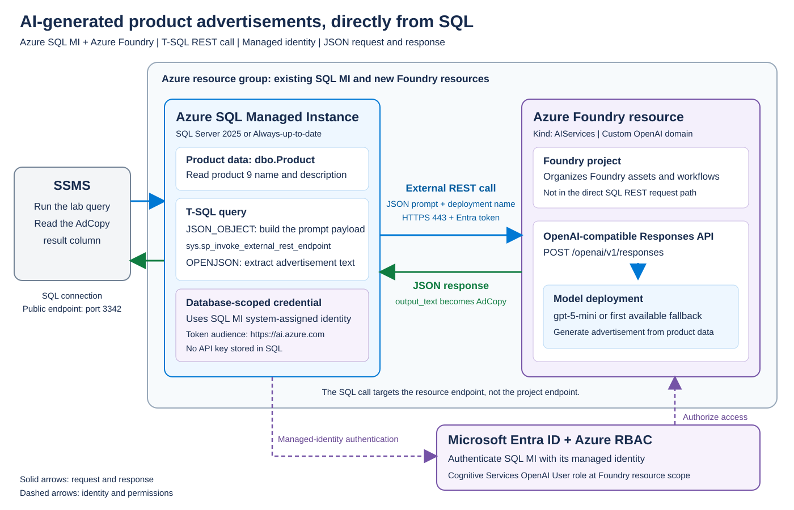
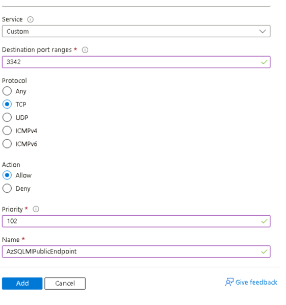
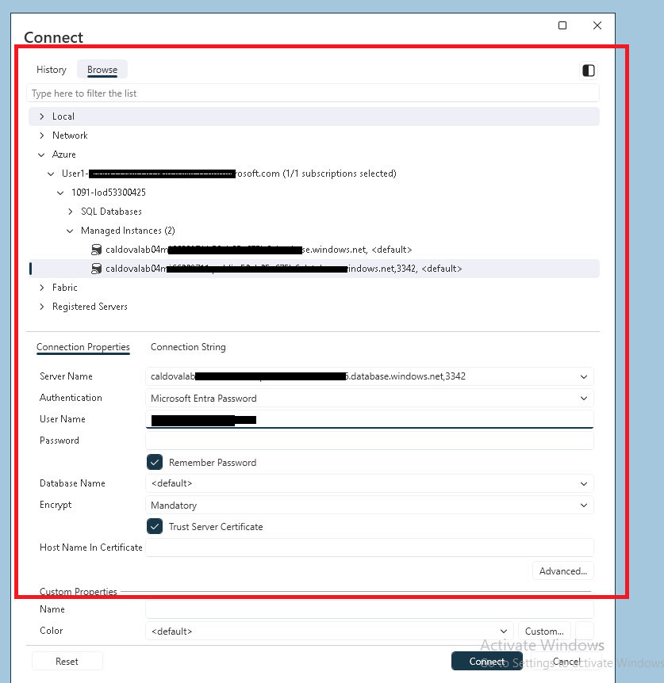

# 🧠 Lab 08: AI-Powered Database in Azure

Now that the database is migrated to Azure, let us use the power of AI for some easy applications out of the database. In this exercise, you will connect Azure AI to the SQL Managed Instance and create an advertisement for one of the product using AI.

## Lab architecture



SQL MI reads product data, builds a JSON prompt, and calls the Foundry resource's model endpoint using `sys.sp_invoke_external_rest_endpoint` and a managed-identity database-scoped credential. The JSON response is parsed into advertisement text and returned to SSMS. The Foundry project organizes assets; it is not in the direct SQL request path.

> [!NOTE] This lab requires additional Azure resources to be deployed.   
> - Azure Foundry resource
> - Foundry project
> - Model deployment
>
> They must follow a certain naming convention. All resources you create must end with i.e. have a suffix @lab.LabInstance.Id. Failing to do so, will block you from creating those Azure resources.
> 
> - Azure Foundry resource: `caldova-lab08-ai-@lab.LabInstance.Id`
> - Foundry project: `caldova-lab08-proj-@lab.LabInstance.Id`
> - Model deployment: `gpt-5-mini-@lab.LabInstance.Id`

## Connect Azure SQL Managed Instance to Microsoft Foundry

This guide discovers an existing Azure SQL Managed Instance and connects it to a model deployed in Microsoft Foundry (formerly Azure AI Foundry). The SQL managed instance uses its existing system-assigned managed identity, so no API key is stored in SQL.

All Azure control-plane commands use Azure CLI. Run them from PowerShell. The database configuration and model call are T-SQL because Azure CLI doesn't execute queries inside Azure SQL Managed Instance.


## 1. Add an NSG rule to connect to SQL MI. Connect to the SQL Managed Instance and find the product 

Log on to Azure portal using your credentials. 

Select the secondary resource group - rg-caldova-lab04-secondary. 

Find out the NSG in it.

Add an inbound rule for port 3342. F

 


Launch SSMS and connect to the SQL Managed instance using entra ID and password.

 You can browse for Azure SQL MI as shown here.
Remember to use the public endpoint on port 3342 and use Entra with password option.



Now lookup a particular product. In this lab, we have named the database **eshop_ai**, it has the same data that you migrated in the migration lab.

```sql
select * from dbo.Product where ID = 9 ;
```
You will come back to this at the end of this lab. Now we need to create some AI resources. Ypu can view the product image - it is a camping tent.

[](./images/AI_Data_Product_9.png).

You can also view the product image at the on-premises <b>*application* </b> <a href="https://app01/Home/Product/9">Camping Tent - eShopLite</a>  that is still running on-premises in this lab. 


## 2. Discover the SQL managed instance and set the lab values

In this lab, we will use the same resource group that hosts SQL MI
to host a Foundry resource.

Also we will use the same location and the same respurce group.

$resourceGroup="rg-caldova-lab04-secondary"

Get the SQL managed instance and its identity from that resource group. This guide expects the resource group to contain exactly one SQL managed instance:

```powershell
$managedInstanceDetails = @(
    az sql mi list `
        -g $resourceGroup `
        --query "[].{SQLMI:name, IdentityType:identity.type, ManagedIdentity:identity.principalId}" `
        --output json |
        ConvertFrom-Json
)
$managedInstance = $managedInstanceDetails[0].SQLMI
$managedInstanceDetails | Format-Table -AutoSize

```

You will deploy a foundry resource in the same region as the managed instance. Determine the region.

```powershell
$location = az sql mi show `
    -g $resourceGroup `
    -n $managedInstance `
    --query location `
    --output tsv
$location

```


## Important corrections and assumptions

- All Foundry and OpenAI resources created by this guide use the same resource group as the SQL managed instance.
- `sp_invoke_external_rest_endpoint` requires the SQL Managed Instance **SQL Server 2025** or **Always-up-to-date** update policy. Changing from SQL Server 2022 permanently upgrades the internal database format.
- The documented Azure CLI value is `SqlServer2025`. `AlwaysUpToDate` also supports this feature but can't later be changed back to a version-aligned policy.
- The OpenAI-compatible v1 endpoint is `https://caldova-lab08-ai-@lab.LabInstance.Id.openai.azure.com/openai/v1/responses`. It doesn't use an `api-version` query parameter.
- The `model` property in the request must contain the **deployment name**, not merely the underlying model name.
- The v1 API uses the `https://ai.azure.com` token audience. In a database scoped credential, use `{"resourceid":"https://ai.azure.com"}`. The `/.default` suffix used by SDK token scopes isn't included in this credential value.
- The SQL managed identity needs the **Cognitive Services OpenAI User** role on the Foundry resource.
- The credential name must match the request URL's scheme and fully qualified domain name.
- This lab assumes that the Foundry public data endpoint is enabled and that the SQL managed instance subnet can reach `*.openai.azure.com` over outbound HTTPS port 443. Enabling the SQL managed instance public data endpoint isn't required.
- The sample query assumes the target database contains `dbo.Product` with the columns `ID`, `Name`, and `Description`, and that product ID `9` exists.

## 3. Upgrade SQL MI ( only if needed )

First inspect the current database version to see if we need an upgrade:

```powershell
az sql mi show `
    -g $resourceGroup `
    -n $managedInstance `
    --query databaseFormat `
    --output tsv

```

- If the result is `SQLServer2025` or `AlwaysUpToDate`, don't run the update command.
Go to Step 4 instead.
- If the result is `SQLServer2022`, run the following command.

> **Important:** Moving from SQL Server 2022 to SQL Server 2025 permanently upgrades the internal database format. If this managed instance participates in a failover group, its partner must use a compatible update policy. Confirm backup, restore, and Managed Instance link requirements before continuing.

```powershell
az sql mi update `
    -g $resourceGroup `
    -n $managedInstance `
    --database-format SqlServer2025 `
    --gpv2 true `
    --yes `
    --output table

```

The update is a *long-running* operation. After it finishes, verify the result:

```powershell
az sql mi show `
    -g $resourceGroup `
    -n $managedInstance `
    --query "{State:state, DatabaseFormat:databaseFormat}" `
    --output table

```

Don't continue until the state is ready and `DatabaseFormat` is `SQLServer2025` or `AlwaysUpToDate`.

## 4. Register the Foundry resource provider and check model availability

Before we can create any resources, we need to register for it our current subscription


```powershell
az provider register `
    --namespace Microsoft.CognitiveServices
```

*It may take a few minutes to get it registered. Wait until the provider state is `Registered`.*


```powershell
do {
    $registrationState = az provider show `
        --namespace Microsoft.CognitiveServices `
        --query registrationState `
        --output tsv
    if ($LASTEXITCODE -ne 0) {
        throw "Failed to retrieve the Microsoft.CognitiveServices provider registration state."
    }
    Write-Host "Provider registration state: $registrationState"
    if ($registrationState -ne "Registered") {
        Start-Sleep -Seconds 30
    }
} until ($registrationState -eq "Registered")
```
#### Now that we can create an AI service in azure, we can deploy an AI service using a model

Not every model is available in every region. This block tries `gpt-5-mini`, `gpt-4o-mini`, `gpt-4.1-mini`, `gpt-4o`, and `gpt-4.1`, in that order, and stops at the first model with a supported pay-as-you-go SKU. It prefers `GlobalStandard`, then `DataZoneStandard`, then `Standard`, using the newest OpenAI version for that SKU and its lowest advertised capacity. Regional availability does not guarantee that your subscription has sufficient deployment quota.

```powershell
$modelCandidates = @("gpt-5-mini", "gpt-4o-mini", "gpt-4.1-mini", "gpt-4o", "gpt-4.1")
$skuCandidates = @("GlobalStandard", "DataZoneStandard", "Standard")
$selectedModel = $null
$modelName = $modelVersion = $modelFormat = $modelSkuName = $modelCapacity = $null
$modelJson = az cognitiveservices model list `
    --location $location `
    --query "[?model.format=='OpenAI'].{Name:model.name, Version:model.version, Format:model.format, SKUs:model.skus}" `
    --output json `
    --only-show-errors
if ($LASTEXITCODE -ne 0) {
    throw "Failed to retrieve the model catalog for location '$location'."
}
$availableModels = @($modelJson | ConvertFrom-Json | ForEach-Object { $_ })
foreach ($candidateName in $modelCandidates) {
    $candidateVersions = @($availableModels |
        Where-Object { $_.Name -eq $candidateName } |
        Sort-Object Version -Descending)
    foreach ($candidateSku in $skuCandidates) {
        foreach ($candidateModel in $candidateVersions) {
            $sku = $candidateModel.SKUs |
                Where-Object { $_.name -eq $candidateSku } |
                Select-Object -First 1
            if (-not $sku) {
                continue
            }
            $capacity = $sku.capacity.minimum
            if ($sku.capacity.allowedValues.Count -gt 0) {
                $capacity = $sku.capacity.allowedValues |
                    Sort-Object |
                    Select-Object -First 1
            }
            if ($null -eq $capacity -or $capacity -le 0) {
                Write-Warning "Skipping '$candidateName' SKU '$candidateSku': no positive minimum capacity was advertised."
                continue
            }
            $selectedModel = $candidateModel
            $modelSkuName = $candidateSku
            $modelCapacity = $capacity
            break
        }
        if ($selectedModel) { break }
    }
    if ($selectedModel) { break }
    Write-Host "No supported deployment found for '$candidateName' in '$location'; trying the next model."
}
if (-not $selectedModel) {
    throw "None of the candidate models has a supported deployment in '$location'. Change `$location to another Azure region and rerun this code block before continuing."
}
$modelName = $selectedModel.Name
$modelVersion = $selectedModel.Version
$modelFormat = $selectedModel.Format
Write-Host "Model selection succeeded:`n  Model:    $modelName`n  Version:  $modelVersion`n  Format:   $modelFormat`n  SKU:      $modelSkuName`n  Capacity: $modelCapacity"
```

If no matching model is available, don't continue to deployment. Change `$location` to another region and rerun the same code block. Refer to [model region availability](https://learn.microsoft.com/en-us/azure/foundry/foundry-models/concepts/models-sold-directly-by-azure-region-availability?tabs=az-americas&pivots=standard) when choosing a region.

## 5. Create the Foundry resource and project in the MI resource group

All Foundry and OpenAI resources in the remaining steps use `$resourceGroup`. Set the deployment name using the selected model:

```powershell
$modelDeployment = "$modelName-@lab.LabInstance.Id"

```


Create a Foundry resource of kind `AIServices`. 

The custom domain supplies the `caldova-lab08-ai-@lab.LabInstance.Id.openai.azure.com` endpoint used later.

```powershell
# Must be globally unique. Use lowercase letters, numbers, and hyphens.
$foundryResource = "caldova-lab08-ai-@lab.LabInstance.Id"
az cognitiveservices account create `
    -n $foundryResource `
    -g $resourceGroup `
    --kind AIServices `
    --sku S0 `
    --location $location `
    --custom-domain $foundryResource `
    --assign-identity `
    --allow-project-management true `
    --output table

```

If creation fails because `$foundryResource` or its custom domain is already in use, run the prompt again, enter a different globally unique name, and rerun the `az cognitiveservices account create` command:

Verify the foundry resource created:

```powershell
az cognitiveservices account show `
    -n $foundryResource `
    -g $resourceGroup `
    --query "{Name:name, Kind:kind, Location:location, ProvisioningState:properties.provisioningState, CustomDomain:properties.customSubDomainName, PublicNetworkAccess:properties.publicNetworkAccess}" `
    --output table

```

The expected provisioning state is `Succeeded`. This lab also expects `PublicNetworkAccess` to be `Enabled`.

The next step is to create a Foundry project under the Foundry resource.

You will use the project to run an AI query later.

```powershell
# The project name doesn't need to be globally unique; it must only be unique within this Foundry resource.
$foundryProject = "caldova-lab08-proj-@lab.LabInstance.Id" 
az cognitiveservices account project create `
    -n $foundryResource `
    -g $resourceGroup `
    --project-name $foundryProject `
    --location $location `
    --output table

```

Verify the project creation and list its endpoints:

```powershell
az cognitiveservices account project show `
    -n $foundryResource `
    -g $resourceGroup `
    --project-name $foundryProject `
    --query "{Project:name, ProvisioningState:properties.provisioningState, Endpoints:properties.endpoints}" `
    --output json

```

Use the value named `AI Foundry API` when a later Foundry project workflow asks for the project endpoint. The project organizes Foundry assets, but the SQL call in this guide goes directly to the resource's OpenAI-compatible model endpoint.

## 6. Deploy the model

```powershell
az cognitiveservices account deployment create `
    -n $foundryResource `
    -g $resourceGroup `
    --deployment-name $modelDeployment `
    --model-name $modelName `
    --model-version $modelVersion `
    --model-format $modelFormat `
    --sku-name $modelSkuName `
    --sku-capacity $modelCapacity `
    --output table
```

Verify that the deployment is ready:

```powershell
az cognitiveservices account deployment show `
    -n $foundryResource `
    -g $resourceGroup `
    --deployment-name $modelDeployment `
    --query "{Deployment:name, ProvisioningState:properties.provisioningState, Model:properties.model.name, Version:properties.model.version, Format:properties.model.format}" `
    --output table
```

Don't continue until `ProvisioningState` is `Succeeded`.

## 7. Grant the SQL MI identity permission to invoke the model

Our SQL MI needs to have permission to invoke the AI model.

First we find the current SQL MI principal ID. 

```powershell
$miPrincipalId = az sql mi show `
    -g $resourceGroup `
    -n $managedInstance `
    --query identity.principalId `
    --output tsv
az sql mi show `
    -g $resourceGroup `
    -n $managedInstance `
    --query "{IdentityType:identity.type, ManagedIdentity:identity.principalId}" `
    --output table
```

Next, find the full URI for the foundry resource and the Id for OpenAI role.

Such that we can grant the role to SQL MI in the "context" of the Foundry resource. 

```powershell
$foundryResourceId = az cognitiveservices account show `
    -n $foundryResource `
    -g $resourceGroup `
    --query id `
    --output tsv
$openAiUserRoleId = az role definition list `
    -n "Cognitive Services OpenAI User" `
    --query "[0].name" `
    --output tsv
Write-Host "Foundry resource ID: $foundryResourceId"
Write-Host "OpenAI user role ID: $openAiUserRoleId"
```
Grant role **Cognitive Services OpenAI User** at the Foundry resource scope to the SQL MI:

```powershell
az role assignment create `
    --assignee-object-id $miPrincipalId `
    --assignee-principal-type ServicePrincipal `
    --role $openAiUserRoleId `
    --scope $foundryResourceId `
    --output table
```

The preceding `az role definition list` command populates `$openAiUserRoleId`. If Azure CLI reports `argument --role: expected one argument`, rerun that lookup command in the current PowerShell session before creating the assignment.

Verify the assignment was created successfully:

```powershell
az role assignment list `
    --scope $foundryResourceId `
    --include-inherited `
    --query "[?principalId=='$miPrincipalId' && roleDefinitionName=='Cognitive Services OpenAI User'].{Role:roleDefinitionName, PrincipalId:principalId, Scope:scope}" `
    --output table
```

Azure role assignments can take several minutes to propagate.

At this point we are done with creating AI services and setting access control.

Next we will finish up this lab running commands on the SQL using SSMS. 

## 8. Enable external REST calls on SQL MI

Connect to the SQL managed instance in SSMS using an administrator login.

SQL Server 2025 provides `sys.sp_invoke_external_rest_endpoint`, a stored procedure for calling external HTTPS REST endpoints from T-SQL. The command below enables this capability at the instance level by setting `external rest endpoint enabled` to `1` and applying the change with `RECONFIGURE WITH OVERRIDE`. The final command checks the configuration.


 


```sql
USE [master];

EXEC sys.sp_configure 'external rest endpoint enabled', 1;
RECONFIGURE WITH OVERRIDE;

EXEC sys.sp_configure 'external rest endpoint enabled';
```

The final result should show `run_value` equal to `1`.

## 9. Create the database master key and scoped credential


Enabling REST calls does not grant access to the Foundry resource. This section configures a database-scoped credential so SQL MI can authenticate using its managed identity and the role assignment created earlier.

Connect to the database `eshop`.

Replace the  `database master` password with a unique 16-128 character secret (this lab requires at least 16 characters; SQL Server's default minimum is 8) containing characters from at least three of these four categories: uppercase letters, lowercase letters, base-10 digits, and nonalphanumeric symbols.

```sql
USE [eshop];

IF NOT EXISTS
(
    SELECT 1
    FROM sys.symmetric_keys
    WHERE [name] = N'##MS_DatabaseMasterKey##'
)
BEGIN
    CREATE MASTER KEY ENCRYPTION BY PASSWORD =
        '<strong-unique-database-master-key-password>';
END;

IF EXISTS
(
    SELECT 1
    FROM sys.database_scoped_credentials
    WHERE [name] = N'https://caldova-lab08-ai-@lab.LabInstance.Id.openai.azure.com'
)
BEGIN
    ALTER DATABASE SCOPED CREDENTIAL
        [https://caldova-lab08-ai-@lab.LabInstance.Id.openai.azure.com]
    WITH
        IDENTITY = 'Managed Identity',
        SECRET = '{"resourceid":"https://ai.azure.com"}';
END
ELSE
BEGIN
    CREATE DATABASE SCOPED CREDENTIAL
        [https://caldova-lab08-ai-@lab.LabInstance.Id.openai.azure.com]
    WITH
        IDENTITY = 'Managed Identity',
        SECRET = '{"resourceid":"https://ai.azure.com"}';
END;
```

The `SECRET` value above isn't an API key. It tells SQL MI which audience to request when it obtains a Microsoft Entra token for its managed identity.

## 10. Final Query - Invoke the Foundry Responses API from T-SQL Generate Advertisement for a product

### Run the following query in SSMS. 

This query reads the name and description of product `9` from `dbo.Product`, builds an advertisement prompt, and calls the Foundry Responses API directly from T-SQL:

- `JSON_OBJECT` builds the JSON request payload containing the model deployment name, prompt, and output-token limit. It handles JSON formatting and escaping rather than requiring manually constructed JSON strings.
- `sys.sp_invoke_external_rest_endpoint` sends the payload in an HTTPS `POST` request. Its `@credential` parameter references the database-scoped credential created in step 9, allowing SQL MI to authenticate with its managed identity instead of an API key.
- SQL's built-in JSON support also processes the response: `OPENJSON` reads the nested output and content arrays under `$.result`, and `CROSS APPLY` expands each message's content to find the `output_text` value returned as `AdCopy`. This example stores JSON in `nvarchar(max)` variables; it does not require the native `json` data type.

The query checks for a missing product, a failed REST call, and missing advertisement text before returning the result.

Set the SQL `@modelDeployment` value below to the PowerShell `$modelDeployment` value from step 5. The example uses `gpt-5-mini`; replace it with the selected model name if a fallback was chosen.

```sql
USE [eshop];

SET NOCOUNT ON;

DECLARE @response nvarchar(max);
DECLARE @returnCode int;
DECLARE @adCopySource nvarchar(max);
DECLARE @modelDeployment nvarchar(128) =
    N'gpt-5-mini-@lab.LabInstance.Id';

SELECT @adCopySource =
    CONCAT([Name], N': ', [Description])
FROM dbo.Product
WHERE ID = 9;

IF @adCopySource IS NULL
    THROW 50000, 'Product ID 9 was not found in dbo.Product.', 1;

DECLARE @input nvarchar(max) =
    CONCAT(
        N'Generate approximately 2,000 characters of compelling ad copy for "',
        @adCopySource,
        N'". Return only the ad copy.'
    );

DECLARE @payload nvarchar(max) =
    JSON_OBJECT(
        'model': @modelDeployment,
        'input': @input,
        'max_output_tokens': 2500
    );

EXEC @returnCode = sys.sp_invoke_external_rest_endpoint
    @url =
        N'https://caldova-lab08-ai-@lab.LabInstance.Id.openai.azure.com/openai/v1/responses',
    @method = N'POST',
    @credential =
        [https://caldova-lab08-ai-@lab.LabInstance.Id.openai.azure.com],
    @payload = @payload,
    @timeout = 120,
    @retry_count = 2,
    @response = @response OUTPUT;

IF @returnCode <> 0
BEGIN
    SELECT
        @returnCode AS ReturnCode,
        @response AS FullResponse;

    THROW 50001, 'The Foundry REST request failed. Inspect FullResponse.', 1;
END;

DECLARE @modelResponse nvarchar(max);

SELECT TOP (1)
    @modelResponse = contentItem.[text]
FROM OPENJSON(@response, '$.result.output')
WITH
(
    [type] nvarchar(50) '$.type',
    [content] nvarchar(max) '$.content' AS JSON
) AS outputItem
CROSS APPLY OPENJSON(outputItem.[content])
WITH
(
    [type] nvarchar(50) '$.type',
    [text] nvarchar(max) '$.text'
) AS contentItem
WHERE outputItem.[type] = N'message'
  AND contentItem.[type] = N'output_text';

IF @modelResponse IS NULL
    THROW 50002, 'The request succeeded, but no output_text item was found. Inspect FullResponse.', 1;

SELECT @modelResponse AS AdCopy;
```

### Copy the AdCopy column full text and paste it into a text file. 

***If you run the query again, see that you get a different text.***

`sp_invoke_external_rest_endpoint` wraps the service response under `$.result`. The `OPENJSON` extraction skips the preceding `reasoning` item, finds the `message` item containing `output_text`, and returns only its `text` value as `AdCopy`.


## 11. Verify the Adverstisement with Application

In SSMS, run a query to see the product for which you created AI generated ad.

```sql
select * from dbo.Product where ID = 9 ;
```

In the retail application pull up the product page from  <b>*application* </b> <a href="https://app01/Home/Product/9">Camping Tent - eShopLite</a>  that is still running on-premises in this lab.

[](./images/AI_Data_Product_9.png)

Your ad campaign text can be different from this example below.

Imagine your next weekend escape: the smell of pine, the sound of a crackling fire, and a shelter that feels like a home away from home. The Camping Tent is built for those moments—the effortless, protective, comfortable centerpiece of every camping trip. Whether you’re chasing sunrises on a mountain ridge or settling in for a starry night by the lake, this tent makes every outdoor stay easy, cozy, and memorable.  Designed for simple setup, the intuitive pole system and color-coded seams mean you’ll be pitched and ready in minutes—less time wrestling with gear, more time exploring. Crafted from durable, water-resistant fabric and a robust rainfly, the tent keeps you dry when weather turns, while taped seams and a reinforced floor protect against damp ground and unexpected showers. Strong, flexible poles and secure guy lines give solid stability in breezy conditions so you can sleep soundly even when the wind picks up.  Inside, thoughtful details turn practicality into comfort. The roomy interior fits sleeping pads or an air mattress with room for gear, and multiple mesh windows and vents promote airflow to reduce condensation and keep the air fresh. Interior storage pockets and gear lofts organize flashlights, phones, and small essentials so everything stays within reach. A wide, zippered door makes entry easy and doubles as an awning for a shaded doorway.  Lightweight and compact when packed, this tent travels easily in the included carry bag—ideal for car campers and backpackers alike. Built to last from rugged materials and dependable hardware, it’s a tent you’ll reach for season after season.  From spontaneous weekend trips to planned backcountry adventures, the Camping Tent is designed to enhance every outdoor experience: quick to set up, solid in storms, comfortable at night, and easy to carry. Make your next camping trip the best one yet—bring a tent that’s as ready for the wild as you are. Ready to go? Pack up adventure and step into the great outdoors with confidence.

## Troubleshooting

| Symptom | Check |
| --- | --- |
| `sp_invoke_external_rest_endpoint` isn't available | Confirm the MI update completed and `databaseFormat` is `SQLServer2025` or `AlwaysUpToDate`. |
| `401 Unauthorized` | Confirm the credential uses `{"resourceid":"https://ai.azure.com"}` exactly and allow time for RBAC propagation. |
| `403 Forbidden` | Confirm the SQL MI principal ID has **Cognitive Services OpenAI User** on the Foundry resource itself. |
| `404` or model not found | Use the deployment name, not the model name, in the payload's `model` property. |
| Credential URL mismatch | Confirm the credential is named exactly `https://caldova-lab08-ai-@lab.LabInstance.Id.openai.azure.com` and the request uses the same host. |
| Connection or DNS failure | Confirm outbound HTTPS 443 from the MI subnet to `*.openai.azure.com`, including NSG, route table, firewall, and DNS configuration. |
| `Product ID 9 was not found` | Use an existing product ID or load the expected sample data. |
| Empty `ModelResponse` with a successful call | Inspect `FullResponse`; the response shape might differ for the selected model or API behavior. |
| Throttling or quota errors | Check the deployment SKU, capacity, regional quota, and the response's retry information. |

## References

- [SQL MI update policy](https://learn.microsoft.com/azure/azure-sql/managed-instance/update-policy)
- [`sp_invoke_external_rest_endpoint`](https://learn.microsoft.com/sql/relational-databases/system-stored-procedures/sp-invoke-external-rest-endpoint-transact-sql)
- [Set up Microsoft Foundry resources with Azure CLI](https://learn.microsoft.com/azure/foundry/tutorials/quickstart-create-foundry-resources)
- [Deploy Foundry models with Azure CLI](https://learn.microsoft.com/azure/foundry/foundry-models/how-to/create-model-deployments)
- [Azure OpenAI-compatible v1 API](https://learn.microsoft.com/azure/foundry/openai/api-version-lifecycle)
- [Azure CLI: `az cognitiveservices account deployment`](https://learn.microsoft.com/cli/azure/cognitiveservices/account/deployment)
