# 🚀 Lab 06: Deploy Code with GitHub Actions

## 🏪 Customer scenario: the platform is ready, but how does code reach it?

Caldova Retail has modernized its storefront, prepared its Azure platform, and migrated its database. Now imagine the application team has a small update ready for customers. Copying files or running deployment commands by hand might work once, but each release would depend on someone remembering the right steps and having the right access.

 You need to help connect application delivery to the platform safely. Which checks should run before a release? How should the deployment sign in to Azure? What can it change, and how will the team know the storefront works afterward?

 In this lab, Copilot helps create the automation while you focus on its flow, permissions, and operational boundaries.

### Why CI/CD matters

**Continuous integration (CI)** automatically builds and tests proposed code changes. **Continuous delivery/deployment (CD)** takes validated changes toward a release; this lab deploys automatically after a successful merge to `main`.

- **Repeatability:** The same defined steps run for each change, reducing manual mistakes and dependence on one person's workstation.
- **Earlier feedback:** Failed builds, tests, and health checks can stop a release before it reaches customers.
- **Controlled access:** Separate identities and passwordless sign-in let automation publish and deploy without sharing administrator credentials.
- **Operational visibility:** Workflow logs and application checks help the team understand what succeeded and where a failure occurred.

Keep three questions in mind: **What must pass before deployment? What is the workflow allowed to change? What evidence shows the application works?** Automation reduces risk, but it does not replace good tests, platform design, or operational ownership.

## 🧭 What you will do

In this lab, you will use GitHub Copilot to create a GitHub Actions CI/CD workflow that takes the modernized retail application from source code to a running release on Azure. You will build on the secure platform examined in Lab 04 and supplied by the instructor-preprovisioned environment, along with the eshop database migrated in Lab 05. The workflow will validate the application, build and test a container, push an immutable image to the existing Azure Container Registry, and deploy that image to Azure Container Apps, replacing the placeholder image.

GitHub Copilot helps you turn the application's requirements and the existing platform's deployment contract into a working workflow rather than starting from a generic YAML template. You will use **Agent** mode to inspect the repository and generate the container files, then **Plan** mode to propose the workflow for your review before returning to **Agent** mode to implement it. This approach reduces repetitive authoring and helps connect application-specific build steps with OIDC authentication, image publishing, and deployment requirements. You remain responsible for reviewing each generated job, asking Copilot to correct gaps, and validating the workflow and deployed application before considering the release complete.

This lab takes approximately **60-75 minutes**.

## 🎯 Objectives

By the end of this lab, you will be able to:

- explain how CI/CD connects application changes to an existing Azure platform
- separate pull-request validation from deployment
- create a repeatable multi-stage .NET container build
- test a container before publishing it
- authenticate GitHub Actions to Azure with OIDC
- publish and deploy a specific image version without registry passwords
- update an existing Container App without recreating its infrastructure
- check the workflow result, revision health, and running storefront

## ✅ Prerequisites

- completed the planning, Bicep generation, validation, and review walkthrough in Lab 04
- access to the instructor-preprovisioned Lab 04 platform
- completed Lab 05, including the managed-identity database user
- Azure access to read the Lab 04 deployment and configure federated credentials
- GitHub ADMIN permission on the repository
- your own fork of the modernized retail app (cloned in Setup below)
- GitHub Actions enabled for the repository


That is the Module 3 end state: the storefront on .NET 10, rendered with Blazor, with its code already updated to use Azure services such as Key Vault and managed identity. If you modernized the root application in place, use its corresponding solution and project paths instead.

## 🛠️ Setup

> This lab configures GitHub OIDC on your repository and runs a CI/CD workflow from it, so you need admin rights on your participant-specific fork in **Skillable-Events**. Run this module against **your own fork** rather than the workshop repository.

**1. Sign in to the workshop repository.** Open a new tab in Microsoft Edge and type this link in your browser `https://github.com/Skillable-Events/caldova-retail-modernized`

1. On the Skillable Events single sign-on page, select **Continue**.

   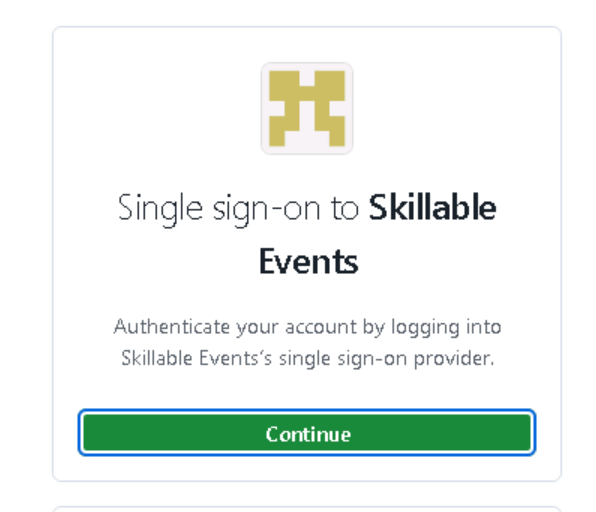

   > 💡 If the sign-in keeps returning to the same page or shows an error, wait a few minutes and try again; this is a transient error. If it takes you to the Skillable GH Enterprise main page [Skillable-Events GH](https://github.com/enterprises/Skillable-Events) search for "caldova-retail-modernized" in the search bar and access the repository that way.

2. In the **Sign in** box, enter the **Username** listed under **Azure portal** on the **Resources** tab of your lab instructions, then select **Next**.
3. Enter the **Password** from the same **Azure portal** section. If you are asked for a **Temporary Access Pass**, enter the **TAP** value instead. If it prompts you to stay signed in, hit **Yes**.

**2. Fork and clone the repository.**

1. On the repository page, select **Fork**. On the **Create a new fork** page, select **Skillable-Events** as the **Owner** and append your **Skillable instance ID (@lab.LabInstance.Id)** to the **Repository name**, using the format `caldova-retail-modernized-@lab.LabInstance.Id`. Confirm both values before selecting **Create fork**.

   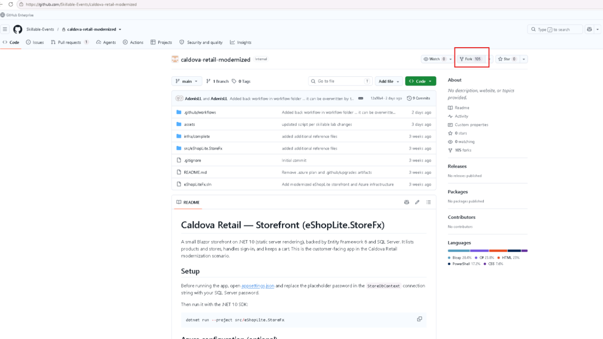

   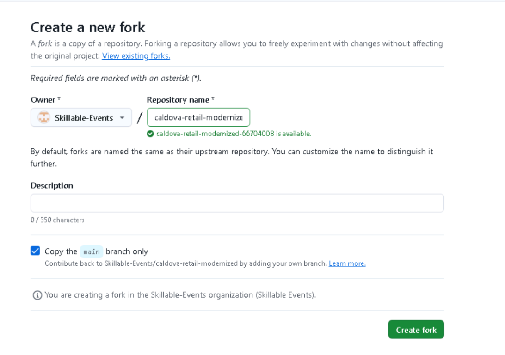

   At the top of your new fork, you should see its name with your instance ID at the end and **forked from Skillable-Events/caldova-retail-modernized** underneath. Note the full name, because it is also the name of the folder you clone in a later step.

   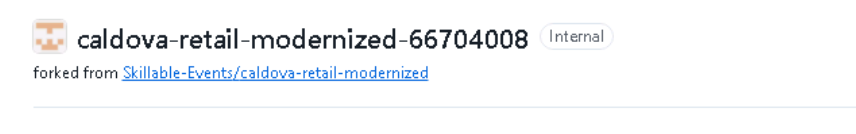

2. In your new fork, select **Code**, then copy the **HTTPS** URL. It should look something like `https://github.com/Skillable-Events/caldova-retail-modernized-@lab.LabInstance.Id.git`, with your own instance ID in the repository name.
   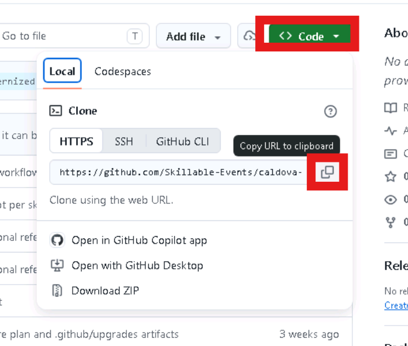

3. Enable GitHub Actions in the new repository

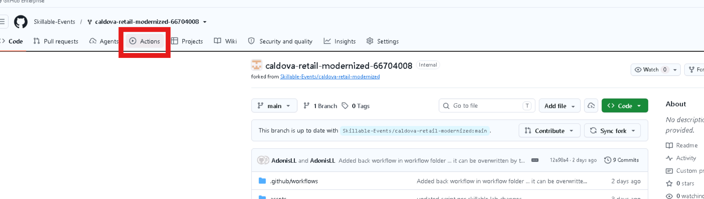

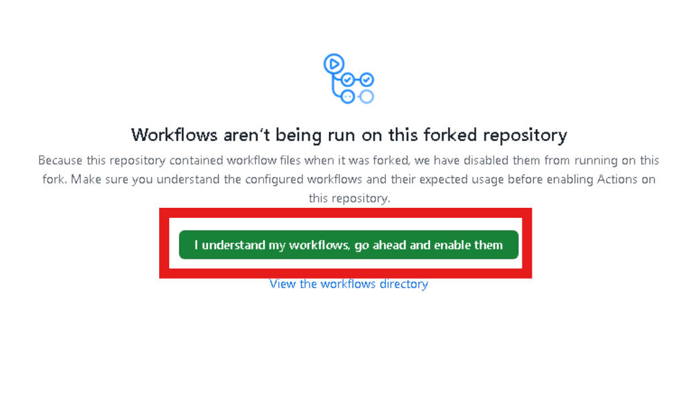

4. Open PowerShell from your applications and clone your fork, pasting the URL you copied into it (run this from the default location -- C:\Users\Admin):

   ```powershell
   git clone https://github.com/Skillable-Events/caldova-retail-modernized-@lab.LabInstance.Id.git
   ```

   If you are asked to sign in, choose **Sign in with your browser**, approve the authorization (select **"Authorize git-ecosystem"**), then return to PowerShell. The clone starts once you are signed in. It creates a folder with the same name as your fork, including your instance ID at the end.
   > 💡 If you face any errors here, the sign in may not have persisted. If that is the case, re-type in the original repo link, +++https://github.com/Skillable-Events/caldova-retail-modernized+++, follow the sign in, click the button to stay signed in, and then run the Powershell command again.

**3. Open the storefront folder in VS Code.** Run these commands in PowerShell.

```powershell
cd "caldova-retail-modernized-@lab.LabInstance.Id"
code .
```

If **code** is not recognized, start VS Code from your applications and use **File → Open Folder…**, then pick the **caldova-retail-modernized folder with your instance ID appended**. If VSCode asks you to sign into GitHub again, authorize access there as well.

If VS Code opens the folder in **Restricted Mode**, select **Manage** in the banner at the top of the window, then select **Trust**. Once the page shows **In a Trusted Folder**, close that tab.

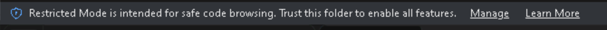

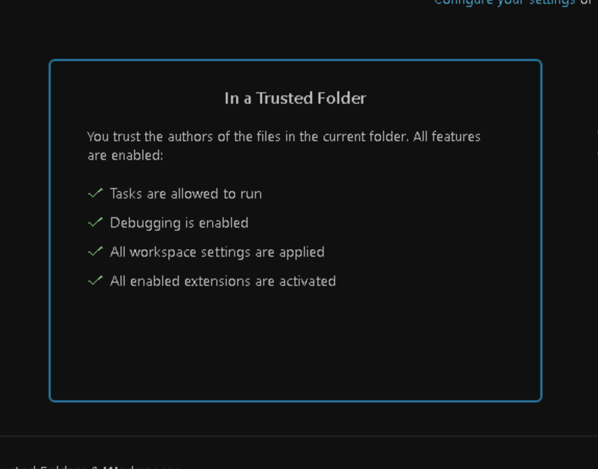

You are in the right place when the Explorer shows **eShopLiteFx.sln** next to a **src** folder.

> 📂 **Where to run commands:** Every PowerShell command in this lab assumes your current folder is the cloned **caldova-retail-modernized folder with your instance ID appended**. The simplest option is the VS Code integrated terminal (**Terminal → New Terminal**), which already opens in that folder. If you use a standalone PowerShell window instead, first run `cd "caldova-retail-modernized-@lab.LabInstance.Id"`, replacing the placeholder with your instance ID. Throughout this lab, blocks marked **💻 Run this in the terminal** are commands you run yourself, while blocks marked **🤖 Paste this into Copilot Chat** are prompts you send to Copilot — not terminal commands.

## 🔑 Authorize VS CODE

In VSCODE select the agent in the bottom right, and click the "Use AI Features" button.
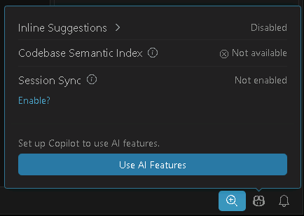

The **Sign in to use GitHub Copilot** prompt opens and select Continue with GitHub

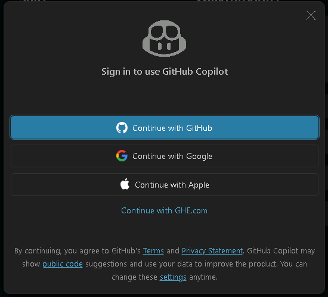

The browser opens displaying an "Authorize with Visual Stusio Code" prompt. Select Continue
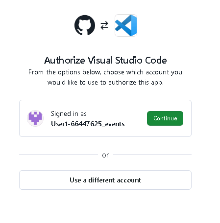

Finally select **Authorize Visual Stusio Code** on the next prompt.
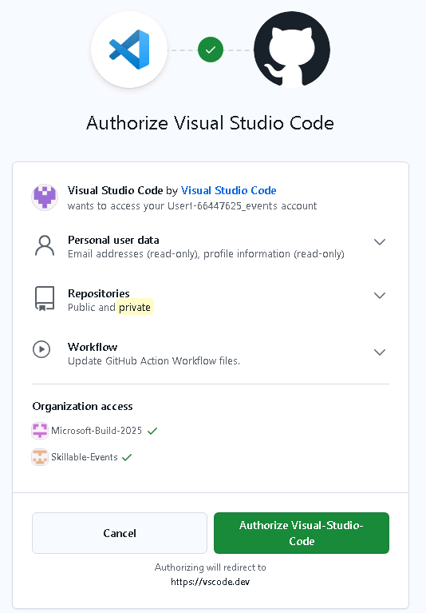


## 🔑 Bootstrap GitHub OIDC

The Azure platform is already provisioned, but its GitHub federation cannot be
copied generically between repositories. An OIDC federated credential includes
the repository and GitHub environment in its subject, so this setup must be
completed for the repository that will run the Lab 06 workflow.

The preprovisioned platform includes separate build and deployment identities.
Bootstrap your repository 

> 💻 **Run this in the terminal.**

```powershell
az login
```

Choose **Work or School Account** and follow the prompts to login to az cli.

```powershell
gh auth login
```

Follow the GitHub CLI sign-in prompts below. Their order may vary by CLI version:

1. **Where do you use GitHub?** Select **GitHub.com**.
2. **What is your preferred protocol for Git operations on this host?** Select **HTTPS**.
3. **Authenticate Git with your GitHub credentials?** Type **Y** and press **Enter**.
4. **How would you like to authenticate GitHub CLI?** Select **Login with a web browser**.
5. Copy the **one-time code** displayed in the terminal, then press **Enter** when prompted to open `https://github.com/login/device` in your browser.
6. Paste the code into the browser's device activation page, select **Continue**, and follow the prompts to authorize GitHub CLI using your lab GitHub account.
7. Return to the terminal and wait for confirmation that authentication succeeded before continuing.

```powershell
gh repo set-default origin
```

```powershell

$subscriptionId = az account show --query id --output tsv
```

```powershell
.\assets\scripts\Initialize-Lab06RepositoryFromResourceGroups.ps1 `
  -SubscriptionId $subscriptionId `
  -AllowDeploymentWithoutRequiredReviewer `
  -DeploymentBranch 'main'
```

> [!NOTE]
> ℹ️ **Informational — for reference only:** The following list explains what the script does automatically. These are not additional steps for you to perform.

The script:

1. examines successful deployments in the preprovisioned resource groups and
   matches bootstrap, primary, secondary, and global deployments by their Bicep
   output contracts
2. validates the existing identities, target resources, and scoped role
   assignments without creating or changing them
3. reads GitHub's effective OIDC subject prefix, including immutable owner and
   repository IDs when enabled, then binds the build identity to lab06 and
   the deployment identity to lab06-deploy with environment-scoped
   federated credentials
4. creates both GitHub environments, restricts lab06-deploy to main, and
   allows deployment without a required reviewer
5. publishes and verifies the non-secret variables required by the workflow

The script selects the newest matching deployment in each resource group and
verifies that all four deployments have the same prefix and suffix
parameters before changing GitHub. If deployment history requires an older
record, pass one or more of
-BootstrapDeploymentName, -PrimaryDeploymentName,
-SecondaryDeploymentName, and -GlobalDeploymentName.

Each resource group is discovered independently from its
rg-caldova-lab04-bootstrap-, rg-caldova-lab04-primary-,
rg-caldova-lab04-secondary-, or rg-caldova-lab04-global- prefix. If more
than one resource group matches a prefix, supply the corresponding
-BootstrapResourceGroup, -PrimaryResourceGroup, -SecondaryResourceGroup,
or -GlobalResourceGroup override.

This keeps the main branch restriction but does not add a manual approval
gate. The script emits a warning when it configures the environment without a
required reviewer.

<!-- To test discovery and print the selected deployments and reconstructed values
without changing Azure resources or GitHub, run:

> 💻 **Run this in the terminal.**

```powershell
.\assets\scripts\Test-Lab06ResourceGroupDeploymentValues.ps1 `
  -SubscriptionId $subscriptionId
``` -->

The probe emits JSON and accepts the same four optional deployment-name
overrides.

## 🧭 Delivery Flow

```mermaid-nocode
flowchart LR
    PR[Pull request] --> VALIDATE[Restore, build, test]
    VALIDATE --> IMAGE[Build container]
    IMAGE --> LOCAL[Run and probe /health]
    LOCAL --> REVIEW[Human review]
    REVIEW --> MAIN[Merge to main]
    MAIN --> OIDC[GitHub OIDC login]
    OIDC --> PUSH[Push sha-tagged image to ACR]
    PUSH --> DIGEST[Resolve immutable digest]
    DIGEST --> PREFLIGHT[Check runtime identity and required setting names]
    PREFLIGHT --> REVISION[Update Container App revision]
    REVISION --> HEALTH[Wait for health]
    HEALTH --> SMOKE[Smoke test through Front Door]
```

## 🔐 Identity and RBAC

> [!NOTE]
> ℹ️ **Informational — for reference only:** This section explains what the bootstrap script does automatically. You do not need to create identities or assign permissions yourself.

The bootstrap script connects your GitHub repository to the existing Lab 04 environment using **passwordless sign-in**. It:

- **Checks existing resources and permissions.** RBAC (*role-based access control*) determines what each identity can do and where. The build identity has **AcrPush** on the registry to publish images. The separate deployment identity has **Container Apps Contributor** on the retail Container App to deploy a revision and **Reader** on Front Door to locate the endpoint for testing. The script verifies these roles; it does not create them or reuse the infrastructure identity.
- **Sets up GitHub-to-Azure trust.** Federated credentials link the build identity to your repository's lab06 environment and the deployment identity to lab06-deploy. With **OpenID Connect (OIDC)**, Azure checks GitHub's repository and environment claims before issuing a short-lived token. No Azure client secret or registry password is stored in GitHub.
- **Configures the workflow environments.** The lab command restricts lab06-deploy to main without requiring manual reviewer approval. The script also publishes and verifies non-secret GitHub variables identifying the Azure resources and the correct identity for each environment.

The application's runtime identities remain separate. Their permissions allow the running app to pull images and access services and data; this script does not configure those permissions or grant database access.

> [!TIP]
> For additional insight, review [Initialize-Lab06RepositoryFromResourceGroups.ps1](../../../../assets/scripts/Initialize-Lab06RepositoryFromResourceGroups.ps1) directly to see how discovery, permission checks, OIDC trust, and GitHub configuration are implemented.

## Challenge 1: Create the Container Contract

The application has no Dockerfile. Generate one rather than copying a template, because the container has to satisfy two things at once: how the application starts, and what the preprovisioned Lab 04 platform expects to run.

Open GitHub Copilot in **Agent** mode. In Copilot Chat, open the mode dropdown (near the message box) and choose **Agent**. Agent mode can read the files in this repository and create or edit files for you, which is why it is the right mode for generating the Dockerfile.

> [!IMPORTANT]
> **Read the prompt before pasting it.** Notice the context it gives the agent: which application details to inspect, where to find the infrastructure expectations, and what security and build requirements to follow. It also asks the agent to flag disagreements between the app and the platform. Understand what you are asking it to do rather than simply copying and pasting; use these requirements to review its output.

> 🤖 **Paste this into Copilot Chat.**

```text
Scan this application and the infrastructure deployed in Lab 04, then create a Dockerfile
and a .dockerignore for the retail app.

Read the application first: target framework, project layout, entry point, the health
endpoints it exposes, and every setting it reads from configuration.

Then read infra/complete to see what the platform expects: the ingress port, the
container registry, and how the Container App authenticates to Azure.

Requirements:
- multi-stage build, using the SDK image only for restore and publish and the ASP.NET
  runtime image for the final stage
- run as a non-root user
- listen on the port the Container Apps ingress targets
- no secrets, connection strings, or credentials baked into the image; anything the app
  needs at runtime arrives as an environment variable or through managed identity
- a .dockerignore that excludes source-control metadata, build output, and local secret files

Tell me about any place where the application and the infrastructure disagree.
```

Review the chat window, review any prompts that are presented to allow the agent task.
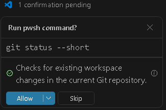

Check the result against the contract before you build it:

- mcr.microsoft.com/dotnet/sdk:10.0 only for restore and publish
- mcr.microsoft.com/dotnet/aspnet:10.0 for the smaller runtime image
- a non-root runtime user
- port 8080 for platform ingress, and /health for pipeline and release probes
- a build context that excludes source-control metadata, build output, and local secret files

> 💡 The credentials question is the interesting one. The app needs a database
> connection at runtime, but the image must not contain it. Lab 04 Bicep owns
> the passwordless connection-string environment variable and runtime identity;
> Lab 05 grants that identity access after migrating eshop. GitHub Actions
> changes only the image. If Copilot bakes configuration into the image or
> rewrites environment variables during release, that is the failure to catch.

<!-- Build the application before building its image:

> 💻 **Run this in the terminal.**

```powershell
dotnet restore .\eShopLiteFx.sln
```

```powershell
dotnet build .\eShopLiteFx.sln `
  --configuration Release `
  --no-restore
``` -->

<!-- Then build and test the container locally:

> 💻 **Run this in the terminal.**

```powershell
$context = '.\'
```

```powershell
$dockerfile = Join-Path $context 'src\eShopLite.StoreFx\Dockerfile'
```

```powershell
$image = 'caldova-retail:lab06-local'
```

```powershell

docker build --file $dockerfile --tag $image $context
```

```powershell
docker run --detach --rm `
  --name caldova-retail-lab06 `
  --publish 8080:8080 `
  --env 'ConnectionStrings__StoreDbContext=Server=localhost;Database=eShop;User ID=test;Password=NotUsed1!;Encrypt=True;TrustServerCertificate=True' `
  $image
```

```powershell
Invoke-WebRequest http://localhost:8080/health
``` 

 ```powershell
docker stop caldova-retail-lab06
``` 

The dummy connection string permits startup but is never used by the health endpoint. It is only for a local container smoke test. -->

## Challenge 2: Design the Workflow

Open GitHub Copilot in **Plan** mode. In Copilot Chat, open the mode dropdown and choose **Plan**. Plan mode proposes an approach and writes a plan for you to review, but it does **not** change any files yet. You will review that plan before Copilot builds anything.

> [!IMPORTANT]
> **Read the prompt before pasting it.** Notice how it separates pull-request validation from deployment on main, defines passwordless authentication, and limits what the workflow can change. It also requires health checks. Understand these requirements rather than simply copying and pasting; use them to evaluate the agent's plan before approving implementation.

> 🤖 **Paste this into Copilot Chat.**

```text
Plan a simple GitHub Actions workflow for the modernized retail app in this
repository. This is a lab workflow, not a production release pipeline.

Read the application, Dockerfile, test project, existing workflow, and lab
deployment information first. Do not modify the deployment contract.

Identity correction:
These requirements override conflicting identity statements in the repository
contract, infrastructure templates, sample workflow, or earlier instructions.
The deployed Container App uses its SYSTEM-ASSIGNED identity for ACR pulls.
The application separately uses the attached USER-ASSIGNED retail runtime
identity, selected by its AZURE_CLIENT_ID environment variable.
LAB06_RUNTIME_IDENTITY_RESOURCE_ID identifies that user-assigned identity.
Do not compare it with the registrys "system" identity setting or replace it
with a system-assigned principal ID.

Workflow requirements:
- Prefer three jobs: validate, build-and-push, deploy.
- Trigger on PRs and pushes to main changing src/eShopLite.StoreFx/**,
  tests/**, .dockerignore, eShopLiteFx.sln, or the workflow itself.
  The source path includes the Dockerfile.
- Use pull_request, never pull_request_target.
- In validate: install .NET 10, restore the solution, Release-build it,
  and test tests/eShopLite.StoreFx.Tests/eShopLite.StoreFx.Tests.csproj
  explicitly, failing if no tests are discovered.
- Build the container with repository-root context and
  src/eShopLite.StoreFx/Dockerfile. Run it locally with 8080:8080 and a
  nonproduction dummy connection string containing no credentials.
- Require HTTP 200 from /health with bounded retries and request timeouts.
  Always clean up the local container.
- PR validation must not authenticate to Azure, receive OIDC permissions,
  use deployment environments, push images, or deploy.
- On pushes to main, repeat validation before building and pushing the image
  to the existing Lab 04 ACR, repository caldova-retail, tagged
  sha-<full commit SHA>. Never use latest.
- Resolve the pushed manifest digest and deploy registry/repository@digest.
- Use Azure Login with OIDC and existing environment-scoped variables:
  the dedicated build identity in lab06, and the deployment identity in
  protected lab06-deploy. Preserve existing approval and federation controls.
- Grant contents: read by default and id-token: write only to publishing
  and deployment jobs. Use no client secrets or registry passwords.
- Use existing variables: AZURE_CLIENT_ID, AZURE_TENANT_ID,
  AZURE_SUBSCRIPTION_ID, LAB06_CONTAINER_REGISTRY_NAME,
  LAB06_CONTAINER_APP_NAME, LAB04_SECONDARY_RESOURCE_GROUP,
  LAB04_GLOBAL_RESOURCE_GROUP, LAB04_PREFIX, and LAB04_SUFFIX.
  Do not require new variables, setup, identities, or Azure permissions.

Include exactly two short, readable preflight gates before the image update:
1. Confirm the expected ACR registry entry has identity "system", and the
   Container App has SystemAssigned identity enabled with a nonempty
   principalId. Read these fields dynamically; do not hardcode identity IDs.
2. Confirm only that the names ConnectionStrings__StoreDbContext,
   AZURE_CLIENT_ID, and ASPNETCORE_ENVIRONMENT are present. Never print values.

Update only the existing retail containers image. Do not create or modify
infrastructure, identities, role assignments, registry authentication, runtime
settings, secrets, ingress, replica limits, or autoscale rules.

Serialize main deployment jobs with a fixed concurrency group and
cancel-in-progress: false. After approval, skip superseded commits by comparing
the triggering SHA with current main. Recheck immediately before the image
update. Do not cancel an active update when a newer commit arrives.

Capture the intended revision from the image update and wait for successful
provisioning and healthy status with bounded polling. Then require HTTP 200
from /health through the existing Front Door endpoint, using bounded retries
and request timeouts. Do not add a /ready release gate for this exercise.

Pin supported major versions of third-party actions. Never print tokens,
credentials, runtime setting values, or full application configuration.
Use narrow queries. Failed preflight checks must stop with clear
instructor-facing messages. Real build, login, push, lookup, and deployment
errors must remain failures; only superseded commits are intentionally skipped.

Keep the workflow small. Do not add image-content/checksum verification,
bootstrap baseline images, provenance checks, configuration snapshots,
automated rollback, LAB06_ROLLBACK_IMAGE, or additional participant setup.
Recovery is outside this workflow.

Explain the jobs, dependencies, required variables and permissions, and each
simple gate. Briefly identify production checks omitted here.

Stop after the plan. Do not create files, run workflows, push, or deploy.
```

Review the proposed plan against the prompt's requirements before approving it. It should separate pull-request validation, image publishing, and deployment, use passwordless authentication, and preserve the existing infrastructure and runtime settings. If anything is missing or unclear, ask Copilot to revise the plan. The workflow file does not exist yet; you will review its YAML after implementation below.

### Implement the plan

When the plan looks right, switch the mode dropdown back to **Agent** and have Copilot build the workflow from the plan:

> 🤖 **Paste this into Copilot Chat.**

```text
Implement the approved plan. Create the workflow file at
.github/workflows/lab06-retail-cicd.yml exactly as planned.

Use the GitHub variables listed in this lab, the lab06 and lab06-deploy
environments, and OIDC federated credentials. Do not use client secrets or
registry passwords.

Only create the workflow file. Do not push a branch, open a pull request, run
the workflow, or deploy anything.
```

Agent mode re-reads your repository and writes **.github/workflows/lab06-retail-cicd.yml**. Approve its file edits as it goes, and let it finish before you continue.

### Review the workflow

Open `.github/workflows/lab06-retail-cicd.yml` in VS Code. A workflow is a YAML file describing when automation runs and the jobs it performs. Your job names may differ, but the flow should be easy to follow:

| Job | What to check |
| --- | --- |
| Validate | Restores, builds, tests, starts the container, and checks `/health`. Pull requests receive no OIDC permission and never sign in to Azure, publish images, or deploy. |
| Build and push | Runs after successful validation on `main`, uses OIDC and the `lab06` environment, and publishes a specific image version. |
| Deploy | Uses OIDC and `lab06-deploy`, checks the expected registry identity and required setting names, updates only the image, waits for revision health, and checks Front Door. |

Failed build, test, health, or preflight checks must stop the release. The workflow must not print secrets or change infrastructure, runtime settings, or scaling.

The workflow automatically tags the image with its commit SHA and deploys by digest, which identifies the exact image contents. You do not need to copy or compare these identifiers yourself.

If a block is unclear or does not match the plan, ask Copilot to explain or correct it before publishing.

## Challenge 3: Publish and Run

Now publish your changes so GitHub Actions can run the workflow. The commands below set your Git commit identity, create a branch, save your changes in a commit, push that branch to GitHub, and open a pull request. Opening the pull request triggers validation without deploying; merging it into main triggers image publishing and deployment.

From the repository root, replace the example email and name with your own. These identify your commits; they do not sign you in to GitHub.

> 💻 **Run this in the terminal.**

```powershell
git config --global user.email "your.email@example.com"
```

```powershell
git config --global user.name "Your Name"
```

The next commands create lab06-cicd, stage all changes in the repository (git add .), commit them, and publish the branch. gh pr create --fill opens a pull request using the commit message for its title and description.

> 💻 **Run this in the terminal.**

```powershell
git switch -c lab06-cicd
```

```powershell
git add .
```

```powershell
git commit -m "Add Lab 06 retail CI/CD workflow"
```

```powershell
git push -u origin lab06-cicd
```

```powershell
gh pr create --fill
```

Open the pull request on GitHub, wait for validation to succeed, review the changes, and merge into `main`. Follow the deployment run in the repository's **Actions** tab. The default lab setup does not require manual deployment approval.

## ✅ Verify the Release

> [!NOTE]
> The checkout, .NET setup, build, test, and local container checks run automatically on a GitHub Actions runner. You can inspect them in the workflow logs; you do not perform them in the Azure portal. The steps below check the application that was actually released to Azure.

Complete these four checks:

1. **Check GitHub Actions.** Open the run triggered by your merge to `main`. Confirm validation, image publishing, and deployment all succeeded. Expand a failed job to see which step needs attention.
2. **Check the new revision.** Open the [Azure portal](https://portal.azure.com), select your lab subscription, and open your **rg-caldova-lab04-secondary-...** resource group. Select the retail **Container App**, then **Revisions and replicas**. Confirm the newly deployed revision is active and healthy. Use your environment's matching suffix to avoid selecting another participant's resources.
3. **Check the public route.** Open your **rg-caldova-lab04-global-...** resource group and select the **Front Door and CDN profile**. Find the application's endpoint hostname and open `https://<endpoint-hostname>/health` in a browser. Expect a successful health response. Use Front Door, not the Container App's direct URL.
4. **Try the storefront.** Open the same Front Door address without `/health` and load the product catalog. Confirm products appear without an application error.

`/health` checks that the application process is running; it does not check database access. Loading the catalog checks that the storefront can retrieve product data.

If any check fails, inspect the failed GitHub Actions step or the Container App's logs and ask Copilot or the instructor for help. Share only redacted error messages, never credentials or full configuration. Do not mark the release complete until all four checks pass.

## 🛟 If deployment fails

Stop and ask the instructor for help. Do not change runtime settings, identities, scaling, or traffic to work around a failure. Recovery and rollback are outside this lab.

## 📚 References and further learning

These optional resources from Microsoft and GitHub explain the concepts used in this lab. Start with the fundamentals; you do not need to repeat the identity setup already completed by the lab scripts.

- [Understanding GitHub Actions](https://docs.github.com/en/actions/get-started/understand-github-actions) — Learn how workflows, events, jobs, steps, and runners fit together.
- [Automate your workflow with GitHub Actions](https://learn.microsoft.com/en-us/training/paths/github-actions/) — Follow a Microsoft Learn training path covering workflow automation and CI/CD.
- [Authenticate to Azure from GitHub Actions with OpenID Connect](https://learn.microsoft.com/en-us/azure/developer/github/connect-from-azure-openid-connect) — Understand Azure federated credentials and passwordless sign-in using the Azure Login action.
- [Configuring OpenID Connect in Azure](https://docs.github.com/en/actions/how-tos/secure-your-work/security-harden-deployments/oidc-in-azure) — Review GitHub's guidance on configuring trust between GitHub Actions and Azure.

---

[← Previous: Modernize Data](../05-modernize-data/README.md) | [Next: Modernize with the CLI →](../../day-3/07-modernize-with-cli/README.md)